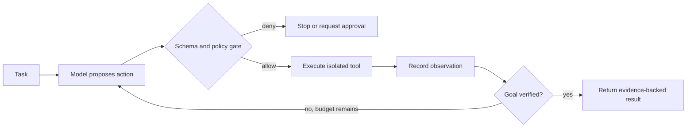

# Reason-and-Act Agent Loop

> Version: 1.0.0  
> Last updated: 2026-07-16

## Purpose

Build bounded tool-use loops that alternate model proposals with deterministic execution and observation.

## Why

ReAct demonstrated benefits from interleaving reasoning and actions on evaluated tasks [1]. In production, the useful abstraction is proposal → authorize → execute → observe, not exposure of private reasoning.

## How

Set maximum steps, wall-clock deadline, cost budget, permitted tools, termination criteria, and repeated-action detection. Treat tool output as untrusted content.

## When

Use only when the task requires adaptive tool selection. Prefer a deterministic workflow when the sequence is known.

## Tradeoffs

| Benefit | Cost |
|---|---|
| Adaptive information gathering | Variable latency and cost |
| Recoverable observations | Larger attack surface |
| Better task coverage | Harder testing |

## Anti-Patterns

- Unlimited loops or retries.
- A model both proposes and authorizes an action.
- Write-capable tools for a read-only task.
- Logging hidden chain-of-thought as state.

## Enterprise Considerations

Use scoped service identities, per-tool policy, network isolation, approval tiers, idempotency keys, and replayable audit events. Define incident kill switches.

## Checklist

- [ ] Loop has step, time, and cost limits
- [ ] Each action is authorized immediately before execution
- [ ] Tool outputs are isolated as untrusted
- [ ] Repeated non-progress is detected
- [ ] Completion is independently verified

## References

1. Yao et al., “ReAct: Synergizing Reasoning and Acting in Language Models,” ICLR 2023, https://arxiv.org/abs/2210.03629

## Changelog

- 1.0.0 (2026-07-16): Defined bounded proposal-and-execution loops.
