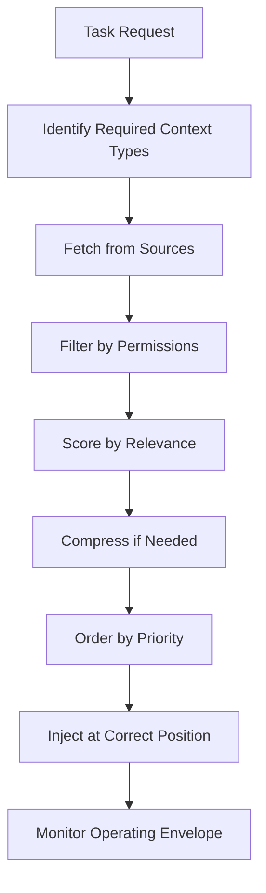

# Level 2: Context Engineering

> **Prerequisites:** Level 1: Prompt Engineering
> **Goal:** Build systems that provide the right information, to the right model, at the right time
> **Version:** 1.2.0  
> **Last updated:** 2026-07-16

---

## Why Context Engineering Matters

Prompt engineering optimizes *how* you ask. Context engineering controls *what the model receives.* Both affect quality; context additionally carries authorization, provenance, freshness, privacy, and cost constraints.

Production systems differentiate through the **information pipeline** as well as model and prompt choices: how precisely they authorize, curate, structure, and deliver evidence.

> **Context Engineering:** The discipline of designing, curating, and managing the information made available to a language model at inference time.

## Purpose

Define the selection, authorization, provenance, capacity, state, and lifecycle controls for model context.

## How

Start from task acceptance criteria, select only required source classes, authorize before ranking, preserve provenance and freshness, and evaluate the complete pipeline on representative work.

## When

Apply before connecting a new context source and re-evaluate after model, index, chunking, ranking, compression, memory, tool, or access-policy changes.

---

## The Context Fidelity Standard

Signal-to-noise is a useful metaphor, not a sufficient metric. Evaluate relevance, evidence completeness, authority, freshness, conflict handling, grounded correctness, latency, and cost separately.

**The goal is not to maximize context.** It is to maximize *relevant* context within the fidelity threshold.

### The Context Operating Envelope
Long-context behavior is model-specific and task-specific. There may be no single degradation point: behavior can change with evidence position, distractors, output reserve, and task difficulty.

**Measuring your fidelity threshold:**
1. Place a critical piece of information at different positions in a long context
2. Measure how often the model correctly uses that information
3. Sweep distractor density and reserve output/tool tokens
4. Select an evidence-based operating point that meets quality, latency, and cost gates with measured margin

---

## Contents

| File | What It Covers |
|------|----------------|
| [principles/context-fidelity.md](./principles/context-fidelity.md) | The signal-to-noise ratio standard |
| [principles/lost-in-the-middle.md](./principles/lost-in-the-middle.md) | Placement rules for critical information |
| [principles/progressive-disclosure.md](./principles/progressive-disclosure.md) | Load context only when needed |
| [principles/fidelity-threshold.md](./principles/fidelity-threshold.md) | Needle-in-haystack testing methodology |
| [principles/structured-state-offloading.md](./principles/structured-state-offloading.md) | Typed external state management |
| [types/README.md](./types/README.md) | 13 context types with assembly patterns |
| [templates/CLAUDE.md.template](./templates/CLAUDE.md.template) | Standard CLAUDE.md for any project |
| [templates/project-context.template.md](./templates/project-context.template.md) | Project context document |
| [templates/task-brief.template.md](./templates/task-brief.template.md) | Per-task context brief |
| [anti-patterns/context-anti-patterns.md](./anti-patterns/context-anti-patterns.md) | Context engineering failures |
| [checklists/context-checklist.md](./checklists/context-checklist.md) | Context quality gate |

---

## The 13 Context Types

These categories are an operational inventory, not an exhaustive ontology or inclusion mandate. Use them to decide what evidence the current task requires and which controls apply.

| Type | What It Contains | When to Include |
|------|-----------------|-----------------|
| **Project Context** | Purpose, stack, conventions, constraints | When project-specific facts affect the task |
| **Business Context** | Domain rules, stakeholder requirements, regulatory constraints | When domain knowledge required |
| **Architecture Context** | System design, component relationships, data flows | When architectural decisions required |
| **Conversation Context** | Conversation history (compressed) | Multi-turn interactions |
| **Knowledge Context** | Retrieved documents, search results | RAG-powered tasks |
| **Memory Context** | Past decisions, preferences, learned patterns | Long-running agents |
| **User Context** | Permissions, role, preferences, history | User-facing applications |
| **Task Context** | Current task specification, acceptance criteria | When a model is asked to perform a task |
| **Code Context** | Relevant files, functions, tests | Code generation/review |
| **Historical Context** | Past incidents, previous attempts, known failures | Complex debugging |
| **Decision Context** | Past architectural decisions (ADRs) | Architectural work |
| **Risk Context** | Known risks, mitigation strategies | Security/compliance work |
| **Dependency Context** | External dependencies, API contracts, version constraints | Integration work |

---

## Context Assembly Pattern



Authorization, tenant isolation, budgets, and side-effect policy are deterministic harness controls. Relevance ranking may use statistical or model-based components, but their candidates, permissions, and acceptance thresholds remain bounded and evaluated.

---

## Critical Placement Rules (Anti-"Lost in the Middle")

Research has found U-shaped long-context retrieval behavior in tested models, but does not establish universal first/last-quarter percentages [1]. Measure placement sensitivity for the deployed model and task. Prefer reducing irrelevant context and improving retrieval; use concise reminders only when evaluations show benefit.

```xml
<!-- Initial task contract -->
<role>You perform application-security review.</role>
<task>Review the following code...</task>

<!-- ... (long code to review) ... -->

<!-- Optional reminder: include only when placement tests show benefit -->
<reminder>
- Apply control IDs required by the task brief
- Return the validated finding schema
</reminder>
```

---

## Progressive Disclosure

Do not load all possible context at the start. Load it when task state indicates a need, while deterministic policy controls which sources the requester may access.

```python
# Wrong — loads everything upfront
context = assemble_full_context()  # 50,000 tokens

# Correct — progressive disclosure
base_context = assemble_base_context()  # 2,000 tokens

# Tool: load more context on demand
def get_additional_context(topic: str) -> str:
    """Load authorized context for a bounded topic request."""
    authorized = policy.allowed_sources(actor, topic)
    return context_store.query(topic, sources=authorized, top_k=5)
```

This pattern is appropriate when evaluations show that a bounded on-demand subset outperforms up-front assembly for the workload.

---

## Anti-Patterns

### ❌ Dumping Everything into the System Prompt
**Symptom:** Context window approaching limit. Reasoning quality degrades.
**Fix:** Categorize context. Include only what's needed for the current task.

### ❌ Stale Context
**Symptom:** Model reasons about outdated state.
**Fix:** Preserve source version or effective time where freshness affects correctness, and enforce workload-specific freshness policy.

### ❌ Uncompressed Conversation History
**Symptom:** History consumes the workload budget or introduces stale instructions.
**Fix:** When evaluations demonstrate the need, retain the task-relevant recent turns and a provenance-linked summary; verify critical facts against authoritative state.

### ❌ Context Without Source Attribution
**Symptom:** Model cannot distinguish between authoritative sources and lower-quality information.
**Fix:** Preserve source identity, authority class, version, and retrieval time where required by the consumer contract.

### ❌ Ignoring the Fidelity Threshold
**Symptom:** Model "forgets" instructions it was given at the start of a long session.
**Fix:** Measure the workload operating envelope and reduce, retrieve, or restructure context based on evidence.

---

## Enterprise Considerations

- **Context as a compliance surface:** Context and logs may become subject to discovery, audit, retention, or data-subject obligations depending on jurisdiction and system use. Apply classification and minimization before assembly.
- **Context isolation:** In multi-tenant systems, context assembly MUST filter by tenant ID at the database level, not the prompt level.
- **Context at scale:** Measure assembly cost and freshness by source. Cache slow-changing authorized context only when invalidation and tenant isolation are defined.

## Tradeoffs

| Decision | Benefit | Cost |
|---|---|---|
| Context minimization | Lower exposure and cost | Evidence omission risk |
| Progressive disclosure | Focused working set | Additional latency |
| Structured state | Reliable recovery | Schema and lifecycle work |

## References

1. Liu et al., “Lost in the Middle,” TACL 2024, https://doi.org/10.1162/tacl_a_00638

---

## Readiness Gate

Before proceeding to Level 3, verify:
- [ ] Required context types identified for your project
- [ ] Context operating envelope measured for your primary workload
- [ ] Conversation retention or compression follows measured task needs
- [ ] Progressive disclosure is used only where it outperforms bounded up-front assembly
- [ ] Placement decisions are supported by workload evaluations
- [ ] Access logging matches the system's security and compliance requirements
- [ ] Sensitive data is minimized and authorized before model submission

## Changelog

- 1.2.0 (2026-07-16): Removed universal inclusion, placement, compression, caching, and scale mandates.
- 1.1.0 (2026-07-16): Completed corpus and replaced universal capacity/placement rules with workload evaluation.
