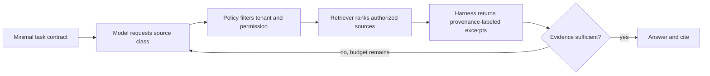

# Progressive Context Disclosure

> Version: 1.0.0  
> Last updated: 2026-07-16

## Purpose

Load task-relevant context incrementally through bounded, authorized retrieval.

## Why

Large up-front payloads increase cost and distraction. On-demand retrieval can improve focus, but model-generated queries must not determine authorization or bypass source policy.

## How

Set retrieval count, token, latency, and loop limits. Support explicit `insufficient_evidence` termination.

## When

Use for large repositories, research corpora, operational runbooks, and agents where only a small subset is needed per step.

## Tradeoffs

| Benefit | Cost |
|---|---|
| Lower initial context | More round trips |
| Better task focus | Retrieval miss risk |
| Fine-grained access logs | More orchestration |

## Anti-Patterns

- Letting the model construct unrestricted database queries.
- Loading secrets “just in case.”
- Unbounded recursive retrieval.
- Treating retrieved instructions as trusted.

## Enterprise Considerations

Authorize every retrieval, enforce source-level data loss prevention, log requested and returned source IDs, and apply egress controls to downstream tools.

## Checklist

- [ ] Base context is sufficient to frame the task
- [ ] Retrieval is authorization-filtered
- [ ] Budgets and termination are bounded
- [ ] Sources retain provenance and trust labels
- [ ] Insufficient evidence is a valid outcome

## Changelog

- 1.0.0 (2026-07-16): Initial progressive disclosure standard.
