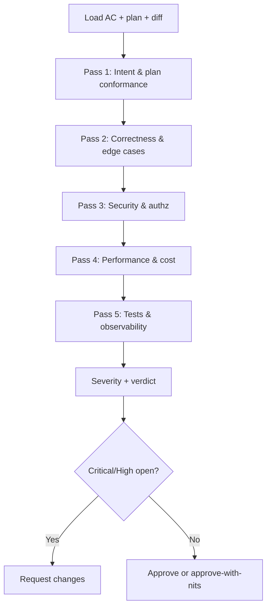

# Code Review Skill

> **Skill ID:** `code-review`  
> **Version:** 1.1 | **Updated:** 2026-07-16  
> **Install:** `.claude/skills/code-review.skill.md`  
> **Handbook:** [`handbook/pr-review-with-ai.md`](../../handbook/pr-review-with-ai.md)  
> **Pattern:** [`patterns/reviewer-pattern/README.md`](../../patterns/reviewer-pattern/README.md)

---

## Trigger

Activate when any of these are true:

- A human asks for a PR / diff review
- A coder agent claims “ready for review”
- CI attached a diff and acceptance criteria
- A security or plan-conformance check is requested before merge

Do **not** activate for “rewrite this feature” — that is coding, not review.

---

## Purpose

Produce a **severity-calibrated** review: concrete file:line findings, remediations, and a verdict a human can own. Verify claimed fixes. Do not merge.

---

## Inputs required

| Input | Why |
|-------|-----|
| Diff or PR URL | What changed |
| Acceptance criteria / story | Intent |
| Approved plan (if multi-file) | Plan conformance |
| Test commands + results | Evidence, not vibes |
| Risk profile | Depth of security/perf passes |

Missing AC → stop and request it. Missing plan on a multi-service change → escalate.

---

## Procedure



### Pass 1 — Intent and plan conformance

- Does the diff match the approved plan paths? Unexpected files → finding (Major+) unless plan revision linked.
- Does each AC have evidence (test or explicit manual protocol)?
- Drive-by refactors outside scope → Major (process debt).

### Pass 2 — Correctness

- Happy path and failure paths
- Null/empty/boundary behavior
- Error handling that does not swallow security-relevant failures
- UI: loading/error/empty states; a11y for new interactive controls

### Pass 3 — Security (invoke [`security.skill.md`](./security.skill.md) for deep pass)

- AuthZ on new/changed routes and tools
- Injection (SQL, XSS, prompt injection into tools)
- Secrets / PII in logs or client bundles
- SSRF / unsafe URL fetch from user input

### Pass 4 — Performance and cost

- N+1, unbounded lists, sync work on request path
- For AI features: token fan-out, unbounded tool loops, missing budgets

### Pass 5 — Tests and operability

- Behavior tests exist for new logic
- Eval cases for user-visible model behavior (link to [`evals handbook`](../../handbook/evals-as-quality-gates.md) when present)
- Metrics/logs sufficient to detect the failure modes in the plan

---

## Output format

```markdown
## Code Review

**PR / change:** <id or paths>
**Summary:** <1–2 sentences>
**Verdict:** Approve | Approve with nits | Request changes | Block
**Plan conformance:** Yes | Delta <link> | N/A (single-file)

### Critical (must fix)
- **path:line** — Issue — Fix — Evidence

### High
- ...

### Medium
- ...

### Low / nit
- ...

### Verified claims
- Claim: "tests pass" → Evidence: <CI URL or command output summary>

### Positive
- <specific good practice>
```

---

## Verification (skill succeeded when)

- [ ] All five passes considered (or explicitly N/A with reason)
- [ ] Every Critical/High has path + fix
- [ ] At least one positive note when the change is non-trivial
- [ ] Verdict matches open severity (no Approve with open Critical)
- [ ] Claimed test/eval results are checked, not trusted from chat

---

## Unhappy path

| Failure | Recovery |
|---------|----------|
| Diff too large to review well | Demand split or plan slices; Block |
| Author “fixed” without showing evidence | Re-open High; require command output |
| Model invented a finding | Delete finding; never bluff file:line |
| Security Critical | Escalate to security owner; Block |

---

## Related repo files

- Reviewer pattern: [`content/patterns/reviewer-pattern/`](../../patterns/reviewer-pattern/README.md)
- Security skill: [`security.skill.md`](./security.skill.md)
- React review checklist: [`content/cookbook/react/checklists/code-review.md`](../../cookbook/react/checklists/code-review.md)
- Definition of Done: [`content/08-ai-sdlc/quality-standards/definition-of-done.md`](../../08-ai-sdlc/quality-standards/definition-of-done.md)
