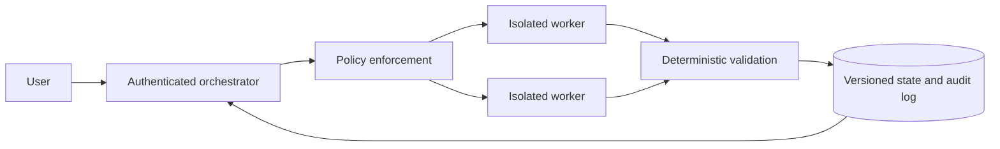

# Level 5: Multi-Agent Systems

> **Version:** 2.0.0  
> **Last updated:** 2026-07-16  
> **Prerequisite:** reliable, evaluated single-agent operation

## Purpose

Define the production control plane for systems in which independently executing agents delegate, communicate, and mutate durable state.

## Why

Multiple agents add trust boundaries, failure modes, latency, and cost. Use them only when an evaluated topology outperforms the strongest single-agent baseline on a representative workload.

## How

1. Establish identity, capability, budget, deadline, and termination policy before dispatch.
2. Use signed, replay-resistant message envelopes and validate provenance at every hop.
3. Commit outputs through versioned checkpoints; never let conversational context be authoritative state.
4. Isolate worker credentials and validate artifacts before privilege is propagated.
5. Compare quality, safety, latency, and cost against a single-agent control before release.

## Standards Corpus

- [Architecture and benefit proof](./standards/architecture-and-benefit.md)
- [Identity and authenticated delegation](./standards/identity-and-delegation.md)
- [Message provenance and non-repudiation](./standards/message-provenance.md)
- [Durable state and checkpoints](./standards/durable-state-checkpoints.md)
- [Threat controls](./standards/threat-controls.md)
- [Cost, budgets, and termination](./standards/cost-and-termination.md)
- [LangGraph integration](./frameworks/langgraph/README.md)
- [AutoGen integration](./frameworks/autogen/README.md)
- [CrewAI integration](./frameworks/crewai/README.md)

## Tradeoffs

Multi-agent execution can improve parallelism and context isolation, but increases coordination overhead, attack surface, nondeterminism, and observability burden. Central orchestration is the default because ownership and termination remain explicit; peer-to-peer autonomy requires a documented exception.

## Anti-patterns

- **Agent count as architecture:** roles without measured independent value add cost without capability.
- **Bearer authority propagation:** forwarding a caller token makes every downstream agent a confused-deputy target.
- **Chat as state:** free-form transcripts cannot provide atomicity, conflict detection, or recoverable checkpoints.
- **Unlimited debate:** peer critique without budgets or convergence tests creates loops and collusion risk.

## Enterprise Considerations

Map every agent and service identity to an accountable owner. Retain tamper-evident decision and delegation records according to legal policy, segregate tenants cryptographically and logically, and require human approval for irreversible or regulated actions.

## Checklist

- [ ] Multi-agent benefit is statistically and operationally demonstrated against the single-agent baseline.
- [ ] Every delegation is authenticated, audience-bound, least-privilege, and expires.
- [ ] Messages are signed, replay-protected, correlated, and retained in a tamper-evident log.
- [ ] Durable state supports optimistic concurrency, idempotency, checkpoints, and tested recovery.
- [ ] Loop, collusion, confused-deputy, and privilege-propagation tests pass.
- [ ] Per-agent and workflow budgets, deadlines, cancellation, and terminal states are enforced.
- [ ] Human escalation and emergency revocation are tested end to end.

## References

- [NIST AI RMF 1.0](https://doi.org/10.6028/NIST.AI.100-1)
- [NIST SP 800-207, Zero Trust Architecture](https://doi.org/10.6028/NIST.SP.800-207)
- [RFC 9421, HTTP Message Signatures](https://www.rfc-editor.org/rfc/rfc9421.html)
- [OWASP Top 10 for LLM Applications 2025](https://owasp.org/www-project-top-10-for-large-language-model-applications/)

## Changelog

- **2.0.0 — 2026-07-16:** Replaced introductory guidance with production identity, provenance, state, threat, budget, and benefit gates.
