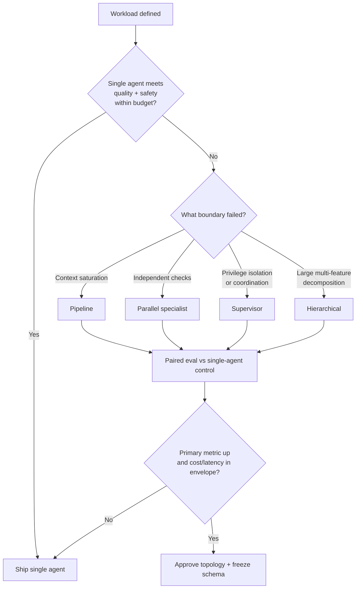
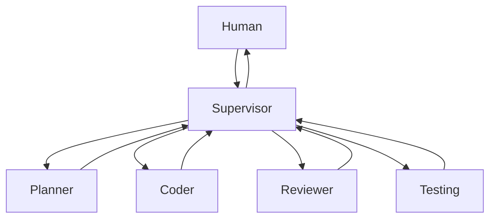
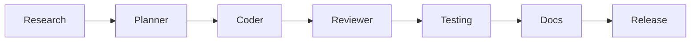
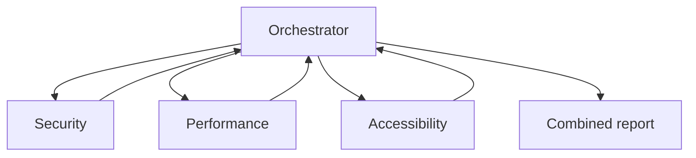
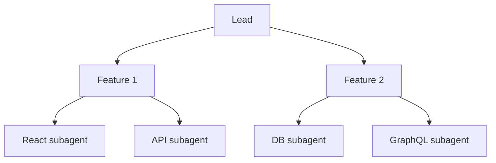

# Architecture and Multi-Agent Benefit Standard

> **Version:** 2.0.0 | **Last updated:** 2026-07-16

## Purpose

Define when multi-agent architectures earn their cost, which topology to use, and how failure isolation must work before you ship.

## Why

Adding agents is not a capability upgrade. Each hop adds tokens, latency, coordination bugs, and a new trust boundary. Ship multi-agent only when a single agent with the same models, tools, data, and budget cannot meet the quality or safety objective.

**When NOT to use multi-agent systems:**

| Signal | Use single agent instead |
|--------|--------------------------|
| Task is one step or one tool call | Orchestration overhead dominates |
| Work fits in one context window without compaction loss | No isolation benefit |
| No natural separation of concerns | Roles become theater |
| Single-agent reliability is unproven | Multi-agent amplifies failure modes |
| Latency budget < ~2× single-agent p95 | Fan-out will miss SLOs |
| Team cannot operate a shared state store + message bus | You will debug by reading chat transcripts |

---

## How — Choose a Topology

### Decision flow



### Pattern 1: Supervisor (most common)



| Dimension | Rule |
|-----------|------|
| **When** | Complex tasks needing delegation, monitoring, and reassignment |
| **Why** | One owner of plan + gates; specialists stay in narrow contexts |
| **Authority** | Supervisor may terminate, reassign, escalate; specialists may not rewrite the plan |
| **Failure isolation** | Specialist failure marks that agent failed; supervisor retries or escalates without corrupting shared `TaskState` |
| **Tradeoff** | Supervisor becomes a bottleneck and a single point of policy mistakes |

**Do not use when** the “supervisor” only suggests and cannot kill or reassign workers — that is an advisory board, not an orchestrator.

### Pattern 2: Pipeline



| Dimension | Rule |
|-----------|------|
| **When** | Clear sequential dependency; each stage’s output is the next input |
| **Why** | No shared mutable conversation; stage contracts are versioned artifacts |
| **Failure isolation** | Failed stage does not advance the gate; previous stage artifacts remain authoritative |
| **Tradeoff** | Slow end-to-end; back-pressure and rework loops need explicit return edges |

**Do not use when** stages need concurrent negotiation or shared mutable state mid-flight.

### Pattern 3: Parallel specialist



| Dimension | Rule |
|-----------|------|
| **When** | Independent checks on the same artifact (review, red-team, perf) |
| **Why** | Wall-clock reduction; separate contexts reduce tool overload |
| **Failure isolation** | One specialist timeout yields a partial report + explicit gap; others still publish |
| **Tradeoff** | Merge conflicts and false consensus if specialists share the same model/prompt/corpus |

**Do not use when** checks are not independent (one result depends on another’s finding).

### Pattern 4: Hierarchical



| Dimension | Rule |
|-----------|------|
| **When** | Very large work that decomposes into independent sub-features with local specialists |
| **Why** | Lead keeps business context; mid-tier agents own feature contracts |
| **Failure isolation** | Feature branch failure quarantines that subtree; lead may cancel or replan that branch only |
| **Tradeoff** | Deepest hop count, hardest cost attribution, easiest privilege propagation bugs |

**Do not use when** you cannot cap delegation depth and per-branch budgets.

---

## How — Prove Benefit Before Shipping

1. Build the strongest **single-agent control** with identical models, tools, data, and total budget.
2. Pre-register tasks, rubrics, safety failures, and operational limits (cost, p95 latency, max hops).
3. Run paired trials; report quality, safety, cost, latency, variance — not anecdotes.
4. Ship only when the primary objective improves by a predeclared margin **and** stays inside the envelope.
5. Re-run after model, prompt, tool, topology, or workload changes.

```typescript
interface TopologyApproval {
  topology: "supervisor" | "pipeline" | "parallel" | "hierarchical";
  single_agent_baseline_id: string;
  primary_metric: string;          // e.g. "task_success_rate"
  practical_margin: number;        // absolute or relative, predeclared
  cost_ceiling_usd: number;
  p95_latency_ms: number;
  max_delegation_depth: number;
  failure_isolation_test_passed: boolean;
  approved_by: string;
  approved_at: string;             // RFC3339
}
```

---

## Failure Isolation Requirements

A failing agent must not corrupt authoritative task state.

| Failure | Required behavior |
|---------|-------------------|
| Timeout | Mark agent failed; do not write gates; escalate or retry with budget debit |
| Invalid output | Reject before state write; optional retry with different context |
| Loop / no progress | Kill branch; restore last checkpoint; escalate |
| Privilege / policy deny | Fail closed; revoke descendant tokens |
| Specialist crash (parallel) | Publish partial results with explicit gaps |

```python
async def execute_isolated(agent, task, state, budget):
    lease = await state.acquire_lease(agent.id, task.id)
    try:
        raw = await agent.execute(task, timeout=agent.timeout_seconds)
        validated = await validate_output(raw, task.output_schema)
        await state.cas_update(
            expected_version=lease.state_version,
            patch={"agents": {agent.id: "complete"}, "artifacts": validated.artifacts},
        )
        return validated
    except Exception as e:
        await state.cas_update(
            expected_version=lease.state_version,
            patch={"agents": {agent.id: "failed"}, "failure_reason": str(e)},
        )
        raise
    finally:
        await lease.release()
```

---

## Tradeoffs

| Choice | You gain | You give up |
|--------|----------|-------------|
| Supervisor | Clear ownership, reassignment | Bottleneck, central policy risk |
| Pipeline | Simple contracts, easy audit | Latency, awkward backtracking |
| Parallel | Lower wall clock | Merge complexity, correlated errors |
| Hierarchical | Scale of decomposition | Depth, cost, confused-deputy surface |
| Paired eval gate | Stops cargo-cult topologies | Inference spend and calendar time |

---

## Anti-patterns

| Anti-pattern | Why it fails |
|--------------|--------------|
| Agents share one context window | You have roles, not multi-agent isolation |
| Framework first, roles later | Topology optimizes for demo, not workload |
| Counting peer opinions as independent evidence when they share model/prompt/corpus | Correlated error looks like consensus |
| Supervisor without kill/reassign authority | Coordination without control |
| No failure-isolation test (kill one agent) | First production outage becomes the test |

---

## Enterprise Considerations

- Archive datasets, evaluator versions, raw traces, and approval records for the retention class of the product.
- Segment results by tenant and risk tier; aggregate wins must not hide regressions on high-impact cohorts.
- Topology changes are change-managed: same gates as model or prompt changes.
- Production identities and budgets must be separate from lab eval runs.

---

## Checklist

- [ ] Single-agent control used equal resources and the same workload.
- [ ] Topology matches a real boundary (context, parallelism, privilege, or feature split).
- [ ] When-NOT criteria reviewed; multi-agent not chosen by default.
- [ ] Failure isolation tested: kill one agent; task continues or escalates cleanly.
- [ ] Quality, safety, cost, latency, and variance reported with uncertainty.
- [ ] Max delegation depth and total system timeout enforced.
- [ ] Communication schema and `TaskState` schema versioned before ship.
- [ ] Re-evaluation triggers configured for model/prompt/tool/topology/workload change.

## Changelog

- **2.0.0 — 2026-07-16:** Full operational rewrite — four topologies with when/why/tradeoffs, failure isolation, when-NOT, Mermaid, and benefit gate.
- **1.0.0 — 2026-07-16:** Initial citation-style stub.
