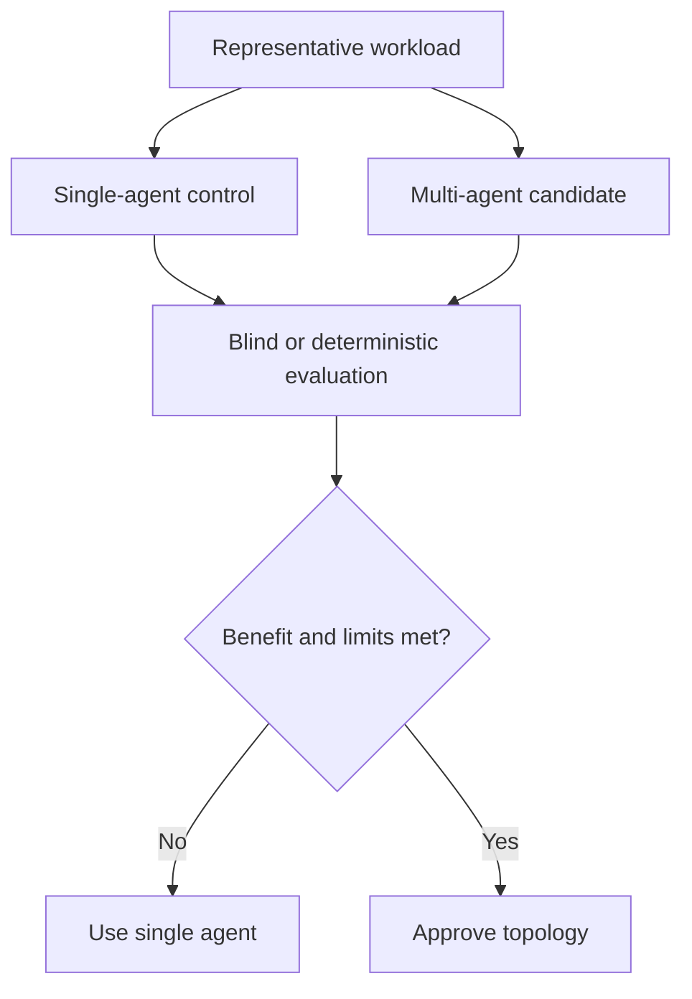

# Architecture and Multi-Agent Benefit Standard

> **Version:** 1.0.0 | **Last updated:** 2026-07-16

## Purpose

Prevent unjustified agent decomposition and define evidence required to claim a multi-agent benefit.

## Why

Additional agents are not an intrinsic capability improvement. Coordination can reduce quality while increasing tokens, latency, and failure probability.

## How

1. Build the strongest single-agent baseline with identical models, tools, data, and total budget.
2. Pre-register representative tasks, success rubrics, safety failures, and operational limits.
3. Choose a topology only for a demonstrated boundary: independent parallel work, privilege isolation, or specialist context.
4. Run paired trials with fixed seeds where supported; report uncertainty, failures, p50/p95 latency, and total cost.
5. Ship only when the multi-agent design improves the primary quality or safety objective by a predeclared practically meaningful margin and stays within cost/latency limits.
6. Re-run the comparison after model, prompt, tool, topology, or workload changes.

## Tradeoffs

Paired evaluation delays rollout and consumes inference budget. It prevents a permanently more expensive architecture based on anecdotes.

## Anti-patterns

- Counting agent opinions as independent evidence when they share model, prompt, or retrieved sources.
- Reporting only task accuracy while omitting cost, latency, variance, and catastrophic failures.
- Selecting a framework first and inventing roles afterward.

## Enterprise Considerations

Archive datasets, evaluator versions, raw traces, confidence intervals, and approval records. Segment results by tenant and risk tier; aggregate wins must not conceal regressions for protected or high-impact cohorts.

## Checklist

- [ ] Single-agent control has equal resources.
- [ ] Workload and practical improvement margin were predeclared.
- [ ] Quality, safety, cost, latency, and variance are reported.
- [ ] Evaluator leakage and correlated-agent evidence are controlled.
- [ ] Re-evaluation triggers are configured.

## References

- [NIST AI RMF 1.0](https://doi.org/10.6028/NIST.AI.100-1)
- [NIST AI 600-1, Generative AI Profile](https://doi.org/10.6028/NIST.AI.600-1)
- [Multi-Agent Collaboration Mechanisms: A Survey](https://arxiv.org/abs/2501.06322) *(research survey; validate findings in-system)*

## Changelog

- **1.0.0 — 2026-07-16:** Initial production standard.
