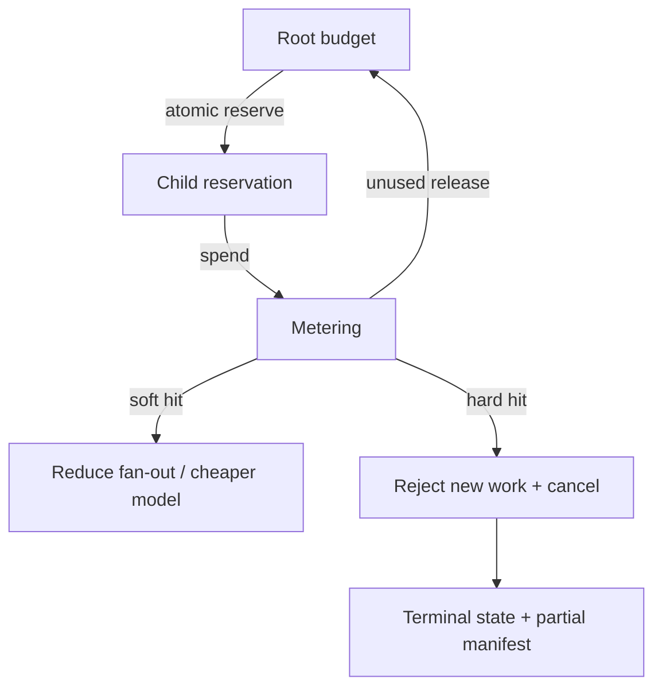

# Cost, Budgets, and Termination

> **Version:** 2.0.0 | **Last updated:** 2026-07-16

## Purpose

Bound multi-agent spend and hops, attribute cost to the right owners, and guarantee every workflow reaches an explicit terminal outcome with descendants stopped.

## Why

Per-call token limits do not stop fan-out, retries, recursive delegation, or unproductive debate from exhausting time and money. Without a workflow envelope and kill switch, a stuck graph becomes an unbounded bill.

---

## How — Workflow Budget Envelope

Allocate at session start; children **reserve** from parent — they never mint budget.

```typescript
interface WorkflowBudget {
  task_id: string;
  currency_limit_usd: number;
  token_limit: number;
  tool_call_limit: number;
  max_agents: number;
  max_concurrent_branches: number;
  max_delegation_depth: number;
  max_retries_per_step: number;
  wall_time_seconds: number;

  // Soft thresholds (adapt / warn)
  soft_currency_usd: number;      // e.g. 80% of hard
  soft_wall_time_seconds: number;

  // Accounting
  committed_usd: number;          // reserved by in-flight children
  spent_usd: number;
  spent_tokens: number;
  hops_used: number;
}
```



### Reservation rules

1. `reserve(child) = min(requested, parent.remaining)` inside a transaction.
2. Child cannot over-commit; excess requests fail closed.
3. On child complete/cancel, unused reservation returns to parent.
4. Moving work to another agent **does not** reset retry or token counters for the task.

---

## How — Max Hops and Kill Switches

| Limit | Enforcement point | On breach |
|-------|-------------------|-----------|
| `max_delegation_depth` | Token exchange | Reject hop |
| `hops_used` / edge count | Orchestrator | Cancel branch or session |
| `wall_time_seconds` | Scheduler | `expired` terminal |
| Hard currency/token/tool caps | Budget service | Reject new work; cancel in-flight per policy |
| No-progress / repeat digest | Orchestrator | Kill switch → escalate |
| Human cancel | Control API | Propagate `cancel` to descendants |

```typescript
type TerminalReason =
  | "succeeded"
  | "failed"
  | "cancelled"
  | "expired"
  | "budget_exhausted"
  | "policy_denied"
  | "no_progress"
  | "unrecoverable";

interface KillSwitchEvent {
  task_id: string;
  reason: TerminalReason;
  issued_by: string;          // human or control-plane
  at: string;
  revoke_tokens: boolean;     // always true for cancel/budget/policy
}
```

**Cancellation must:**

1. Publish `cancel` to all active agents.
2. Revoke leases and delegation tokens for the task.
3. Stop external jobs (CI, deploys) via receipt-linked compensations where possible.
4. Checkpoint terminal reason + partial-result manifest.
5. Never leave zombie workers spending quietly.

---

## How — Cost Attribution

Record actual and committed spend with dimensions that finance and engineering can join:

| Dimension | Example |
|-----------|---------|
| `tenant_id` | Customer or internal BU |
| `task_id` / `story_id` | Work item |
| `agent_id` | `spiffe://prod/agent/coder` |
| `model` / `provider` | `claude-…` / vendor |
| `tool` | `github.create_pr` |
| `topology` | supervisor / pipeline / … |
| `risk_tier` | high |
| `chargeback_tag` | `team:payments` |

```typescript
interface CostLedgerEntry {
  entry_id: string;
  task_id: string;
  tenant_id: string;
  agent_id: string;
  model?: string;
  tool?: string;
  tokens_in: number;
  tokens_out: number;
  currency_usd: number;
  committed_or_spent: "committed" | "spent" | "released";
  at: string;
  provider_request_id?: string;  // reconcile to invoice
}
```

Reconcile ledger totals to provider invoices on a schedule; alert on unexplained variance.

---

## How — Soft vs Hard Behavior

| Threshold | Allowed adaptation | Forbidden |
|-----------|-------------------|-----------|
| Soft | Switch to cheaper model, cut parallel width, summarize context | Raising hard limits silently |
| Hard | Reject new work; cancel or checkpoint-and-stop | “One more retry” without approval |
| Override | Risk-tiered, accountable human approval, time-boxed | Unlimited auto-extension |

---

## Tradeoffs

Hard budgets stop some tasks that might succeed with one more attempt. Explicit escalation and risk-tiered overrides are safer than unbounded automatic extension. Fine-grained attribution costs metering engineering; coarse tags make FinOps blind.

---

## Anti-patterns

| Anti-pattern | Why it fails |
|--------------|--------------|
| Estimating cost only after completion | No control loop |
| Resetting counters when work changes agents | Hides true task spend |
| Timeout without cancelling descendants | Zombie spend |
| Per-agent limits only, no workflow envelope | Fan-out bypasses every local cap |
| Kill switch that only sets a flag in chat | Workers never see it |

---

## Enterprise Considerations

- Enforce tenant quotas and chargeback tags at the gateway.
- Financial limits fail closed; overrides require accountable approval and audit.
- Metering must reconcile with provider invoices.
- Alert on fan-out rate, retry storms, spend-rate spikes, and zombie work (active lease, no progress).

---

## Checklist

- [ ] Parent→child budget reservation is atomic; children cannot mint budget.
- [ ] Hard limits cover currency, tokens, tools, time, depth, retries, concurrency.
- [ ] Soft thresholds trigger adaptation; hard thresholds stop work.
- [ ] Kill switch cancels descendants, revokes tokens/leases, checkpoints reason.
- [ ] Cost ledger dimensions support chargeback and invoice reconciliation.
- [ ] Terminal conditions and partial-result manifests tested.
- [ ] No-progress and retry-storm alerts configured.
- [ ] Overrides are time-boxed, attributed, and audited.

## Changelog

- **2.0.0 — 2026-07-16:** Full rewrite — budget envelope, hops, kill switches, cost ledger, Mermaid.
- **1.0.0 — 2026-07-16:** Initial citation-style stub.
