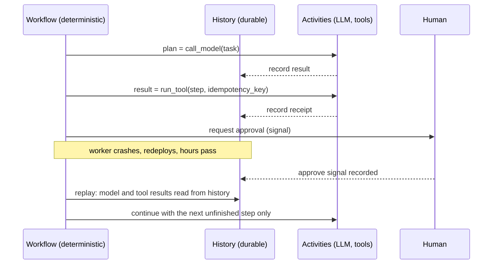

# Durable Execution for Long-Running Agents

> **Version:** 1.0.0
> **Last updated:** 2026-11-06
> **Status:** Normative AIES operating standard. Engine versions and integrations are a dated snapshot.

## Purpose

Run agents that outlive a single request. Those agents wait for humans, survive deploys and crashes, and call tools with side effects. They must resume exactly where they stopped, without re-running model calls or repeating side effects.

## Why

An agent that runs for minutes or days will be interrupted, by:

- worker restarts, deploys, and spot-instance reclaims;
- provider 429s and 5xxs;
- a human approval that arrives the next morning.

Without durable execution, every interruption forces one of two bad choices:

- **Restart from scratch.** You pay for every model call again and repeat side effects: a second email, a second refund.
- **Hand-rolled resume logic.** It works in the demo and corrupts state in production.

Durable execution engines record each completed step's result in a persistent history. After a crash, the workflow replays its code against that history. Completed model calls and tool calls return their recorded results instead of running again, and execution continues from the first unfinished step.

This became the default in 2026:

- **Temporal:** its integrations for Google ADK, OpenAI Agents SDK, Strands, LangGraph, and Vercel AI SDK reached GA on 2026-10-30.
- **DBOS and Restate:** lighter-weight engines with the same guarantees.
- **Frameworks:** Pydantic AI supports multiple durable engines. LangGraph 1.2 adds strict resume mode with an ID per interrupt.

[Durable state and checkpoints](./durable-state-checkpoints.md) defines **what** state must be authoritative: TaskState, CAS, receipts. This standard defines **how** the agent's execution itself becomes durable.

## When

| Situation | Durable execution? |
|---|---|
| Single request–response chat or a one-shot tool call | No. Use request retries. |
| Agent runs longer than one HTTP request or about 60 seconds | **Yes** |
| Any human-in-the-loop wait (approval, clarification) | **Yes.** The wait must survive restarts without holding a process. |
| Tools with external side effects (payments, email, tickets, deploys) | **Yes**, with idempotent tools |
| Fan-out to parallel subagents whose results are joined | **Yes** |
| Batch jobs over many items that must not reprocess completed items | **Yes** |

## How

### 1. Pick the engine

| Engine | Model | Choose when | Cost |
|---|---|---|---|
| **Temporal** (default) | Deterministic workflow code plus activities; history in a Temporal cluster or Temporal Cloud | Platform-wide agent runtime, multiple teams and languages, long waits, complex fan-out; first-party agent-SDK integrations | Runs a cluster (or Cloud spend); determinism rules in workflow code |
| **DBOS** | Library; steps checkpointed into your existing Postgres | One service that already runs on Postgres and wants durability without new infrastructure | Scale is bounded by your Postgres; fewer orchestration primitives |
| **Restate** | Durable handlers behind a log-based server; HTTP and serverless friendly | Serverless or FaaS-heavy stacks and event-driven agents | Another runtime to operate; smaller ecosystem |
| Framework checkpointers (LangGraph Postgres checkpointer) | Graph state saved per step | Single-framework graphs with human interrupts and no cross-service side effects | Not a general workflow engine; no exactly-once tool semantics across services |

Default to Temporal for an organization's agent platform. Choose DBOS or Restate only when the row above describes your situation.

### 2. Separate orchestration from effects



- **Workflow code** decides what happens next: the agent loop, branching, budgets, waiting. It must be deterministic. That means no network calls, no `datetime.now()` (use the engine's clock), no random values, and no reading environment or files.
- **Activities** do everything non-deterministic. Every model call is an activity, and so is every tool call. Their results go into the history, so replay never calls the model again.

```python
from datetime import timedelta
from temporalio import workflow
from temporalio.common import RetryPolicy

MODEL_RETRY = RetryPolicy(
    initial_interval=timedelta(seconds=2),
    backoff_coefficient=2.0,
    maximum_attempts=6,
    non_retryable_error_types=["InvalidRequestError", "ContentPolicyError"],  # 400s never succeed on retry
)

@workflow.defn
class ResolveTicket:
    def __init__(self) -> None:
        self.approved: bool | None = None

    @workflow.signal
    def review(self, approved: bool) -> None:
        self.approved = approved

    @workflow.run
    async def run(self, ticket_id: str, model_id: str) -> str:   # model pinned per execution
        plan = await workflow.execute_activity(
            draft_resolution, args=[ticket_id, model_id],
            start_to_close_timeout=timedelta(minutes=10),        # reasoning models can think for minutes
            retry_policy=MODEL_RETRY,
        )
        await workflow.wait_condition(lambda: self.approved is not None, timeout=timedelta(days=2))
        if not self.approved:
            return "rejected"
        return await workflow.execute_activity(
            apply_resolution, args=[ticket_id, plan.artifact_uri, f"{workflow.info().workflow_id}:apply"],
            start_to_close_timeout=timedelta(minutes=2),
            retry_policy=RetryPolicy(maximum_attempts=5),
        )
```

### 3. Make every side-effecting tool idempotent

An activity can run more than once: the worker dies after the effect but before the result is recorded. Every tool with an external effect must:

1. Accept an **idempotency key** derived from the workflow ID and step ID. Never use a random value: on retry, the key must be the same.
2. Pass the key to the downstream API when it supports one (payments, ticketing). Otherwise record a receipt keyed by it before returning ([tool receipts](./durable-state-checkpoints.md)).
3. On retry, return the stored receipt instead of acting again.

Read-only tools need no key. Mark them as such in the tool registry, so reviewers can see which tools carry the duty.

### 4. Set retries and timeouts per activity

| Activity | Retry | Timeout |
|---|---|---|
| Model call | Back off on 429, 5xx, and timeouts; **no retry** on 400-class errors such as a rejected parameter or invalid schema | Start-to-close of 5–15 min for high-effort reasoning; size `max_tokens` for thinking |
| Read-only tool | Back off, up to 5 attempts | Seconds to minutes |
| Side-effecting tool | Back off with the same idempotency key | Short; heartbeat for anything long |
| Long tool (build, test suite, crawl) | Back off | Heartbeat every 30 s; the heartbeat timeout detects dead workers |

### 5. Implement human-in-the-loop as durable waits

- Ask for approval **after** the agent has produced a concrete, reviewable result (a diff, a drafted email, a refund amount), not before it starts.
- Waits are engine primitives: Temporal signals and `wait_condition`, DBOS `recv`, Restate awakeables, LangGraph interrupts with strict resume. They hold no thread and no process, and they survive deploys.
- Every wait has a deadline and an escalation path (a durable timer). A wait without a deadline is a leaked workflow.
- Record who approved and what they saw: the artifact digest. That is the audit evidence.

### 6. Keep the history small

Histories have hard limits. Temporal defaults to 2 MB per payload and about 50 MB or 51,200 events per execution, and replay time grows with history size.

- Pass **references** (artifact URIs, digests) between steps, not transcripts, files, or retrieved documents.
- Use continue-as-new (Temporal) or an equivalent every few hundred agent turns. Carry forward only the compacted state.
- Record the model's final output and usage per step, not the full streamed token log.

### 7. Version workflows and models

- Pin the model ID per workflow **execution** at start, and pass it into every model activity. A config change then affects new executions only ([Model lifecycle](../../07-llmops/model-lifecycle.md)).
- Changing workflow code while executions are in flight needs the engine's versioning: Temporal worker versioning or patch markers, or DBOS and Restate deployment versions. Otherwise replay fails with non-determinism errors.
- Run **replay tests** in CI: replay a set of recorded production histories against the new workflow code. Any non-determinism error fails the build.

### 8. Enforce budgets and termination in the workflow

Max turns, max spend, and a wall-clock deadline are workflow-level checks evaluated before each model call ([cost and termination](./cost-and-termination.md)). Cancellation must propagate to running activities and to child workflows for subagents.

### 9. Verify

| Test | Pass condition |
|---|---|
| Kill the worker during a model activity | Workflow resumes; the model is called at most once more for that step; earlier steps are not re-run |
| Kill the worker after a side effect, before completion | Retry returns the receipt; the side effect happened exactly once |
| Deliver the approval signal twice | Second delivery is a no-op |
| Deploy new workflow code with executions in flight | Replay tests pass; in-flight executions complete |
| Approval never arrives | Escalation fires at the deadline; the workflow reaches a terminal state |

## Tradeoffs

| Choice | Benefit | Cost |
|---|---|---|
| Durable engine vs. request retries | Exactly-once effects, resumable waits, crash safety | New runtime, determinism discipline, history storage |
| Temporal vs. DBOS | Rich orchestration, multi-language, agent-SDK integrations | Cluster or Cloud spend vs. "just Postgres" |
| Model calls as activities | No double billing on replay; recorded outputs for audit | Prompts and outputs land in workflow history and need encryption and retention |
| References instead of payloads | Small, fast histories | An artifact store with its own retention and access control |
| Pinning the model per execution | Reproducible runs; safe rollouts | Long-running executions keep older models until they finish |

## Anti-patterns

- **Calling the model or a tool from workflow code.** Replay calls it again: double cost, divergent output, and a non-determinism failure.
- **Random or time-based idempotency keys.** A retry gets a new key and repeats the effect.
- **Retrying 400s.** A rejected parameter (for example `temperature` on Opus 5.5) fails identically six times and burns the retry budget.
- **Holding a process open for a human approval.** The next deploy kills it, and the approval is lost.
- **Storing transcripts and files in history.** You hit payload limits, replay slows, and sensitive data spreads into a store nobody classified.
- **Shipping workflow changes without replay tests.** In-flight executions fail at the deploy boundary.
- **Treating LangGraph checkpoints as exactly-once.** Graph checkpoints resume the graph; they don't make external tools idempotent.

## Enterprise considerations

- **Data in history:** model prompts, outputs, and tool arguments are persisted in workflow history. Encrypt payloads client-side (Temporal payload codecs), classify the history store at the highest data class it holds, and include it in retention and deletion jobs.
- **Residency:** the history store's region (Temporal Cloud namespace, your Postgres) is where the agent's data lives. Match it to the model endpoint's region.
- **Audit:** the workflow history is a complete, ordered record of decisions, approvals, and effects. Export it to the evidence store for high-risk systems (EU AI Act logging; ISO/IEC 24970 once published).
- **Identity:** activities run as workload identities with least privilege. Credentials are fetched at activity start and never stored in workflow state or history.
- **RTO and RPO:** the agent platform's recovery objectives include the workflow engine. Back up and test failover for it like any other tier-1 datastore.

## Checklist

- [ ] Engine chosen per the selection table; the reason is recorded in an ADR
- [ ] Every model call and tool call is an activity; workflow code is deterministic (lint or engine sandbox enforced)
- [ ] Every side-effecting tool takes a deterministic idempotency key and records a receipt
- [ ] Retry policies make 400-class model errors non-retryable; timeouts are sized for reasoning effort
- [ ] Human approvals are durable waits with deadlines, escalation, and recorded artifact digests
- [ ] Histories carry references, not transcripts; continue-as-new or equivalent bounds history size
- [ ] Model ID pinned per execution; replay tests run in CI on recorded histories
- [ ] Workflow history payloads are encrypted and covered by retention and deletion jobs
- [ ] Failure-injection tests (worker kill, duplicate signal, deploy mid-flight) pass

## References

- [Temporal AI framework integrations](https://temporal.io/blog/ai-framework-integrations)
- [Pydantic AI durable execution](https://pydantic.dev/docs/ai/durable-execution/)
- [DBOS documentation](https://docs.dbos.dev/)
- [Restate documentation](https://docs.restate.dev/)
- [LangGraph releases](https://github.com/langchain-ai/langgraph/releases)

Sources accessed 2026-11-06.

## Changelog

- **1.0.0 — 2026-11-06:** Initial standard. Covers engine selection, the orchestration and effects split, idempotent tools, retry policy, durable human-in-the-loop, history limits, versioning and replay tests, and failure-injection checks.
