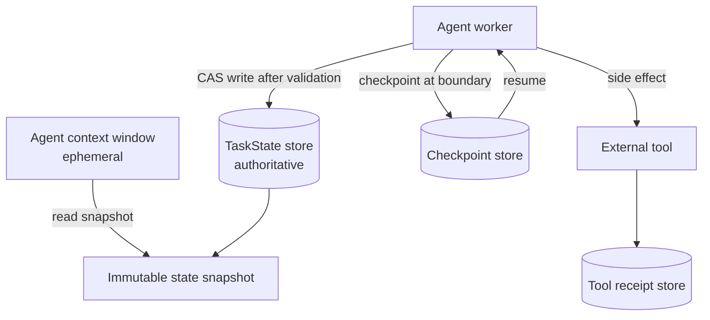
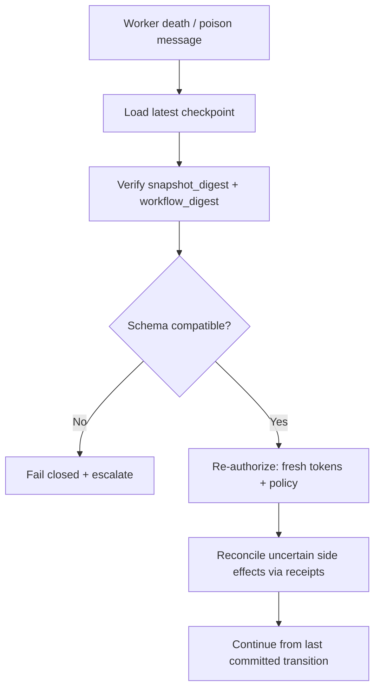

# Durable State and Checkpoints

> **Version:** 2.0.0 | **Last updated:** 2026-07-16

## Purpose

Keep recoverable, conflict-safe workflow state outside model context so agents can crash, retry, and resume without corrupting gates or double-applying side effects.

## Why

Agents retry, crash, duplicate messages, and race. A chat transcript cannot provide atomic transitions, compare-and-swap, exactly-once effects, schema migration, or deterministic recovery. Authoritative state lives in a transactional store; the context window is a disposable working set.

---

## How — Authoritative State vs Chat Context

| Layer | Role | Durable? | Source of truth? |
|-------|------|----------|------------------|
| **TaskState store** | Gates, status, artifact pointers, agent status, budget consumed | Yes | **Yes** |
| **Checkpoint** | Validated snapshot at a semantic boundary | Yes | Point-in-time truth for resume |
| **Message bus / outbox** | Communication + pending publishes | Yes (until acked) | For delivery, not business gates |
| **Agent context window** | Reasoning scratchpad | No | **Never** |
| **Tool receipts** | Proof a side effect already ran | Yes | For idempotent replay |



### Minimum TaskState (from Level 5, productionized)

```typescript
interface TaskState {
  schema_version: "oaies.task-state.v2";
  task_id: string;
  version: number;              // monotonic; CAS target
  status:
    | "planning"
    | "implementing"
    | "reviewing"
    | "testing"
    | "complete"
    | "failed"
    | "cancelled"
    | "expired";

  gates: {
    plan_approved: boolean;
    implementation_complete: boolean;
    review_passed: boolean;
    tests_passing: boolean;
    security_approved: boolean;
    deployment_approved: boolean;
  };

  artifacts: {
    implementation_plan?: string;
    code_files?: string[];
    test_results?: string;
    review_report?: string;
  };

  active_agents: string[];
  completed_agents: string[];
  failed_agents: string[];

  budget: {
    currency_committed_usd: number;
    currency_spent_usd: number;
    tokens_spent: number;
    hops_used: number;
  };

  workflow_digest: string;      // hash of graph/definition
  intent_id: string;
  updated_at: string;
  updated_by: string;           // SPIFFE ID
}
```

**Rules:**

1. One authoritative store — not fragments in agent contexts.
2. Agents read snapshots and write via CAS; no last-write-wins.
3. Every state change is logged (who, what, when, previous version).
4. Schema is defined upfront; agents cannot invent arbitrary keys in production.

---

## How — Checkpoint Format

Checkpoint **after validated semantic boundaries** and **before irreversible effects** — not after every token.

```typescript
interface Checkpoint {
  schema_version: "oaies.checkpoint.v2";
  checkpoint_id: string;
  task_id: string;
  state_version: number;        // TaskState.version at commit
  created_at: string;
  created_by: string;

  workflow_definition_digest: string;
  input_digest: string;
  output_digest?: string;

  state_snapshot_uri: string;   // serialized TaskState
  pending_work: Array<{
    agent_id: string;
    lease_id?: string;
    message_id?: string;
  }>;

  tool_receipt_ids: string[];
  budget_consumed: {
    currency_usd: number;
    tokens: number;
    hops: number;
  };

  provenance: {
    last_message_id: string;
    delegation_hash: string;
    policy_version: string;
  };

  integrity: {
    snapshot_digest: string;    // sha256 of snapshot bytes
    signature?: string;
  };
}
```

### Boundary examples

| Checkpoint after | Why |
|------------------|-----|
| Plan approved gate flips true | Resume must not re-ask human without cause |
| Implementation artifacts validated | Coder crash should not lose accepted files |
| Before `deploy` / `payment` / `delete` | Separate commit from irreversible effect |
| Branch cancelled / escalated | Terminal reason preserved |

Do **not** checkpoint raw chain-of-thought or secrets in cleartext.

---

## How — Concurrency and Idempotency

```typescript
async function casUpdate(taskId: string, expected: number, patch: Partial<TaskState>) {
  const ok = await db.taskState.updateIfVersion(taskId, expected, patch);
  if (!ok) throw new StaleWriteError();
}

async function withLease(taskId: string, agentId: string, fn: () => Promise<void>) {
  const lease = await db.leases.acquire({ taskId, agentId, ttlSeconds: 60 });
  try {
    await fn();
  } finally {
    await db.leases.release(lease.id);
  }
}
```

| Control | Purpose |
|---------|---------|
| CAS `version` | Conflict-safe writes |
| Leases | Exclusive work on a branch |
| Inbox/outbox dedupe | Safe retries |
| Tool receipts | Exactly-once effects |

---

## How — Recovery



**On resume:**

1. Verify digests and workflow definition compatibility.
2. **Re-authorize** — never restore live credentials, policy decisions, or remaining budget limits blindly from the checkpoint; re-read current policy and re-reserve budget.
3. Reconcile side effects: if receipt exists, skip; if uncertain, compensate or human-gate.
4. Reacquire leases; continue from last committed transition.
5. If checkpoint corrupt: fall back to prior checkpoint or terminal `failed` with audit.

### Tests required

Worker death mid-write, duplicate delivery, stale CAS, partial write, corrupt checkpoint, schema upgrade, regional failover.

---

## Tradeoffs

| Choice | Benefit | Cost |
|--------|---------|------|
| Fine-grained checkpoints | Fast recovery | Storage + contention |
| Coarse checkpoints | Cheaper | More rework on crash |
| Separate outbox | Reliable publish | Operational complexity |

Checkpoint only validated semantic boundaries — not every reasoning step.

---

## Anti-patterns

| Anti-pattern | Why it fails |
|--------------|--------------|
| Last-write-wins from multiple agents | Silent gate corruption |
| Treating transcript as state | Non-atomic, non-CAS, non-migratable |
| Replaying tools without receipt check | Double deploy / double charge |
| Restoring old credentials or budgets from checkpoint | Stale privilege and spend |
| Checkpointing before validation | Poison resumes |

---

## Enterprise Considerations

- Encrypt state at rest; segregate tenants; classify checkpoint payloads.
- Retention/deletion must cover state store, artifact store, audit log, and receipts together.
- RTO/RPO for the agent platform include identity and policy dependencies, not only the DB.
- Legal hold can freeze destruction but must still allow correction annotations.

---

## Checklist

- [ ] Authoritative `TaskState` in a transactional store; context is non-authoritative.
- [ ] State machine + terminal states (`complete` / `failed` / `cancelled` / `expired`) explicit.
- [ ] CAS versioning and leases enforced.
- [ ] Checkpoint schema includes digests, budget, provenance, pending work.
- [ ] Resume re-authorizes and reconciles tool receipts.
- [ ] Failure-injection and DR tests pass.
- [ ] Tenant encryption and retention mapped to class.

## Changelog

- **2.0.0 — 2026-07-16:** Full rewrite — authoritative vs context, checkpoint schema, recovery Mermaid, CAS/leases, anti-patterns.
- **1.0.0 — 2026-07-16:** Initial citation-style stub.
