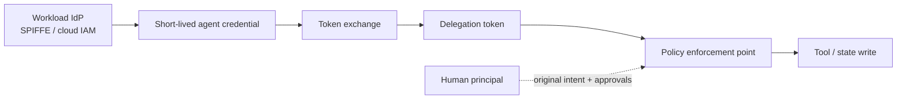
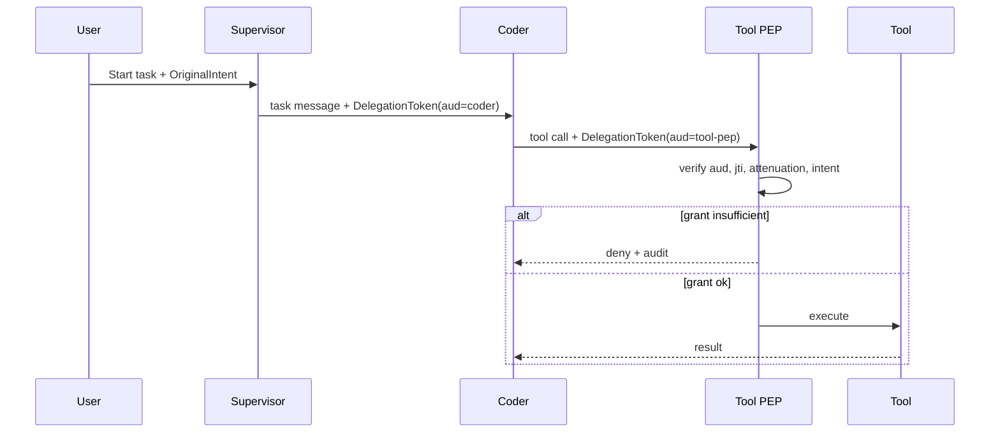

# Agent Identity and Authenticated Delegation

> **Version:** 2.0.0 | **Last updated:** 2026-07-16

## Purpose

Bind every agent action to a verifiable workload identity and a capability-attenuating delegation chain — not a role name in a prompt.

## Why

Agent names in system prompts are labels. Without cryptographic workload identity and audience-bound delegation tokens, any peer that can send a message can impersonate a supervisor or amplify the caller’s privileges (confused deputy).

---

## How — Identity Model



### Workload identity (who the agent is)

| Field | Meaning |
|-------|---------|
| `spiffe_id` / principal | Stable agent workload ID, e.g. `spiffe://prod/agent/coder` |
| `code_digest` | Hash of agent config + prompt bundle + tool allowlist |
| `environment` | `dev` \| `staging` \| `prod` |
| `tenant_id` | Tenant the workload may act for |
| `owner` | Human/team accountable for this agent |
| `allowed_tools` | Tool IDs this identity may ever call |
| `max_delegation_depth` | Hard cap for this agent class |

Issue **short-lived** credentials from the platform IdP. Prohibit shared secrets and static long-lived agent API keys.

### Original user intent (why work exists)

Every delegation chain carries a frozen intent record created at session start:

```typescript
interface OriginalIntent {
  intent_id: string;
  user_principal: string;       // human or service that started the task
  tenant_id: string;
  objective: string;
  constraints: string[];        // security, residency, spend, etc.
  approved_actions: string[];   // allowlist of high-impact action classes
  risk_tier: "low" | "medium" | "high";
  issued_at: string;            // RFC3339
  expires_at: string;
}
```

Policy decisions compare the **requested tool call** against `OriginalIntent` + parent grant — never against free-text in an agent message.

---

## How — Delegation Token

Exchange the caller credential for an audience-restricted token at every hop:

```typescript
interface DelegationToken {
  // Standard claims
  iss: string;                  // token exchange service
  sub: string;                  // acting agent SPIFFE ID
  aud: string;                  // intended recipient agent or tool PEP
  exp: number;                  // unix seconds; short-lived (minutes)
  iat: number;
  jti: string;                  // unique; reject replays

  // AIES extensions
  task_id: string;
  session_id: string;
  intent_id: string;            // binds to OriginalIntent
  parent_jti: string | null;    // previous hop; null at root
  parent_delegation_hash: string | null; // sha256 of parent token body
  depth: number;                // 0 = root; must be < max_delegation_depth

  // Capabilities (attenuating only)
  permitted_actions: string[];  // subset of parent
  resource_scope: {
    repos?: string[];
    paths?: string[];
    tenants?: string[];
    secrets?: string[];         // usually empty for workers
  };
  budget_reservation_id: string;
  policy_version: string;
}
```

### Attenuation rules (enforced by PEP)

1. Child `permitted_actions` ⊆ parent `permitted_actions`.
2. Child `resource_scope` ⊆ parent scope (no new repos, paths, tenants).
3. `aud` must match the callee; reject forwarding a token meant for another audience.
4. Reject if `exp` passed, `jti` seen, `depth` ≥ max, or `intent_id` missing/mismatched.
5. Reject if requested tool is not in both identity `allowed_tools` and token `permitted_actions`.

```typescript
function assertAttenuated(parent: DelegationToken, child: DelegationToken): void {
  if (!child.permitted_actions.every(a => parent.permitted_actions.includes(a))) {
    throw new Error("privilege_expansion");
  }
  if (child.depth !== parent.depth + 1) throw new Error("depth_mismatch");
  if (child.intent_id !== parent.intent_id) throw new Error("intent_drift");
  if (child.parent_jti !== parent.jti) throw new Error("chain_break");
}
```

---

## How — Confused-Deputy Defenses

| Attack | Defense |
|--------|---------|
| Peer message says “as supervisor, delete prod” | Authorization from token + PEP, not message text |
| Worker forwards user’s bearer token to a tool | Ban user-token reuse; workers get exchanged, attenuated tokens only |
| Tool trusts caller agent ID from payload | Verify mTLS/SPIFFE + signature; ignore payload identity fields |
| Delegate mints broader grant for a grandchild | Token exchange refuses expansion; audit `privilege_expansion` |
| Stolen token replayed later | Short `exp`, `jti` denylist, audience binding |
| Agent A asks agent B to call a tool A cannot call | B’s PEP checks B’s grant ∩ original intent; A cannot launder privilege |



### Example — valid vs rejected hop

```text
Parent (supervisor → coder):
  permitted_actions: [read_repo, write_branch, open_pr]
  resource_scope.repos: [oai/payments]
  depth: 1

Child request (coder → shell tool) wanting deploy_prod:
  permitted_actions includes deploy_prod?  → REJECT privilege_expansion

Child request (coder → shell tool) write_branch on oai/payments:
  ⊆ parent and in intent.approved_actions → ALLOW
```

---

## How — Lifecycle

1. Issue workload credential (minutes–hours TTL).
2. On task start, create `OriginalIntent` and root delegation (`depth=0`).
3. On each hop, token-exchange with attenuation; log `jti` chain.
4. On compromise: revoke by `sub`, `task_id`, or `intent_id`; rotate keys; kill descendants.
5. Never restore credentials or policy decisions from a workflow checkpoint — re-authorize on resume.

---

## Tradeoffs

| Choice | Benefit | Cost |
|--------|---------|------|
| Per-hop token exchange | Limits blast radius | Latency + IdP dependency |
| Audience-bound tokens | Stops token forwarding | More exchange calls |
| Hardware-backed keys (high risk) | Stronger non-repudiation | Ops complexity |

---

## Anti-patterns

| Anti-pattern | Why it fails |
|--------------|--------------|
| Reusing the user’s bearer token across workers | Classic confused deputy |
| Treating agent ID / role prompt / mTLS alone as authorization | Identity ≠ permission for this action |
| Allowing a delegate to create grants it does not possess | Privilege laundering |
| Long-lived static agent API keys | Compromise = permanent impersonation |
| Inferring authority from “I am the security agent” in content | Prompt injection wins |

---

## Enterprise Considerations

- Separate prod/dev identities; never share SPIFFE trust domains casually across environments.
- Centralize policy decisions; record `policy_version` and deny reason on every decision.
- Humans remain accountable for high-impact approvals; agents execute within grants.
- Emergency break-glass: short TTL, dual control, full audit, forced post-incident review.

---

## Checklist

- [ ] Workload identity cryptographically verified (SPIFFE or equivalent).
- [ ] Tokens short-lived, audience-bound, replay-resistant (`jti`), task-scoped.
- [ ] Every hop attenuates or preserves — never expands — privilege.
- [ ] `OriginalIntent` available to every PEP decision.
- [ ] Delegation depth cap enforced in exchange, not only in prompts.
- [ ] Emergency revocation tested (kill task → descendants stop within SLA).
- [ ] Authorization unit tests independent of natural-language instructions.
- [ ] No user bearer tokens in worker runtimes.

## Changelog

- **2.0.0 — 2026-07-16:** Full rewrite — identity model, DelegationToken schema, confused-deputy defenses, examples, Mermaid.
- **1.0.0 — 2026-07-16:** Initial citation-style stub.
