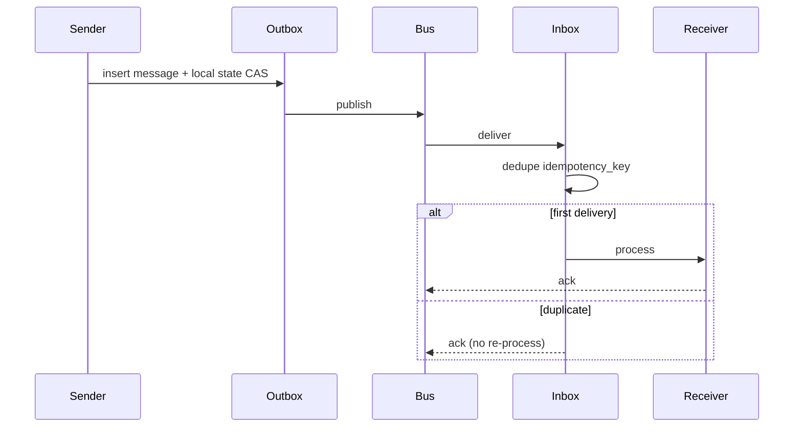

# Message Provenance, Delivery, and Audit

> **Version:** 2.0.0 | **Last updated:** 2026-07-16

## Purpose

Make every agent-to-agent message attributable, integrity-protected, delivery-safe, and auditable — using the AIES `AgentMessage` schema as the wire format.

## Why

TLS proves a connection, not which workload authored a stored message. Free-form chat between agents cannot be deduplicated, timed out, or forensically reconstructed. Production multi-agent systems need a versioned envelope, delivery guarantees, idempotency, and an append-only audit trail.

---

## How — AgentMessage Schema

Expand the Level 5 README schema into the production envelope:

```typescript
type MessageType =
  | "task"
  | "result"
  | "question"
  | "escalation"
  | "complete"
  | "cancel"
  | "nack";           // permanent reject (schema/policy)

type DeliveryMode =
  | "at_most_once"
  | "at_least_once"
  | "exactly_once_effect"; // see guarantees below

interface Artifact {
  artifact_id: string;
  media_type: string;
  uri: string;              // object store path, not inline secrets
  content_digest: string;   // sha256:...
  classification: string;
}

interface AgentMessage {
  schema: "oaies.agent-message.v2";

  // Routing
  from: string;             // SPIFFE ID of sender
  to: string;               // SPIFFE ID of recipient
  session_id: string;
  message_id: string;       // UUID; primary idempotency key for consumers
  correlation_id: string;   // ties request/response pairs
  causation_id?: string;    // parent message_id that caused this one

  // Content
  type: MessageType;
  priority: "high" | "normal";
  content: string;
  artifacts: Artifact[];

  // Task context (every message)
  task_context: {
    story_id: string;
    objective: string;
    constraints: string[];
    intent_id: string;
  };

  // State / control
  requires_response: boolean;
  timeout_seconds: number;
  escalation_target: string;
  delivery_mode: DeliveryMode;
  idempotency_key: string;  // stable across retries; often == message_id

  // Provenance (signed)
  issued_at: string;        // RFC3339
  expires_at: string;
  nonce: string;            // base64url
  delegation_hash: string;  // sha256 of active DelegationToken body
  content_digest: string;   // sha256 of canonical body + artifact digests
  policy_version: string;
  signature: {
    alg: "ed25519" | "es256";
    kid: string;
    value: string;          // base64url over protected headers + digest
  };
}
```

### Canonicalization and signing

1. Canonicalize JSON (RFC 8785 / JCS) for the protected set: routing fields, times, digests, `delegation_hash`, `policy_version`, `idempotency_key`.
2. Hash body + artifact manifest → `content_digest`.
3. Sign protected set + digest with the sender workload key (`kid`).
4. Verify **before** processing: identity, audience (`to`), signature, time window, nonce/`jti` replay, schema version, delegation chain, content digest.

```typescript
async function acceptMessage(msg: AgentMessage, inbox: Inbox): Promise<"process" | "duplicate" | "reject"> {
  await verifySignature(msg);
  if (await inbox.seen(msg.idempotency_key)) return "duplicate";
  if (Date.parse(msg.expires_at) < Date.now()) return "reject";
  if (msg.to !== await localSpiffeId()) return "reject";
  await inbox.record(msg.idempotency_key, msg.message_id);
  return "process";
}
```

---

## How — Delivery Guarantees

| Mode | Broker behavior | Consumer duty | Use when |
|------|-----------------|---------------|----------|
| `at_most_once` | Fire and forget | Accept loss | Telemetry, non-critical hints |
| `at_least_once` | Retry until ack | **Must be idempotent** | Default for task/result/question |
| `exactly_once_effect` | At-least-once + outbox | Deduplicate by `idempotency_key` and apply side effects once | Tool calls, gate writes, payments |

**AIES default:** `at_least_once` on the bus; **exactly-once effects** at the state/tool boundary via idempotency keys and transactional outbox.



### Timeouts and escalation

- Every `requires_response: true` message has `timeout_seconds` and `escalation_target`.
- On timeout: emit `escalation` (or supervisor `cancel`), do not silently retry forever.
- `question` blocks the requesting branch only — not the entire session — unless the supervisor marks it global.

---

## How — Idempotency

| Layer | Key | Behavior |
|-------|-----|----------|
| Message consume | `idempotency_key` | Second delivery → ack, no re-entry |
| State transition | `task_id` + `transition_id` | CAS version; duplicate patch is no-op |
| Tool call | `tool_idempotency_key` | Return stored receipt; do not re-execute |

```typescript
interface ToolReceipt {
  tool_idempotency_key: string;
  message_id: string;
  status: "succeeded" | "failed";
  result_digest: string;
  executed_at: string;
}
```

Never replay a tool because a response was lost without checking the receipt store.

---

## How — Audit Trail

Persist verification outcomes in an append-only, hash-chained log:

```typescript
interface MessageAuditRecord {
  seq: number;
  prev_hash: string;
  record_hash: string;
  event: "accepted" | "duplicate" | "rejected" | "timeout" | "escalated";
  message_id: string;
  session_id: string;
  from: string;
  to: string;
  type: MessageType;
  content_digest: string;
  delegation_hash: string;
  reject_reason?: string;
  recorded_at: string;
}
```

Rules:

- Keep original bytes (or authorized encrypted originals); summaries never replace evidence.
- Redact or hash sensitive `content` per retention class before long-term storage if policy requires minimization — but then you cannot claim full content non-repudiation for that field.
- Export procedure must include trust roots, `kid` history, and schema versions.

---

## Tradeoffs

| Choice | Benefit | Cost |
|--------|---------|------|
| Sign every message | Attribution + integrity | CPU, key management |
| At-least-once + idempotent consumers | Reliable delivery | Consumer complexity |
| Immutable audit retention | Forensics | Storage + privacy obligations |

---

## Anti-patterns

| Anti-pattern | Why it fails |
|--------------|--------------|
| Free-form agent chat with no schema | Cannot parse, timeout, or audit |
| Signing only the body; routing fields mutable | Sender/recipient spoof after sign |
| Calling a DB row “non-repudiation” without protected keys | Operators can edit history |
| Assuming valid signature ⇒ content is true/authorized | Signature ≠ policy grant |
| Reprocessing duplicates because “safer” | Double tool effects |

---

## Enterprise Considerations

- Align retention and export with counsel; restrict who can read raw message bodies.
- Clock skew monitoring is mandatory for `exp`/`issued_at` verification.
- Cross-tenant message buses require tenant labels on every record and query predicate.
- Key compromise drill: revoke `kid`, re-sign or quarantine in-flight sessions.

---

## Checklist

- [ ] `oaies.agent-message.v2` (or newer) versioned and enforced at the bus.
- [ ] Signatures cover routing, time, delegation, and content digest.
- [ ] Inbox dedupe by `idempotency_key`; tool receipts prevent double effects.
- [ ] Timeouts escalate; no infinite retry loops.
- [ ] Audit log append-only and hash-chained; reject outcomes recorded.
- [ ] Replay and clock-skew tests pass.
- [ ] Key rotation and evidentiary export drills pass.

## Changelog

- **2.0.0 — 2026-07-16:** Full rewrite — expanded AgentMessage TypeScript schema, delivery modes, idempotency, audit records, Mermaid.
- **1.0.0 — 2026-07-16:** Initial citation-style stub.
