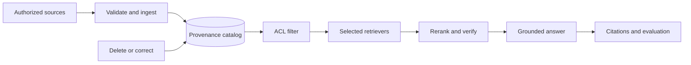

# Level 6: Memory and Knowledge Systems

> **Version:** 2.0.0  
> **Last updated:** 2026-07-16  
> **Prerequisite:** governed identity, authorization, and evaluation infrastructure

## Purpose

Define production memory and retrieval systems that are attributable, tenant-safe, correctable, deletable, and measurably useful.

## Why

Memory can preserve mistakes, secrets, stale claims, and injected instructions as efficiently as it preserves useful knowledge. Retrieval quality and control must be measured on the actual corpus and workload; universal recall percentages, chunk overlaps, vector-count cutoffs, and compression thresholds are unsupported.

## How

1. Govern the [memory lifecycle](./standards/memory-lifecycle-governance.md) and [security and poisoning controls](./standards/security-and-poisoning.md).
2. Select memory by semantics: [in-context](./memory-types/in-context.md), [episodic](./memory-types/episodic.md), [semantic](./memory-types/semantic.md), [procedural](./memory-types/procedural.md), or [external state](./memory-types/external.md).
3. Select and combine retrieval modes from measured query classes, not ideology.
4. Enforce authorization before candidate retrieval and again before generation.
5. Validate with [retrieval and citation evaluation](./standards/retrieval-citation-evaluation.md).

## Corpus

### Knowledge Graphs
- [Construction](./knowledge-graphs/construction.md)
- [Querying](./knowledge-graphs/querying.md)
- [Maintenance](./knowledge-graphs/maintenance.md)

### Vector and Retrieval Infrastructure
- [Store selection](./vector-databases/selection-guide.md)
- [Indexing patterns](./vector-databases/indexing-patterns.md)
- [Retrieval optimization](./vector-databases/retrieval-optimization.md)

### RAG Architectures
- [Naive RAG](./rag/naive-rag.md)
- [Advanced RAG](./rag/advanced-rag.md)
- [Hybrid RAG](./rag/hybrid-rag.md)
- [Agentic RAG](./rag/agentic-rag.md)

## Tradeoffs

Stronger provenance, isolation, and deletion add metadata and operational cost. Hybrid and graph retrieval can improve specific query classes but increase latency and tuning surface; they are enabled only when offline and online evidence justifies them.

## Anti-patterns

- **Write-only memory:** no expiry, correction, conflict, or deletion path.
- **ACL after retrieval:** unauthorized candidates can leak through ranking, caches, telemetry, or timing.
- **Similarity as truth:** high vector score does not establish authority, freshness, or factual support.
- **Summary replacement:** destructive compaction silently removes commitments and qualifiers.
- **Graph by default:** knowledge graphs remain an emerging option for relationship-heavy workloads, not a universal RAG requirement.

## Enterprise Considerations

Classify data before ingestion; enforce purpose, residency, legal hold, retention, deletion, correction, and tenant isolation across source, indexes, caches, replicas, backups, traces, and derived artifacts.

## Checklist

- [ ] Every record has source, owner, tenant, ACL, version, timestamps, and transformation provenance.
- [ ] Retention, deletion, correction, conflict, and legal-hold workflows are tested end to end.
- [ ] Authorization occurs before retrieval and cache access.
- [ ] Poisoning detection, quarantine, rollback, and re-index recovery are exercised.
- [ ] Retrieval mode is selected per evaluated query class.
- [ ] Retrieval, generation, citation support, and compaction-loss tests pass workload-specific gates.

## References

- [NIST AI RMF 1.0](https://doi.org/10.6028/NIST.AI.100-1)
- [NIST SP 800-53 Rev. 5](https://doi.org/10.6028/NIST.SP.800-53r5)
- [OWASP RAG Security Cheat Sheet](https://cheatsheetseries.owasp.org/cheatsheets/RAG_Security_Cheat_Sheet.html)
- [Retrieval-Augmented Generation](https://arxiv.org/abs/2005.11401)

## Changelog

- **2.0.0 — 2026-07-16:** Added lifecycle, provenance, isolation, correction, poisoning, retrieval-selection, ACL-first, citation, and compaction standards; removed unsupported numeric mandates.
