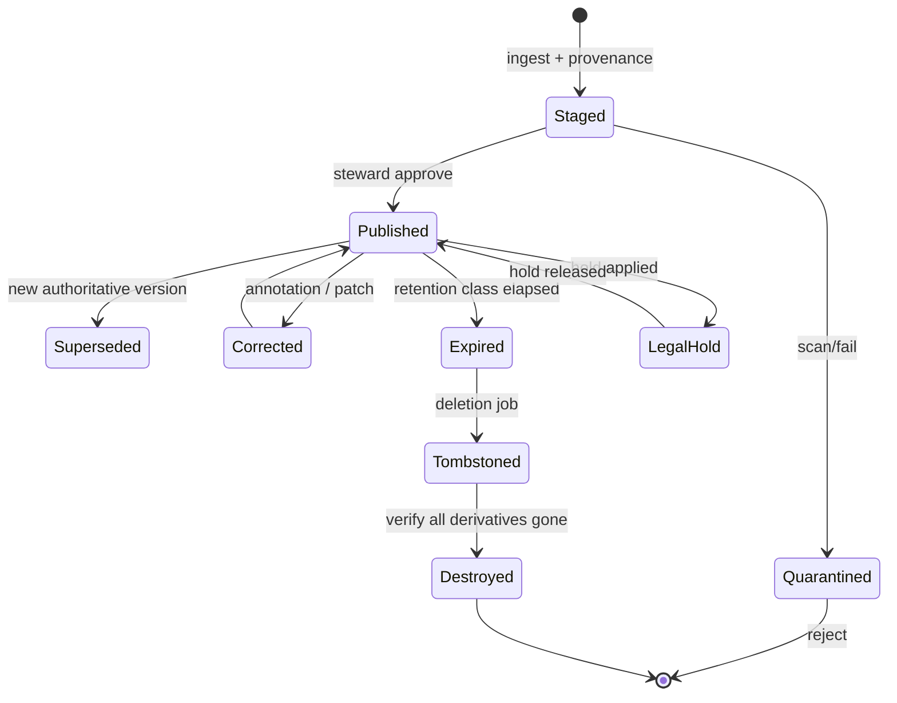
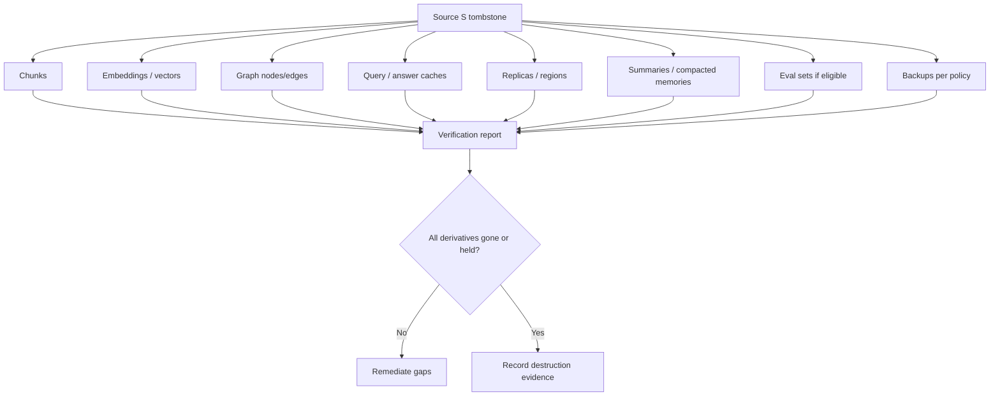

# Memory Lifecycle Governance

> **Version:** 2.0.0 | **Last updated:** 2026-07-16

## Purpose

Control agent memory from authorized creation through correction, expiry, deletion, and verifiable destruction — including every derived chunk, embedding, and cache.

## Why

Persistent memory creates privacy, stale-data, and accountability risk. Updating a source document while leaving old embeddings and cached answers live is how agents keep citing lies. Governance fails unless every derived copy can be found and acted on.

---

## How — Lifecycle



### Stage requirements

| Stage | Required actions |
|-------|------------------|
| **Ingest** | Record immutable provenance (below); never learn directly from model output without approval |
| **Validate** | Schema, malware/injection scan, parser sandbox, ACL completeness |
| **Stage** | Invisible to retrieval until publish |
| **Publish** | Steward approval by risk tier; index chunks/embeddings/graph edges |
| **Correct** | Annotate or supersede; preserve lineage; do not silent-rewrite history without audit |
| **Expire** | Access denied by policy clock; content may remain until destruction window |
| **Tombstone** | Propagate deletion markers to all derivatives |
| **Destroy** | Cryptographic erase or media sanitize per class; verify completion |

### Provenance record (immutable at ingest)

```typescript
interface MemoryProvenance {
  source_id: string;
  source_version: string;
  content_hash: string;          // sha256 of normalized bytes
  tenant_id: string;
  subject_ids?: string[];        // data subjects if applicable
  owner: string;                 // steward
  purpose: string[];
  acl: string[];                 // principals/roles
  classification: MemoryClass;
  legal_basis?: string;          // where privacy law applies
  consent_ref?: string;
  ingested_at: string;
  parser_version: string;
  embedding_model_version: string;
  parent_source_id?: string;     // derivation lineage
}
```

---

## How — Retention by Class (no fake fixed day counts)

Retention is **policy-owned per class and jurisdiction**, not a universal number in this standard. Engineering implements the class machine; counsel/records set the durations.

| Class | Typical content | Access after “expire” | Destruction | Notes |
|-------|-----------------|----------------------|-------------|-------|
| `session_ephemeral` | In-context working memory dumps | Denied immediately at session end | Aggressive; usually no backup index | Default for raw transcripts marked ephemeral |
| `operational` | Runbooks learned, task episodic facts | Denied after class TTL | After TTL + purge lag | Prefer short TTLs; review on publish |
| `knowledge_product` | Curated wiki, approved ADRs | Denied after review date miss or TTL | Only after steward + records OK | Prefer supersession over delete |
| `regulated_personal` | Anything identifying a person | Hard deny on expire/withdraw | Verifiable destruction + audit residue only | Map to privacy program; no “indefinite” |
| `security_sensitive` | Secrets adjacent, vuln detail | Strict ACL always | On rotate/expire; never in eval sets | Prefer pointers over copies |
| `legal_hold` | Any class under hold | May still be readable per counsel | **Blocked** until hold lifts | Hold ≠ skip corrections |

**Rules:**

- “Indefinite” is not a default class — it is an explicit records decision with an owner and review trigger.
- Legal hold prevents destruction, not correction annotations.
- Evaluation sets and prompt caches inherit the **strictest** class of their sources.

```typescript
interface RetentionPolicy {
  classification: MemoryClass;
  review_trigger: string;        // e.g. "on_source_update" | "periodic_steward_review"
  expire_access_after: string;   // duration expression from records policy — not hard-coded here
  destroy_after: string;         // may differ from access expiry
  allow_indefinite: boolean;     // requires named approver if true
  approver?: string;
}
```

---

## How — Conflict Resolution

When two memories disagree:

1. Prefer higher **source authority** (signed system of record > wiki > chat rumor).
2. Prefer correct **effective time** (what was true when).
3. Use explicit **supersession** links; do not let recency or vector similarity silently win.
4. If policy cannot resolve, keep competing claims visible to stewards and block automatic overwrite.

---

## How — Deletion Propagation Checklist

On correction or deletion of source `S`:



**Operator checklist (run and attach evidence):**

- [ ] Tombstone written for `source_id` + version with actor and reason.
- [ ] Chunk table rows soft-deleted / hard-deleted per class.
- [ ] Vector index IDs removed or filtered fail-closed (not only “flagged”).
- [ ] Graph edges/nodes detached; orphan cleanup run.
- [ ] Application caches and CDN keys for answers citing `S` invalidated.
- [ ] Replica regions show consistent tombstone (measure lag).
- [ ] Summaries/compactions that incorporated `S` rebuilt or tombstoned.
- [ ] Eval/golden sets: removed or marked `held` if under legal hold.
- [ ] Backups: scheduled expiry per sanitization policy; online restore path cannot resurrect live index without re-applying tombstones.
- [ ] Minimal non-content audit evidence retained (who/when/what ID) where law/policy permit.
- [ ] Data-subject/tenant export path still works for remaining eligible data.
- [ ] Verification query: retrieve-by-id and semantic search both miss `S` (or return tombstone only).

Publish a **deletion SLO** (e.g. online indexes vs backup lag) with exception evidence — do not invent a universal hour count here; set it per system risk.

---

## Tradeoffs

Lineage and deletion propagation cost storage and engineering. Without them, correction and retention are theater. Aggressive destroy improves privacy but hurts incident forensics — keep non-content audit residue when permitted.

---

## Anti-patterns

| Anti-pattern | Why it fails |
|--------------|--------------|
| “Indefinite” as default retention | Unbounded privacy and stale-risk |
| Updating source text; leaving old embeddings live | Agents keep retrieving poison/stale |
| Conflict resolved by top-1 similarity | Silent wrong “winner” |
| Delete source row only | Derivatives keep serving |
| Learning from raw model output into prod memory | Self-poisoning loop |

---

## Enterprise Considerations

- Map classes to privacy, records, residency, discovery, and legal-hold obligations with named stewards.
- Deletion SLOs and exception registers are audit artifacts.
- Cross-border replicas must honor the strictest applicable destroy policy.
- Coordinate with [security-and-poisoning](./security-and-poisoning.md) when deletion is part of incident response.

---

## Checklist

- [ ] Provenance and derivation lineage complete at ingest.
- [ ] Retention and review are class-based policies with owners — not hardcoded slogans.
- [ ] Conflict decisions deterministic and auditable.
- [ ] Tombstones reach chunks, vectors, graph, caches, replicas, summaries, eval sets, backups.
- [ ] Destruction verification evidence retained.
- [ ] Legal hold blocks destroy but allows corrections.
- [ ] Deletion/correction drills meet the system’s published SLO.

## Changelog

- **2.0.0 — 2026-07-16:** Full rewrite — lifecycle Mermaid, retention by class without fake day counts, deletion propagation checklist.
- **1.0.0 — 2026-07-16:** Initial citation-style stub.
