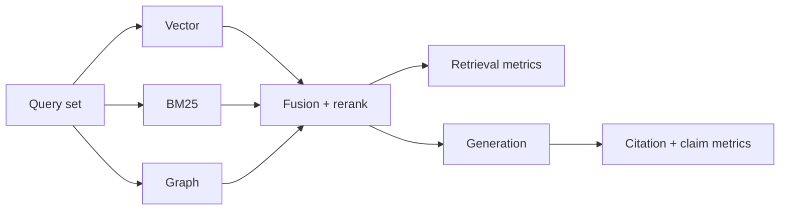

# Retrieval, Citation, and Compaction Evaluation

> **Version:** 2.0.0 | **Last updated:** 2026-07-16

## Purpose

Define how to evaluate hybrid RAG quality, citation support for material claims, and memory-compaction safety — with workload-specific gates, not universal score theater.

## Why

No single recall number or framework score proves production readiness. Metrics depend on corpus, query mix, annotation quality, and the cost of a miss. Fluency is not retrieval. A URL that exists is not a citation that entails the claim.

---

## How — Evaluation Sets

Build **versioned, adjudicated** query sets. Cover at least:

| Slice | What it catches |
|-------|-----------------|
| Answerable factual | Baseline retrieval + generation |
| Unanswerable / abstain | Hallucination under empty evidence |
| Exact identifier (IDs, error codes) | Keyword path health |
| Semantic paraphrase | Vector path health |
| Temporal / freshness | Stale index and version skew |
| Relationship / multi-hop | Graph or multi-retrieve need |
| ACL / cross-tenant | Authorization failures |
| Conflicting sources | Citation and conflict handling |
| Adversarial / injection-laden | Refusal and isolation |
| Multilingual (if in scope) | Embedding and analyzer gaps |

Pin corpus snapshot, embedding model, chunker version, and judge version on every run.

---

## How — Hybrid Retrieval Metrics

Evaluate **retrieval separately** from generation. For hybrid (vector + keyword/BM25 + graph → fusion → rerank):

| Metric | Measures | Notes |
|--------|----------|-------|
| `recall@k` | Fraction of relevant docs in top-k | Primary for answerable set; report per channel and fused |
| `precision@k` | Fraction of top-k that are relevant | Noise / over-retrieval |
| `MRR` / `nDCG@k` | Rank quality | When graded relevance exists |
| `channel_contribution` | Unique relevant hits from vector vs BM25 vs graph | Detects dead channels |
| `fusion_regret` | Relevant lost after fusion vs best single channel | Fusion bugs |
| `p50/p95_latency_ms` | End-to-end retrieve | SLO input |
| `cost_per_query` | Embed + search + rerank $ | Gate alongside quality |
| `acl_violation_rate` | Unauthorized docs in candidates | **Must be ~0**; fail closed |
| `freshness_error_rate` | Stale version preferred | Temporal slice |
| `abstention_precision/recall` | Correct empty retrieval | Unanswerable slice |



```typescript
interface RetrievalEvalRow {
  query_id: string;
  slice: string;
  relevant_ids: string[];          // adjudicated
  retrieved_ids: string[];         // fused top-k
  channel_hits: {
    vector: string[];
    bm25: string[];
    graph: string[];
  };
  latency_ms: number;
  cost_usd: number;
  acl_violations: string[];
}
```

**Gate setting:** derive thresholds from risk appetite and the single-system baseline — not from a blog’s “0.85 recall.” Publish confidence intervals and per-slice results. Aggregate wins must not hide ACL or high-impact slice regressions.

---

## How — Citation Requirements

For each material claim in the answer:

1. **Resolve:** citation pointer → authorized `source_id` + `version` (deterministic).
2. **Authorize:** retrieving principal may read that source (same ACL as prod path).
3. **Entail:** cited span actually supports the claim (human sample + calibrated judge).
4. **Attribute:** unsupported claims counted separately from wrong claims.

| Citation metric | Definition |
|-----------------|------------|
| `citation_resolution_rate` | Citations that resolve to live authorized sources |
| `claim_support_rate` | Material claims entailed by cited spans |
| `unsupported_claim_rate` | Material claims with no adequate support |
| `citation_precision` | Cited docs that were used for at least one claim |
| `overcitation_rate` | Citations not needed for any claim (noise) |

```typescript
interface ClaimCitationCheck {
  claim_id: string;
  claim_text: string;
  citations: Array<{ source_id: string; version: string; span?: string }>;
  resolves: boolean;
  authorized: boolean;
  entails: "yes" | "no" | "partial" | "unevaluated";
  reviewer: "human" | "judge" | "both";
}
```

**Failure cases to include in every eval release:**

| Failure | Expected system behavior |
|---------|--------------------------|
| Empty retrieval | Abstain or ask; no fabricated citations |
| Conflicting sources | Present conflict or prefer authority policy; do not silently pick similarity winner |
| Stale version cited | Prefer current effective version or label temporal scope |
| Citation to unauthorized doc | Never; ACL enforced pre-retrieval |
| URL/title only, no span | Fail citation quality gate for high-impact tiers |
| Judge/human disagreement | Escalate; do not ship on judge alone |

Calibrate model judges against human samples; report calibration drift when corpus or model changes.

---

## How — Compaction / Memory Summarization Eval

Before/after compression, replay tasks and score retention of:

- Commitments and constraints  
- Unresolved questions  
- Entities, dates, quantities  
- Provenance and permissions  
- Safety instructions  

| Metric | Meaning |
|--------|---------|
| `omission_rate` | Critical facts dropped |
| `contradiction_rate` | Summary vs source conflict |
| `task_success_delta` | Downstream task pass rate change |
| `permission_drift` | ACL/scope changed by summary |

Generic embedding similarity is **insufficient** — it hides lost negation and numbers.

---

## How — Offline vs Online Gates

1. **Offline:** every material change to chunker, embeddings, index, fusion, prompt, or model.
2. **Online:** canary traffic with slice dashboards; rollback on ACL violations or unsupported-claim spikes.
3. Retain evaluator versions, labels, and raw scores with the release record.

---

## Tradeoffs

High-quality labels are expensive and rot as the corpus moves. They still beat arbitrary percentages and uncalibrated LLM-as-judge scores. Strict citation gates increase abstention — correct for high-impact domains.

---

## Anti-patterns

| Anti-pattern | Why it fails |
|--------------|--------------|
| Using answer fluency as retrieval eval | Hides empty or wrong evidence |
| Verifying only that a citation URL exists | No entailment |
| One aggregate RAGAS-style score as ship gate | Masks ACL and slice failures |
| Testing summaries with cosine similarity only | Misses negation/quantity loss |
| Training on the eval set | Leakage; false confidence |

---

## Enterprise Considerations

- Protect eval data from training leakage.
- Report tenant/cohort performance where products differ.
- Domain experts adjudicate high-impact claims.
- Tie gates to change management; retrieval regressions are release blockers equal to model regressions.

---

## Checklist

- [ ] Query set covers ACL, conflict, freshness, unanswerable, and adversarial slices.
- [ ] Retrieval and generation metrics reported separately; hybrid channels measured.
- [ ] Citations resolve, authorize, and entail material claims.
- [ ] Judge calibration and human sampling documented.
- [ ] Compaction omission/contradiction/task-delta gates pass.
- [ ] Offline gates on material changes; online canary + rollback defined.
- [ ] No universal vanity threshold substituted for risk-based gates.

## Changelog

- **2.0.0 — 2026-07-16:** Full rewrite — hybrid metrics, citation requirements, failure cases, compaction eval, Mermaid.
- **1.0.0 — 2026-07-16:** Initial citation-style stub.
