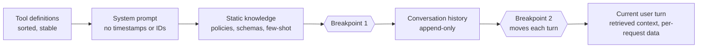

# Prompt Caching Engineering

> **Version:** 1.0.0
> **Last updated:** 2026-11-06
> **Status:** Normative AIES operating standard. Provider prices and limits are a dated snapshot. Re-verify them quarterly with [Model lifecycle](../model-lifecycle.md).

## Purpose

Design prompts, agent loops, and deployments so the provider's prefix cache hits. Measure the hit rate as a service-level objective. Treat any change that silently breaks the cache as a regression.

## Why

Prompt caching is the largest cost and latency lever in a 2026 LLM system:

- A cached input token costs 0.025–0.1× of an uncached one.
- Caching stacks with the 50% Batch and Flex discounts.

Lowering reasoning effort, routing to a smaller model, or rewriting prompts usually saves less than fixing the cache.

The cache is also fragile. It matches only an exact prefix. One timestamp in the system prompt, a reordered tool list, or a reasoning-effort switch can turn a 90% hit rate into 0%. Nothing errors when that happens; only the bill and the p50 latency change. Teams find out at month end.

The [general caching profile](./caching-strategies.md) covers application-level response caches: exact and semantic caching, tenant isolation, and invalidation. This standard covers the **provider prefix cache**. It reuses the model's computation for an identical prompt prefix and never returns a stored answer.

## When

| Workload | Apply this standard |
|---|---|
| Agent loops: coding agents, tool-using assistants, multi-turn chat | Always. Every turn resends the system prompt, tools, and history. |
| RAG with a stable instruction block and variable retrieved context | Yes. Cache the instructions and tools; retrieved chunks stay uncached. |
| Batch jobs sharing one long instruction block | Yes. Combine with the Batch API. |
| One-shot requests under the provider minimum (512–4,096 tokens) | No. Below the minimum nothing is cached. |
| Prompts whose prefix is unique per request | No. Restructure first, or skip caching. |

## How

### 1. Order the prompt from most stable to least stable

The cache key is the exact token prefix. Everything before the last cache breakpoint must be byte-identical across requests that should share it.



Rules:

1. **Tools first, sorted by name, serialized deterministically.** Sort keys in JSON schemas. MCP spec `2026-07-28` requires deterministic `tools/list` ordering; pin MCP server versions so tool descriptions don't drift.
2. **No volatile values in the system prompt:** no current date, request ID, user name, or A/B bucket. Put them in the final user turn.
3. **History is append-only.** Editing or summarizing an earlier turn invalidates everything after it. Use the provider's compaction or context editing, which are cache-aware, instead of hand-rolled rewrites.
4. **Retrieved context and per-request data go last**, after the final breakpoint.

### 2. Place breakpoints per provider

| Provider (snapshot 2026-11-06) | Mechanism | Minimum prefix | Write cost | Read cost | Lifetime |
|---|---|---|---|---|---|
| Anthropic (Claude 5.x) | Automatic mode (one top-level `cache_control`), or up to 4 explicit `cache_control` breakpoints with a 20-block lookback | 512 tokens | 1.25× (5 min) or 2× (1 h) | 0.1×; 0.05× on Opus and Sonnet 5.5; 0.025× on Fable 5.1 | 5 min or 1 h, refreshed on each hit |
| OpenAI (GPT-5.6 and later) | Implicit, or explicit breakpoints (`prompt_cache_breakpoint`) with `prompt_cache_options` | 1,024 tokens | 1.25× (`30m`) or 2.5× (`12h`) | 0.1×; 0.05× on GPT-6.1 Sol and Terra | `30m` or `12h` |
| Google (Gemini 4 Argon and later) | Implicit only; explicit cache objects are not supported | 4,096 tokens | None | 0.05× (95% discount) | Provider-managed |

Placement:

- **Breakpoint 1** goes after the static block (tools, system prompt, knowledge). Every request in the deployment shares it.
- **Breakpoint 2** goes on the last message of the history and moves forward each turn, so turn *n+1* reads turn *n*'s prefix.
- On Anthropic, a cache entry exists only after the first response **starts**. Fire parallel fan-out requests after one warm-up request has begun streaming, not at the same time.
- On Gemini 4 agent loops, the previous request is cached in full only if the new turn adds at least 2,050 tokens. Batch small tool results into one turn where the loop allows it.

Anthropic, with explicit breakpoints:

```python
response = client.messages.create(
    model=config.model_for(tier="mid"),          # pinned ID from config, never a literal
    max_tokens=16_000,
    tools=sorted_tools,                          # stable order; last tool carries no breakpoint
    system=[
        {"type": "text", "text": SYSTEM_PROMPT},
        {"type": "text", "text": POLICY_AND_SCHEMAS,
         "cache_control": {"type": "ephemeral", "ttl": "1h"}},   # breakpoint 1: shared by all sessions
    ],
    messages=[
        *history[:-1],
        with_cache_control(history[-1]),         # breakpoint 2: rolls forward each turn (5 min default)
        {"role": "user", "content": f"{retrieved_context}\n\n{user_turn}"},
    ],
)
log_cache_usage(response.usage)  # cache_creation_input_tokens, cache_read_input_tokens, input_tokens
```

### 3. Choose the lifetime from the arrival pattern

Let *N* be the number of reads of a prefix within one lifetime, with cost measured in units of an uncached prefix. Caching wins when the write premium plus the reads costs less than *N + 1* uncached sends:

| Option | Cached cost | Break-even | Use when |
|---|---|---|---|
| Anthropic 5 min (1.25×) | 1.25 + 0.1·*N* | *N* ≥ 1 | Requests on the prefix arrive less than 5 minutes apart: agent loops, active chat |
| Anthropic 1 h (2×) | 2 + 0.1·*N* | *N* ≥ 2 | Human think time over 5 minutes between turns; shared prefix with bursty traffic |
| OpenAI `30m` (1.25×) | 1.25 + 0.1·*N* | *N* ≥ 1 | Same as the 5-minute row |
| OpenAI `12h` (2.5×) | 2.5 + 0.1·*N* | *N* ≥ 2 | Deployment-wide system prompt shared by many users through the day |
| Gemini implicit | 0.05·*N* | Any reuse | Nothing to choose; meet the 4,096-token minimum |

Mix lifetimes: a long-lived breakpoint on the deployment-wide static block, and a short-lived rolling breakpoint on the session history.

### 4. Measure the hit rate as an SLO

Log the provider's usage fields on every call: cache read tokens, cache write tokens, and uncached input tokens. Record them on the model span as `gen_ai.usage.cache_read.input_tokens`, `gen_ai.usage.cache_write.input_tokens`, and `gen_ai.usage.input_tokens`; that is the OpenTelemetry GenAI pin in [tracing](../observability/tracing.md). Then compute:

```text
cache_hit_ratio = cache_read_tokens / (cache_read_tokens + cache_write_tokens + uncached_input_tokens)
```

| Workload | SLO (7-day) | Alert |
|---|---|---|
| Agent loops and multi-turn chat | ≥ 80% | Drop of 20 points or more within 24 h, or a 1-hour window below 50% |
| RAG with a static instruction block | ≥ 50% | Drop of 20 points or more within 24 h |
| Batch with a shared instruction block | ≥ 90% | Any job below 70% |

A sudden drop almost always follows a deploy. Tag cache metrics with the prompt release digest and tool-set digest, so a dashboard shows which release broke the prefix ([tracing](../observability/tracing.md), [token budgets](./token-budgets.md)).

### 5. Treat cache-breaking changes as reviewed changes

Each of these invalidates the prefix from the point of change onward:

| Change | Affected providers | Mitigation |
|---|---|---|
| Any edit to the system prompt or a tool definition | All | Ship through prompt release; expect a one-time write spike |
| Tool order, or JSON key order in tool schemas | All | Sort and serialize deterministically; contract-test the bytes |
| Model or snapshot change | All | Expected; schedule with the [model lifecycle](../model-lifecycle.md) |
| Reasoning effort change between requests | Anthropic (unless per-message effort is enabled), OpenAI | Fix effort per session; use Anthropic per-message effort when it must vary |
| Verbosity or output-format change | OpenAI | Fix per session |
| Compaction or summarization of history | All | Compact rarely, at a threshold, with the provider's API |
| Timestamps, request IDs, or user names before a breakpoint | All | Move them to the final user turn |
| Adding or removing an MCP server mid-session | All | Fix the tool set per session; use tool search with deferred loading for large catalogs |
| Turning thinking on or off, or toggling images | Anthropic, Google | Keep per session |

Add a contract test that renders the cacheable prefix for a fixed input and compares its SHA-256 with the approved digest. A changed digest fails CI unless the PR is labeled as a prompt release.

### 6. Verify

1. Send the same two-turn conversation twice, 10 seconds apart. The second call must report cache read tokens of at least the static block's size.
2. Run the prefix-digest contract test in CI.
3. After every deploy, compare the hit ratio for the first hour with the previous release's ratio.

## Tradeoffs

| Choice | Benefit | Cost |
|---|---|---|
| Strict prompt ordering (static first, volatile last) | High hit rate across sessions | Some prompts read less naturally; dynamic instructions move to the user turn |
| Long lifetimes (1 h, 12 h) | Prefix survives idle gaps | Higher write premium; wasted if reuse is below break-even |
| Fixed tool set per session | Stable prefix | Agents can't gain tools mid-session without a cache miss |
| Prefix-digest contract test | Catches silent cache regressions in CI | Every intentional prompt change needs a labeled release |
| Multi-provider routing | Resilience | Each provider keeps its own cache; failover traffic starts cold |

## Anti-patterns

- **"Today is {date}" in the system prompt.** Every request gets a new prefix, so the hit rate is zero. Put the date in the user turn.
- **Rebuilding the tool list from a hash map or set on each request.** Ordering is not guaranteed, so the prefix changes randomly. Sort it.
- **Hand-rolled history summarization every few turns.** Each rewrite invalidates the whole history. Use provider compaction at a token threshold.
- **Switching reasoning effort per turn "to save money".** The cache miss usually costs more than the effort saved. Choose effort per session.
- **Parallel fan-out on a cold prefix.** Ten simultaneous requests pay ten write premiums on Anthropic. Warm the prefix with one request first.
- **Reporting cost without a cache breakdown.** A blended input-token number hides a broken cache. Report uncached input, cache writes, cache reads, output, and thinking separately.
- **Treating the prefix cache as a response cache.** It reuses computation, never answers. Response caching has its own correctness and isolation rules ([caching strategies](./caching-strategies.md)).

## Enterprise considerations

- **Isolation:** provider prefix caches are scoped to the organization or project. Cross-tenant reuse needs a byte-identical prefix. Still, put tenant-specific content after the shared breakpoints, so a shared prefix never contains one tenant's data.
- **Retention:** cache entries are held for the lifetime you choose (up to 12 h on OpenAI). Check that each provider's data-retention and zero-data-retention terms cover cache entries for your data class before enabling long lifetimes on regulated data.
- **FinOps:** chargeback must attribute cache write premiums to the team whose deploy broke the prefix. Track the hit ratio per service as a cost KPI next to cost per task.
- **Change control:** a system prompt change on a high-volume service is a cost event. Have FinOps review releases that change the prefix on services above an agreed spend threshold.

## Checklist

- [ ] Prompt order is tools → system → static knowledge → history → current turn, with no volatile values before the last breakpoint
- [ ] Tool definitions and JSON schemas serialize deterministically (sorted)
- [ ] Breakpoints placed per provider rules; the lifetime is justified by measured arrival intervals
- [ ] Usage logging captures cache read, cache write, and uncached input tokens on every call
- [ ] Hit-ratio SLO and alert defined per workload and tagged with prompt and tool-set digests
- [ ] A CI contract test fails on an unlabeled change to the cacheable prefix digest
- [ ] Reasoning effort, tool set, and output format are fixed per session
- [ ] Data-retention terms reviewed for cache lifetimes on regulated data

## References

- [Anthropic prompt caching](https://docs.anthropic.com/en/docs/build-with-claude/prompt-caching)
- [OpenAI prompt caching](https://platform.openai.com/docs/guides/prompt-caching)
- [Gemini context caching](https://ai.google.dev/gemini-api/docs/caching)
- [Anthropic tool search](https://platform.claude.com/docs/en/agents-and-tools/tool-use/tool-search-tool)
- [MCP specification 2026-07-28 changelog](https://modelcontextprotocol.io/specification/2026-07-28/changelog)

Sources accessed 2026-11-06.

## Changelog

- **1.0.0 — 2026-11-06:** Initial standard. Covers prompt ordering, per-provider breakpoints, lifetime break-even math, the hit-ratio SLO, cache-breaking changes, and the prefix-digest contract test.
