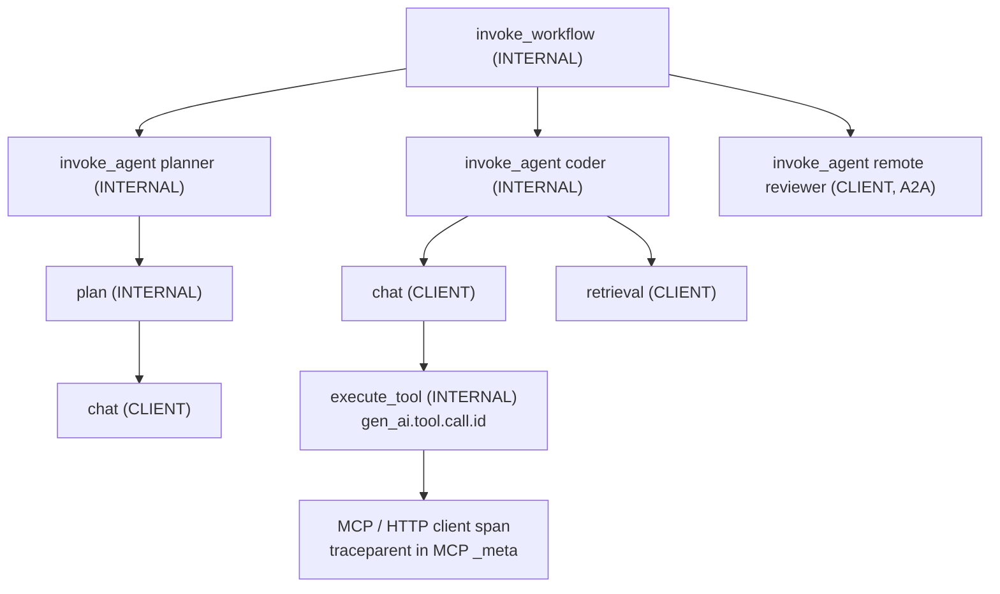
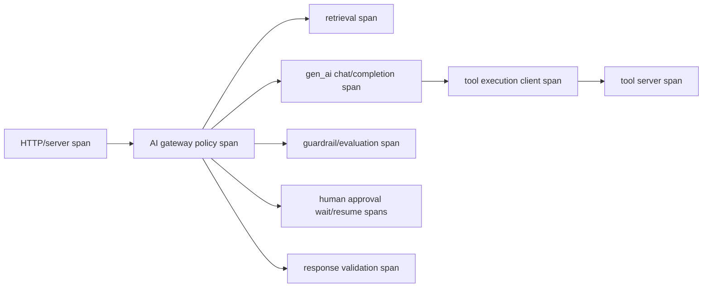

# OpenTelemetry LLM Tracing

> **Version:** 1.2.0
> **Last updated:** 2026-11-06
> **Status:** Informative AIES implementation profile

## Purpose
Create vendor-neutral end-to-end traces across gateway, retrieval, model, tools, and approvals.

## Why
Without causal traces, quality, cost, and incidents cannot be reconstructed.

## When
Use on every production request, with privacy-safe sampling.

## How
1. Propagate W3C trace context.
2. Instrument gateway, retrieval, model, tool, guardrail, and human-approval spans.
3. Use OpenTelemetry GenAI semantic conventions where stable; namespace experimental attributes.
4. Record artifact IDs and hashes, not sensitive prompt bodies by default.
5. Export to approved backends and test trace continuity.

## Version-pinning policy
The OpenTelemetry GenAI semantic conventions are still **Development** status: every stability marker says so. In 2026 they moved from the core semantic-conventions repository to the dedicated `open-telemetry/semantic-conventions-genai` repository. As of 2026-11-06 that repository publishes **no releases and no schema URL**, so the only reproducible pin is a commit SHA. Non-GenAI conventions (HTTP, RPC, database, messaging) come from the core repository, which does publish releases and schema URLs.

Pin both. Never track `main` or `latest`.

```yaml
telemetry_contract:
  contract_version: aies-genai-trace/3
  otel_genai_semconv_ref: e6658f14c9d9ea0760825f029cb82e7673f48fab   # semantic-conventions-genai main, 2026-11-06
  otel_genai_schema_url: none                                       # not published; do not invent one
  otel_core_semconv_version: "1.45.0"                               # HTTP, RPC, DB, messaging
  otel_core_schema_url: https://opentelemetry.io/schemas/1.45.0
  validation_tool: weaver v0.28.0                                   # the version the conventions repo itself uses
  instrumentation_scope: "com.example.ai-gateway"
  instrumentation_version: "3.4.1"
  content_capture: disabled
  trace_context: "W3C traceparent + tracestate"
  baggage_allowlist: ["tenant.region", "risk.tier"]
  custom_attribute_prefix: "aies."
```

The values above are the AIES reference pin as of 2026-11-06; teams record their own pin in their telemetry contract. When the GenAI repository publishes its first release, move the pin to that tag and add its schema URL.

An upgrade requires:

- a fixture trace produced by both the old and new instrumentation;
- collector transformation tests;
- a backend query compatibility check;
- a dashboard and alert review;
- redaction tests;
- a migration window in which both schema versions can be queried.

Record custom fields under an organization namespace, and never create fields beginning `gen_ai.*`.

**Prefix migration:** contract versions 1–2 used the `oaies.` prefix. Contract version 3 uses `aies.`. During migration, have the collector's transform processor copy each `oaies.*` attribute to its `aies.*` name for one retention period, then drop the old names.

## Agent span taxonomy (pinned ref)
Agent systems produce more than model calls. Use the operation names from the pinned conventions, so any backend can reconstruct the agent's structure:

| `gen_ai.operation.name` | Span kind | Emit when |
|---|---|---|
| `invoke_agent` | `CLIENT` for a remote agent (A2A, managed agent API); `INTERNAL` for an in-process agent | One agent run, from task in to result out. It is the parent of everything below. |
| `create_agent` | `CLIENT` | Provisioning a remote agent (managed agent runtimes) |
| `invoke_workflow` | `INTERNAL` | A multi-step orchestration (a durable workflow or graph run) that invokes agents |
| `plan` | `INTERNAL` | An explicit planning step whose output drives later steps |
| `chat` / `generate_content` / `text_completion` | `CLIENT` | Each model request, including retries as separate child spans |
| `execute_tool` | `INTERNAL` | Each tool execution; parent of the downstream HTTP, RPC, or MCP client span |
| `retrieval` | `CLIENT` | Each retrieval or search call |
| `embeddings` | `CLIENT` | Each embedding request |



Attribute rules for agent spans:

- Set `gen_ai.tool.call.id` on `execute_tool` whenever the provider returns a tool-call ID. It joins the model's proposed call to the executed call.
- Set `gen_ai.agent.id`, `gen_ai.agent.name`, and `gen_ai.agent.version` on `invoke_agent`. Set `gen_ai.conversation.id` on every span of a session. These are **span attributes, never metric labels**.
- Record token usage with the split counters: `gen_ai.usage.input_tokens`, `gen_ai.usage.output_tokens`, `gen_ai.usage.cache_read.input_tokens`, `gen_ai.usage.cache_write.input_tokens`, and `gen_ai.usage.reasoning.output_tokens`. A blended input count hides a broken prompt cache ([prompt caching](../cost-optimization/prompt-caching.md)), and thinking tokens are billed as output.
- **MCP:** spec `2026-07-28` carries trace context in request `_meta`. Propagate `traceparent` through it, so the MCP server's spans join the agent's trace. The pinned repository's `mcp.md` defines the MCP span conventions.
- **A2A:** propagate W3C trace context on agent-to-agent calls and use a `CLIENT` `invoke_agent` span on the caller side.
- **Coding-agent hooks:** attach the runtime's correlation IDs (Claude Code `session_id`, Devin `prompt_id`, Copilot `agentId`/`parentAgentId`) as `aies.agent.session_id`. In cloud agents, ship hook events over HTTP, because their filesystem is discarded when the job ends.
- **Durable workflows:** use the workflow ID as `aies.workflow.id` and link resumed executions to the original trace with span links. A resume hours later is a new trace, not a child of a closed span ([durable execution](../../05-multi-agent-systems/standards/durable-execution.md)).

## Span topology


- Keep the inbound server span as trace root; do not create a second root at the model call.
- Represent retries as separate child model spans with `aies.retry.attempt`; retain one logical request ID.
- Link asynchronous evaluation, human approval, and incident-analysis traces using OpenTelemetry links. Do not falsify parent/child timing across queues.
- Use producer/consumer messaging spans around durable queues and propagate W3C trace context in signed metadata.
- A tool call has both the model’s proposed tool-call record and the actual downstream client/server spans. Record proposed, policy-approved, attempted, and completed states separately.

## Required attribute contract
Use the exact names and requirements from the pinned OpenTelemetry release. The table identifies the minimum intent; the conformance test resolves version-specific spelling and stability.

| Span | Required attributes | AIES extension | Prohibited by default |
|---|---|---|---|
| Model operation | `gen_ai.operation.name`, `gen_ai.provider.name`, requested model, response model/ID when returned, input/output token usage, `error.type` | `aies.prompt.release`, `aies.policy.release`, `aies.route.id`, `aies.risk.tier`, `aies.data.class` | Raw input/output messages, API keys, full retrieved documents |
| Retrieval | database/search system attributes appropriate to client library, result count, duration | `aies.retrieval.index_release`, `aies.retrieval.query_hash`, `aies.retrieval.document_set_hash` | Query text containing personal data; document bodies |
| Tool | pinned `gen_ai.tool.*` attributes where specified plus normal RPC/HTTP/database conventions | `aies.tool.policy_decision`, `aies.tool.side_effect`, `aies.tool.approval_id` | Tool arguments/results unless field-level policy explicitly permits |
| Guardrail/evaluation | operation name, status, duration | `aies.control.id`, `aies.control.release`, `aies.decision`, `aies.reason.code` | Free-form hidden reasoning |
| Human approval | workflow and messaging identifiers | `aies.approval.id`, `aies.approval.outcome`, `aies.approver.role` | Approver personal details beyond approved pseudonymous identity |

Every low-cardinality attribute has an owner and allowed-value registry. Never use user ID, session ID, prompt digest, trace ID, document ID, or error message as a metric label.

## Content-capture policy
1. Default to no prompt, completion, retrieved document, tool argument, or tool result content in telemetry.
2. Capture immutable artifact digests and bounded reason codes instead.
3. If content is essential for an approved evaluation sample, send it through a separate data path with purpose, lawful basis, sampling probability, field-level redaction, access, region, retention, deletion, and legal-hold controls.
4. Mark capture on the trace with a boolean and policy version, not the content itself.
5. Test canary secrets, personal-data patterns, indirect prompt injection, binary attachments, and structured tool payloads against redaction. Regex-only redaction is insufficient.

## Sampling and tail decisions
- Head-sample routine low-risk traffic using a documented probability.
- Tail-sample all errors, policy denials, severe evaluator outcomes, tool side effects, human overrides, novel releases, and provider/model changes.
- Preserve the sampling probability and policy version so rate estimation can be weighted.
- Bound tail-sampler memory and decision latency. If the tail sampler is unavailable, degrade to a privacy-safe head policy rather than exporting everything.
- Security audit logging and distributed tracing are separate controls: traces may be sampled; required action/audit records must not disappear with sampling.

## Collector pipeline
```yaml
receivers:
  otlp:
    protocols: {grpc: {}, http: {}}
processors:
  memory_limiter: {}
  transform/redact:
    error_mode: propagate
  attributes/allowlist: {}
  tail_sampling: {}
  batch: {}
exporters:
  otlp/approved_region: {}
service:
  pipelines:
    traces:
      receivers: [otlp]
      processors: [memory_limiter, transform/redact, attributes/allowlist, tail_sampling, batch]
      exporters: [otlp/approved_region]
```

Pin the collector image digest and configuration digest. Run a denylist scan after the allowlist, and fail deployment when a fixture secret reaches the exporter. Keep bounded encrypted disk buffering only where the threat model and regional policy permit it.

## Conformance tests
| Test | Pass condition |
|---|---|
| Trace continuity | Server → gateway → model → tool trace IDs and async links reconstruct one request |
| Schema | Every required stable attribute has correct type; experimental attributes match pinned version |
| Cardinality | Attribute cardinality budget holds under randomized users, prompts, and errors |
| Redaction | Canary secrets and personal data never reach exporter payloads |
| Failure | Timeout, rate limit, malformed output, tool denial, cancellation, and fallback set bounded reason/error codes |
| Sampling | Declared inclusion probability matches observed routine sampling; all declared tail triggers retained |
| Region/access | Collector and backend endpoints, roles, and retention match data classification |
| Load | Instrumentation overhead remains within the service latency and CPU budget |

## Evidence contract
The decision record is the **telemetry contract and conformance capture**. It records OTel semconv version; span names; attribute allowlist; redaction tests; sampling; trace continuity; backend region. The observability platform owner owns completeness; the evidence is invalid when collector or semantic-convention upgrades alter field meaning. Persist schema, instrumentation, collector, query, dashboard, and alert revisions so operational conclusions remain reproducible.

## Failure response and recovery
**Trigger:** trace continuity, redaction, or export durability SLO fails.

**Immediate response:** disable unsafe attributes, spool locally within quota, and restore the pinned collector pipeline. Preserve the telemetry contract and conformance capture, affected trace IDs, timestamps, and decision logs before mutation. Open an incident when users, data, money, authorization, or a release decision may have been affected; closure requires a regression case and verified control change specific to opentelemetry llm tracing.

### Telemetry incident runbook
1. Classify the event as confidentiality leakage, integrity/schema corruption, availability loss, cardinality exhaustion, or regional-routing failure.
2. For leakage, stop the exporter or offending processor, revoke backend access as needed, preserve minimal hashes/configuration, and invoke privacy/security breach assessment.
3. For integrity failure, annotate the invalid time range and stop release or SLO automation that depends on affected fields.
4. For availability loss, use bounded local buffering or privacy-safe dropping according to risk; consequential actions continue only if their separate audit log is healthy.
5. Restore the last pinned collector image/configuration and replay only data authorized for replay.
6. Verify fixture traces, dashboards, alerts, and deletion; add the failure to collector conformance CI.

## Decision authority
The **observability platform owner** accepts the operational decision. The **privacy and security telemetry reviewer** provides independent challenge for high-risk scope, failed gates, or exceptions. Telemetry can trigger declared alerts or rollback; service and incident owners judge impact, restoration, and invalid measurement windows.

## Tradeoffs
| Choice | Benefit | Cost |
|---|---|---|
| Rich traces | Fast diagnosis | Privacy and storage cost |
| Minimal traces | Lower exposure | Poor causality |

## Anti-patterns
- Logging raw prompts by default.
- Treating experimental semantic conventions as stable.
- Pinning to "latest" or to the semantic-conventions-genai `main` branch. Attribute renames land without a release, and dashboards break silently.
- Emitting every agent step as a generic `chat` span. Without `invoke_agent`, `plan`, and `execute_tool`, a trace shows what the model was asked but not which agent asked it or which tool ran.
- Dropping trace context at the MCP boundary. The tool server's spans become orphans, and tool latency can't be attributed to agent turns.

## Enterprise considerations
- Apply regional collectors and least privilege.
- Document sampling bias.

## Framework relationship
**OpenTelemetry LLM Tracing** defines informative diagnosability evidence. Sampling and mutable operational telemetry do not replace required action or records-management logs.

| Source | Relationship for OpenTelemetry LLM Tracing | Boundary |
|---|---|---|
| NIST AI RMF | MEASURE 2.8; MANAGE 4.1 | Evaluate monitoring coverage against known failure modes and sampling limitations. |
| ISO/IEC 42001 | 42001 clauses 8.1 and 9.1 | Performance-evaluation evidence remains subject to data quality, access, retention, and internal-audit scope. |
| Domain threat/control source | Sensitive Information Disclosure in telemetry | Test only the threats applicable to the documented system and release |

## Checklist
- [ ] OpenTelemetry semantic-convention and collector versions are pinned: the GenAI conventions by commit SHA, the core conventions by release.
- [ ] Agent runs emit `invoke_agent` spans with the correct span kind; tools emit `execute_tool` with `gen_ai.tool.call.id`.
- [ ] Token usage is recorded with separate cache read, cache write, and reasoning counters.
- [ ] Trace context propagates through MCP `_meta` and A2A calls.
- [ ] Span topology covers retrieval, model retries, tools, guardrails, approvals, and async links.
- [ ] Stable and Development attributes are distinguished in the telemetry contract.
- [ ] Content capture is off by default and uses a separate governed path when enabled.
- [ ] Attribute types, allowed values, and metric-cardinality budgets pass CI.
- [ ] Tail-sampling triggers and inclusion probabilities are tested.
- [ ] Audit records remain complete when traces are sampled or unavailable.
- [ ] Leakage, integrity, availability, and regional-failure runbooks are exercised.

## References
- OpenTelemetry, [dedicated GenAI semantic conventions repository](https://github.com/open-telemetry/semantic-conventions-genai) (accessed 2026-11-06); reference pin [`e6658f14`](https://github.com/open-telemetry/semantic-conventions-genai/tree/e6658f14c9d9ea0760825f029cb82e7673f48fab). No releases or schema URL were published as of that date.
- OpenTelemetry, [GenAI agent spans at the pinned commit](https://github.com/open-telemetry/semantic-conventions-genai/blob/e6658f14c9d9ea0760825f029cb82e7673f48fab/docs/gen-ai/gen-ai-agent-spans.md) and [GenAI attribute registry](https://github.com/open-telemetry/semantic-conventions-genai/blob/e6658f14c9d9ea0760825f029cb82e7673f48fab/docs/registry/attributes/gen-ai.md) (accessed 2026-11-06).
- OpenTelemetry, [semantic conventions v1.45.0](https://github.com/open-telemetry/semantic-conventions/releases/tag/v1.45.0) (accessed 2026-11-06).
- OpenTelemetry, [semantic conventions v1.42.0 migration note](https://github.com/open-telemetry/semantic-conventions/releases/tag/v1.42.0) (accessed 2026-07-16).
- OpenTelemetry, [former Generative AI semantic-conventions location](https://opentelemetry.io/docs/specs/semconv/gen-ai/) (accessed 2026-07-16); retained only as a migration pointer.
- W3C, [Trace Context Level 2](https://www.w3.org/TR/trace-context-2/) (accessed 2026-07-16).
- OpenTelemetry, [Collector configuration](https://opentelemetry.io/docs/collector/configuration/) (accessed 2026-07-16).
- OpenTelemetry, [Trace semantic conventions](https://opentelemetry.io/docs/specs/semconv/general/trace/) (accessed 2026-07-16).

## Changelog
| Version | Date | Change |
|---|---|---|
| 1.2.0 | 2026-11-06 | Pinned the GenAI conventions by commit (`e6658f14`) and the core conventions at v1.45.0. Added the agent span taxonomy, split token-usage counters, and MCP/A2A/hook/workflow correlation. Contract version 3 renames the custom prefix from `oaies.` to `aies.`. |
| 1.1.0 | 2026-07-16 | Added pinned semantic-convention contract, trace topology, attribute/content policy, collector configuration, tail sampling, conformance tests, and telemetry incident runbook. |
| 1.0.0 | 2026-07-16 | Initial complete profile. |
