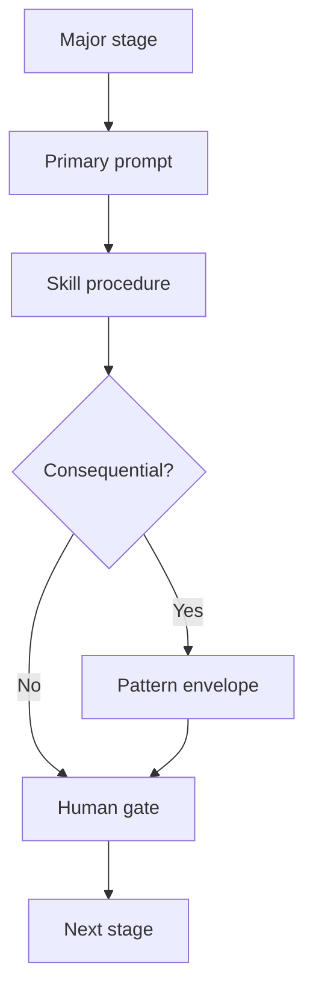

# AI SDLC — Stage tooling map

**Version:** 1.0.0  
**Date:** 2026-07-29  
**Status:** Working standard — operator map

---

## Purpose

For each **major** delivery stage, name the AIES tools to run and **how AI is leveraged** — so teams stop guessing between a prompt, a skill, a pattern, and a chat.

## Why

Prompts without a stage produce theater. Stages without tools produce “we use AI.” This page is the binding: stage → artifact → human gate.

## How to use

1. Identify the current stage (left column).  
2. Open the **primary prompt**.  
3. Activate the **skill** when the Why column matches.  
4. Escalate to a **pattern** when the change is consequential (multi-file, AuthZ, cutover, SEV).  
5. Keep MCP empty until [MCP when and how](../handbook/mcp-when-and-how.md) allowlists it.

---

## Major stages → tools

| Stage | How AI is leveraged | Primary prompt | Skill(s) | Pattern (when consequential) | Human gate |
|-------|---------------------|----------------|----------|------------------------------|------------|
| Idea / research | Structure options; surface risks — does **not** decide product | (workflow Idea) + story draft | [Planning](../03-skill-engineering/skills/planning.skill.md) | — | Product owner locks problem |
| Requirements / DoR | Turn intent into testable AC | [Story kickoff](./prompts/story-kickoff.prompt.md) | [Context](../03-skill-engineering/skills/context.skill.md) | [Context](../patterns/context-pattern/README.md) | [Definition of Ready](./quality-standards/definition-of-ready.md) |
| Context pack | Curate trusted evidence for agents | Kickoff context list | Context · [Security](../03-skill-engineering/skills/security.skill.md) | Context | Trust labels reviewed |
| Planning | Decision-complete execution contract | [Implementation plan](./prompts/implementation-plan.prompt.md) | Planning · [Architecture](../03-skill-engineering/skills/architecture.skill.md) | [Planner](../patterns/planner-pattern/README.md) | Named plan approval |
| Architecture | Scenario-governed topology / ADR | [Architecture review](./prompts/architecture-review.prompt.md) | Architecture · Security | [Architecture](../patterns/architecture-pattern/README.md) | ADR + rejected alternatives |
| Coding | Implement **only** against approved plan | [Coding](./prompts/coding.prompt.md) | Stack cookbook skill | Planner → Coder handoff | Diff stays inside planned paths |
| Self / agent review | Severity-calibrated findings | Coding self-review + [Reviewer pattern](../patterns/reviewer-pattern/README.md) | [Code review](../03-skill-engineering/skills/code-review.skill.md) | Reviewer | Human owns merge |
| Testing | Generate failing-first coverage | [Test generation](./prompts/test-generation.prompt.md) | [Testing](../03-skill-engineering/skills/testing.skill.md) | — | Tests gate merge |
| Security | Threat pass on AI-touched paths | [Security review](./prompts/security-review.prompt.md) | Security | Reviewer / Enterprise | Block on Critical/High |
| Performance | Profile-guided changes | [Performance review](./prompts/performance-review.prompt.md) | [Performance](../03-skill-engineering/skills/performance.skill.md) | [Optimization](../patterns/optimization-pattern/README.md) | Baseline before change |
| Docs | Capture decisions humans will need | [Documentation](./prompts/documentation.prompt.md) | [Documentation](../03-skill-engineering/skills/documentation.skill.md) | — | Docs in DoD |
| Release | Progressive expose + abort | [Release](./prompts/release.prompt.md) | [DevOps](../03-skill-engineering/skills/devops.skill.md) · [Evaluation](../03-skill-engineering/skills/evaluation.skill.md) | [Release](../patterns/release-pattern/README.md) | Abort owner named; eval gate |
| Incident / hotfix | Contain first; smallest reversible change | [Incident](./prompts/incident.prompt.md) | Debug · DevOps · Security | [Hotfix](../patterns/hotfix-pattern/README.md) | IC named |
| RCA / learn | Evidence-bound cause + follow-ups | [Root cause analysis](./prompts/root-cause-analysis.prompt.md) · [Knowledge capture](./prompts/knowledge-capture.prompt.md) | Debug · Documentation | [Root Cause](../patterns/root-cause-pattern/README.md) | Follow-up owners |
| Migration / legacy | Phased cutover or strangler | [Migration](./prompts/migration.prompt.md) | Planning · Testing · DevOps | [Migration](../patterns/migration-pattern/README.md) · [Legacy](../patterns/legacy-modernization-pattern/README.md) | Rollback owner per phase |
| Enhance harness | Fit kit to **this** repo | [Enhance repo](./prompts/enhance-repo.prompt.md) · create-prompt/skill/agent | — | — | PR review of harness diffs |

---

## How AI is leveraged (rules of engagement)

| Leverage | Allowed | Forbidden |
|----------|---------|-----------|
| Draft | Plans, tests, docs, review findings | Silent merges |
| Accelerate | Boilerplate inside an approved plan | Inventing AuthZ or schema |
| Detect | Diff review, eval failures, incident signals | Sole production authority |
| Propose | ADRs with rejected alternatives | Architecture-by-chat with no gate |

---

## Agent roles (when to escalate beyond a prompt)

| Need | Agent | Notes |
|------|-------|-------|
| Multi-file plan | [Planner pattern agent](../patterns/planner-pattern/agent.md) | No application code |
| Implement plan | [Coder](../04-agent-engineering/agents/coder.agent.md) | Path-bounded |
| Review PR | [Reviewer pattern](../patterns/reviewer-pattern/agent.md) | Human merges |
| Org / tenant AI | [Security](../04-agent-engineering/agents/security.agent.md) · Enterprise pattern | SoA first |
| SEV | [Incident response](../04-agent-engineering/agents/incident-response.agent.md) | IC required |

---

## Tradeoffs

A stage map slows “just ask the chat.” It prevents silent scope expansion and unverifiable AI output. Teams that skip the map recreate private dialects and lose auditability.

## Anti-patterns

- Jumping to Coding before Story kickoff + plan approval  
- Using MCP write tools as a substitute for Release / Hotfix patterns  
- Treating evals as optional for user-visible model behavior  
- Claiming AI SDLC compliance because prompts exist in a wiki  

## Enterprise considerations

- Stages 9 (plan), Security, and Release retain **named** human sign-off in regulated contexts.  
- Evidence artifacts (plan, review, eval report) feed SoA / portal — prompts alone are not evidence.  
- Data class constrains which MCP servers may enable at each stage.

## Checklist

- [ ] Current stage identified  
- [ ] Primary prompt opened from this table  
- [ ] Skill activated with a concrete artifact  
- [ ] Pattern used if change is consequential  
- [ ] Human gate named before irreversible effects  
- [ ] MCP still empty or allowlisted  

## Related

- [AI SDLC overview](./README.md)  
- [How to browse](../handbook/how-to-browse.md)  
- [Workflows](/workflows)  
- [Evals as quality gates](../handbook/evals-as-quality-gates.md)

## Changelog

- **1.0.0 (2026-07-29):** Initial stage → tooling map with leverage rules.
