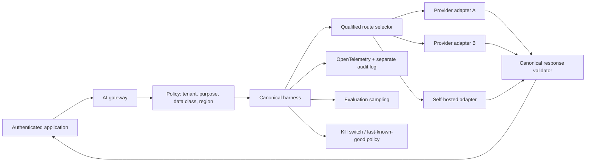

# Provider-Neutral AI Harness

> **Version:** 1.1.0
> **Last updated:** 2026-07-16
> **Status:** Informative OAIES implementation profile

## Purpose
Decouple applications from provider SDKs while preserving provider-specific safety and capability controls.

## Why
A stable contract enables failover and requalification; a lowest-common-denominator wrapper hides critical differences.

## When
Use for enterprise applications calling external or self-hosted models.

## How
1. Define canonical request, response, error, usage, tool, and policy contracts.
2. Implement adapters that expose declared capability differences.
3. Centralize identity, data policy, redaction, tracing, budgets, and evaluation hooks.
4. Qualify every provider/route independently.
5. Test exit, export, failover, and rollback at least annually.

## Reference data flow


Restricted payload stays in the approved regional path. Policy receives authenticated attributes from trusted identity and data-classification services, not model-generated text. Adapters receive short-lived provider credentials from workload identity; credentials never enter canonical messages or traces.

## Canonical contract
```typescript
type CanonicalRequest = {
  requestId: string;
  tenantId: string;
  actor: { subject: string; purpose: string };
  task: { type: string; riskTier: "low" | "medium" | "high" };
  data: { classification: string; allowedRegions: string[] };
  messagesRef: string;
  promptRelease: string;
  toolPolicyRelease?: string;
  limits: { inputTokens: number; outputTokens: number; totalCostUsd: number };
};

type AdapterCapabilities = {
  immutableModelIds: boolean;
  regions: string[];
  toolCalling: "none" | "native" | "emulated";
  structuredOutput: "none" | "best_effort" | "constrained";
  zeroDataRetentionContract: boolean;
  contentCaptureConfigurable: boolean;
};

type CanonicalResult =
  | { status: "ok"; outputRef: string; providerResponseId: string; usage: Usage }
  | { status: "blocked"; reasonCode: string }
  | { status: "retryable"; reasonCode: string; retryAfterMs?: number }
  | { status: "failed"; reasonCode: string };
```

Provider-specific fields remain in a namespaced extension with schema/version and are never required by application business logic. If a capability cannot be represented safely, policy marks the route ineligible rather than emulating it invisibly.

## Adapter conformance
Each adapter passes:
- request/response/error fixtures and unknown-field handling;
- timeout, cancellation, retry-after, streaming interruption, and duplicate-response behavior;
- tool-call ID, argument schema, finish reason, safety block, and malformed structured-output mapping;
- usage and cost reconciliation against provider invoices;
- data-region, retention, training-use, and content-filter configuration tests;
- OpenTelemetry attribute mapping and redaction;
- failover equivalence on the route’s locked golden set.

Failover is policy selection, not catch-all retry. It is prohibited when the fallback lacks data authority, capability, qualification freshness, or equivalent tool/security behavior.

## Operational verification
| Frequency | Verification |
|---|---|
| Every adapter change | Contract fixtures, golden set, adversarial tests, telemetry schema, cost reconciliation |
| Daily | Provider model/alias resolution, region, authentication, quota, sentinel quality |
| Quarterly | Credential rotation, deletion/retention evidence, failover game day |
| Annual or material change | Provider due diligence, terms, capability, concentration and exit requalification |

## Evidence contract
The decision record is the **harness contract and adapter conformance suite**. It records canonical request/response/error; capability declaration; policy hooks; provider fields; test vectors; failover result. The AI platform architect owns completeness; the evidence is invalid when provider adapter behavior escapes the canonical contract. Architecture evidence binds diagrams and contracts to deployed adapters, policies, identities, data routes, resilience tests, and exit drills.

## Failure response and recovery
**Trigger:** contract, policy, or data-boundary test fails.

**Immediate response:** remove the adapter from routing and restore the previous adapter release. Preserve the harness contract and adapter conformance suite, affected trace IDs, timestamps, and decision logs before mutation. Open an incident when users, data, money, authorization, or a release decision may have been affected; closure requires a regression case and verified control change specific to provider-neutral ai harness.

## Decision authority
The **AI platform architect** accepts the operational decision. The **provider risk owner** provides independent challenge for high-risk scope, failed gates, or exceptions. Runtime policy may select only approved paths; architecture, service, data, and risk owners approve topology and failover boundaries.

## Tradeoffs
| Choice | Benefit | Cost |
|---|---|---|
| Neutral harness | Portability and control | Adapter maintenance |

## Anti-patterns
- Leaking provider objects into application code.
- Failing over without data-boundary checks.

## Enterprise considerations
- Contract for data use, retention, incident notice, and exit.
- Maintain an approved-provider register.

## Framework relationship
**Provider-Neutral AI Harness** is an informative architecture pattern. Teams may use an equivalent design that satisfies the same boundaries, and no portability or provider-neutrality certification is implied.

| Source | Relationship for Provider-Neutral AI Harness | Boundary |
|---|---|---|
| NIST AI RMF | MANAGE 2.3 and 3.2 | Use NIST risk outcomes to evaluate the actual data and control plane. |
| ISO/IEC 42001 | 42001 clause 8.1 | ISO-related evidence is informative unless incorporated into the organization’s formally scoped system. |
| Domain threat/control source | Supply-chain and sensitive-data boundaries | Test only the threats applicable to the documented system and release |

## Checklist
- [ ] Adapters pass contract tests.
- [ ] Failover respects policy.
- [ ] Exit tested.

## References
- NIST, [AI RMF 1.0](https://doi.org/10.6028/NIST.AI.100-1), MANAGE 2–4 (accessed 2026-07-16).
- ISO, [ISO/IEC 23894:2023](https://www.iso.org/standard/77304.html) (accessed 2026-07-16). This is a design input, not a certification claim.

## Changelog
| Version | Date | Change |
|---|---|---|
| 1.1.0 | 2026-07-16 | Replaced generic assurance text with the harness contract and adapter conformance suite, failure trigger, accountable decision, and scoped framework relationships for provider-neutral ai harness. |
| 1.0.0 | 2026-07-16 | Initial complete profile. |
