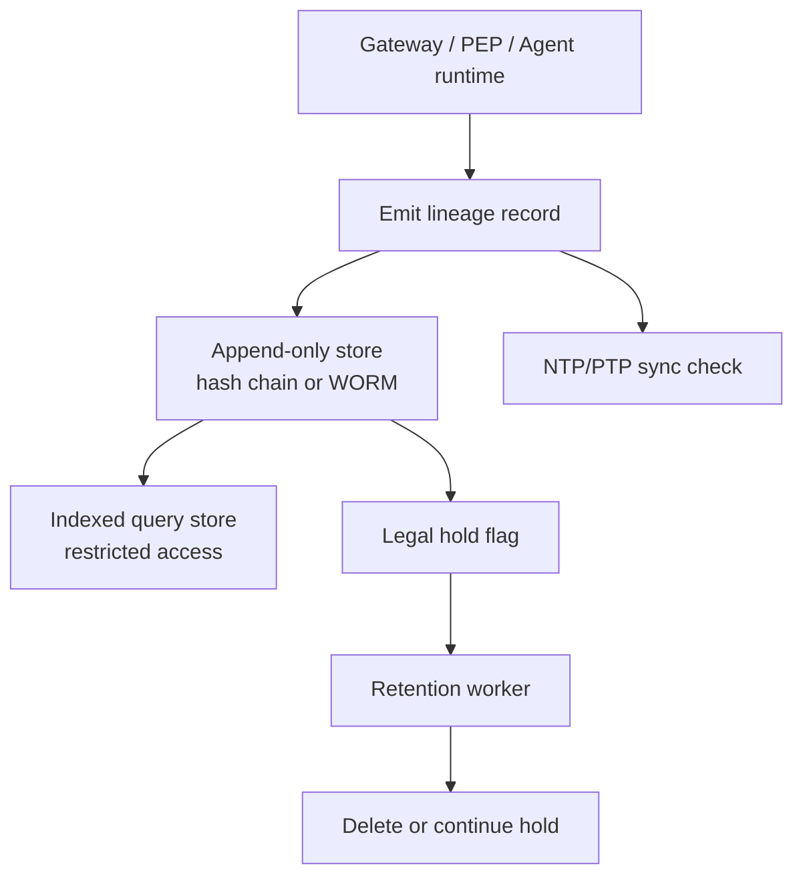

# Enterprise AI Audit Logging

> **Version:** 2.0.0 | **Last updated:** 2026-07-16

## Purpose

Record tamper-evident lineage for AI requests, tool side effects, approvals, and admin changes — with minimization so logs do not become a second copy of every secret.

## Why

When something goes wrong you must reconstruct: who requested, which artifact versions ran, what policy allowed it, what tools executed, and what the outcome was. Application logs that operators can edit are not an audit trail. Dumping raw prompts by default creates a privacy and security incident factory.

---

## How — What to Log

### Event classes

| Class | Examples | Required fields |
|-------|----------|-----------------|
| **Invocation** | Chat/completions, agent step | trace, tenant, actor, model, prompt digest, policy version, tokens, cost, latency, outcome |
| **Retrieval** | Hybrid RAG query | corpus IDs, filter digest, hit IDs (not full chunk text by default), ACL decision ID |
| **Tool** | Deploy, PR, email, DB | tool ID, args digest / redacted args, idempotency key, receipt ID, effect |
| **Authorization** | Allow/deny | decision ID, policy version, obligations |
| **Approval** | Dual control, step-up | approver, scope, expiry |
| **Admin** | Prompt publish, key rotate, budget override | actor, before/after digests |
| **Termination** | Cancel, budget kill, expire | reason, descendants revoked |

```typescript
interface AiActionLineageRecord {
  schema: "oaies.audit.v2";
  event_id: string;
  prev_hash?: string;             // hash chain when using append-only log
  recorded_at: string;            // RFC3339; from synchronized clock

  trace_id: string;
  request_id: string;
  session_id?: string;
  task_id?: string;
  tenant_id: string;

  actor: {
    type: "user" | "agent" | "service";
    principal: string;            // IdP sub or SPIFFE
  };

  artifact_digests: {
    prompt?: string;
    policy?: string;
    workflow?: string;
    memory_snapshot?: string;
  };

  provider?: string;
  model?: string;
  model_version?: string;

  tool?: {
    id: string;
    idempotency_key: string;
    args_digest: string;
    receipt_id?: string;
  };

  authz_decision_id?: string;
  approval_id?: string;

  proposed_action?: string;
  approved_action?: string;
  executed_action?: string;

  outcome: "success" | "denied" | "error" | "cancelled" | "timeout";
  latency_ms?: number;
  tokens_in?: number;
  tokens_out?: number;
  cost_usd?: number;

  retention_class: string;
  content_ref?: string;           // pointer to encrypted payload if policy allows
}
```

### Minimization rules

| Data | Default | When full content is allowed |
|------|---------|------------------------------|
| Prompts / completions | Hash + length + redaction markers | Explicit policy + access control + short retention |
| Tool args | Schema + digests; redact secrets | Break-glass investigation |
| Retrieved chunks | Source IDs + digests | Security IR with dual control |
| PII | Tokenize / hash | Legal hold export under counsel |

Never log API keys, session cookies, or raw credentials — even on error paths.

---

## How — Integrity and Storage



| Control | Requirement |
|---------|-------------|
| Append-only / WORM | Operators cannot alter their own trail |
| Hash chain or signed batches | Tamper detection |
| Clock sync | Alert on skew that would break ordering/`exp` correlation |
| Segregation | Prod audit store ≠ app primary DB writable by app admins |
| Access | Read roles split: ops metrics vs full forensic export |
| Encryption | At rest; tenant-aware where required |

```typescript
function chainHash(prev: string | null, body: object): string {
  const canonical = jcs(body);
  return sha256(`${prev ?? "genesis"}:${canonical}`);
}
```

---

## How — Correlation and Export

- Every user-visible error and incident ticket carries `trace_id`.  
- Evaluations and canary failures link to the same IDs.  
- Export packages include: records, trust roots / signing keys metadata, schema versions, and time range.  
- Deletion and legal hold tested together — hold wins.

---

## Failure Response

| Trigger | Response |
|---------|----------|
| Audit write failures exceed tolerance | **Fail closed** for consequential actions; buffer non-consequential only if pre-approved and bounded |
| Tamper / chain break signal | Freeze writes forensically; escalate IR; do not “repair” by rewriting history |
| Clock skew | Page on-call; mark new decisions untrusted until corrected |

Preserve lineage records before any remediation mutation. Closure needs a regression test (e.g. forced audit outage → consequential deny).

---

## Tradeoffs

| Choice | Benefit | Cost |
|--------|---------|------|
| Full prompt capture | Rich forensics | Privacy, cost, insider risk |
| Digests-only | Safer default | Harder UX debugging |
| Sync WORM cloud store | Strong integrity | Latency, vendor dependency |

---

## Anti-patterns

| Anti-pattern | Why it fails |
|--------------|--------------|
| Logging raw prompts by default | Creates regulated/secret corpus |
| App admins can UPDATE audit rows | Non-repudiation theater |
| No `trace_id` across gateway → tools | Cannot reconstruct |
| Infinite retention “just in case” | Violates minimization and records policy |
| Treating metrics dashboards as audit | Not evidentiary |

---

## Enterprise Considerations

- Retention is **requirement-specific** (security, privacy, contract) — not a universal duration in this standard.  
- Records + service owners jointly own completeness; internal audit challenges high-risk gaps.  
- Align export/deletion with counsel; restrict privileged log access and monitor it.  
- Reconcile cost fields with FinOps ledgers where chargeback matters.

---

## Checklist

- [ ] Every consequential action reconstructable from lineage + receipts.  
- [ ] Digests default; raw content only under explicit policy.  
- [ ] Append-only / tamper-evident storage; admins cannot rewrite.  
- [ ] Clock skew monitored.  
- [ ] `trace_id` end-to-end across invoke, retrieve, tool, approve.  
- [ ] Legal hold, export, and deletion tested.  
- [ ] Audit-outage fail-closed tested for high-impact tools.  
- [ ] Access to forensic exports dual-controlled and audited.

## Changelog

- **2.0.0 — 2026-07-16:** Operational rewrite — event classes, lineage schema, minimization, integrity Mermaid, failure modes.  
- **1.1.0 — 2026-07-16:** Evidence-contract stub.  
- **1.0.0 — 2026-07-16:** Initial profile.
