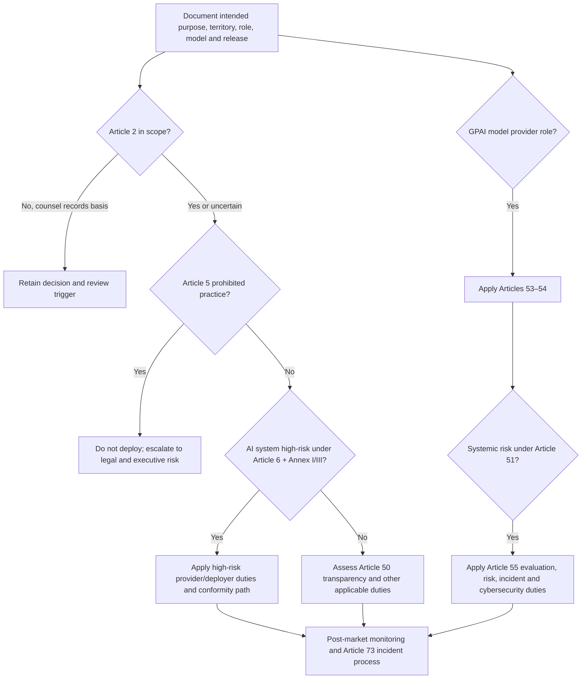

# EU AI Act Engineering Control Map

> **Version:** 1.2.0
> **Last updated:** 2026-11-06
> **Status:** Informative AIES implementation profile

## Purpose
Translate Regulation (EU) 2024/1689 obligations into engineering evidence without presenting legal advice.

## Why
Applicability depends on role, system, use case, geography, and effective date.

## When
Use at intake, material change, and scheduled regulatory review.

## How
1. Create one applicability record per intended purpose, jurisdiction, value-chain role, and materially distinct model or system release.
2. Have qualified counsel decide scope under Article 2, role definitions under Article 3, prohibited-practice exposure under Article 5, and high-risk classification under Article 6 with Annex I or III.
3. If the organization provides or modifies a general-purpose AI model, assess Chapter V separately; downstream system classification does not replace GPAI-provider analysis.
4. Bind each applicable duty to an engineering owner, immutable evidence, verification cadence, and stop-release condition.
5. Re-open applicability when intended purpose, geography, model, fine-tuning, brand, value-chain contract, or substantial-modification facts change.

## Legal boundary and effective-date caveat
This document is engineering implementation guidance, not legal advice. It does not determine whether a system is prohibited, high-risk, a GPAI model, or compliant. The accountable legal function must use the Official Journal text, applicable delegated or implementing acts, harmonised standards or common specifications, Commission guidance, and national competent-authority requirements current on the decision date.

As of **2026-11-06**, the principal timeline — Article 113 of Regulation (EU) 2024/1689 as amended by the **Digital Omnibus on AI, Regulation (EU) 2026/1744** (Official Journal 24 Jul 2026, in force 27 Jul 2026) — is:

| Date | Engineering planning significance | Caveat |
|---|---|---|
| 2024-08-01 | Regulation entered into force | Entry into force is not the same as full applicability |
| 2025-02-02 | Chapters I and II apply, including Article 4 AI-literacy and Article 5 prohibited practices | Confirm workforce and prohibited-use controls now |
| 2025-08-02 | Article 113(b) provisions apply, including GPAI Chapter V and specified governance, notified-body, confidentiality, and penalty provisions | Transitional rules in Article 111 can alter dates for existing systems/models |
| 2026-08-02 | Article 50 transparency obligations apply; Commission GPAI enforcement powers apply | Chatbot disclosure, machine-readable marking **and** detection of synthetic content, deepfake labels. Marking without a detection means is non-compliant |
| 2026-12-02 | Article 50 compliance deadline for systems already on the market before 2026-08-02; new prohibition on generating non-consensual intimate content and CSAM applies | Legacy chat and generation features need disclosure and marking shipped by this date |
| 2027-08-02 | GPAI models placed on the market before 2025-08-02 must comply | Transitional rule; verify the model's placement date |
| 2027-12-02 | High-risk obligations (Chapter III, Sections 1–3) apply to **Annex III** stand-alone systems | Moved from 2026-08-02 by Regulation (EU) 2026/1744 |
| 2028-08-02 | High-risk obligations apply to **Annex I** systems (Article 6(1), AI in regulated products) | AI-enabled machinery moves to the Machinery Regulation; verify sector scope |

**Harmonised standards.** EN 18286:2026 (quality management system, Article 17) is the first harmonised standard cited in the Official Journal (Implementing Decision (EU) 2026/2274, 14 Oct 2026); conformity with it gives presumption of conformity for Article 17 only. Risk management (prEN 18228), cybersecurity (prEN 18282), logging (prEN 18229-1) and data (prEN 18284) are still drafts — track them, do not cite them as harmonised.

**Article 50 implementation.** The Code of Practice on marking and labelling AI-generated content (finalised 10 Jun 2026) and Commission guidelines C(2026) 5054 (20 Jul 2026) describe acceptable techniques. Engineering evidence: disclosure shown before first interaction, provenance metadata (C2PA manifests) plus a watermark or fingerprint that survives common transformations, a detection API or tool available to the people the Code names, and regression tests that marking survives your own export paths.

**Unverified after the Omnibus.** The Article 73 serious-incident reporting start date for high-risk providers presumably follows the delayed high-risk dates; counsel must confirm. The GDPR "Digital Omnibus" (COM(2025) 837, including a proposed Art. 88bis legitimate-interest basis for AI) is **not law** as of this date.

For GPAI, Commission guidance states: obligations apply from 2025-08-02 for models placed on the market from that date; Commission enforcement powers apply from 2026-08-02; providers of GPAI models placed on the market before 2025-08-02 must comply by 2027-08-02 under the transitional rule. Verify the specific model’s placement date and current guidance.

Do not encode any date in this section as permanent legal logic. Store `applicability_reviewed_at`, `official_journal_version`, `pending_amendments_reviewed`, and `next_review_at`; require counsel to update the decision when a binding amendment or authoritative interpretation changes.

## Operator-role map
One organization can hold several roles for the same value chain. Record each role independently.

| Role | Typical trigger | Primary engineering evidence | Boundary to resolve |
|---|---|---|---|
| Provider | Develops an AI system/model or has it developed and places it on the market or puts it into service under its name or trademark | Intended purpose, QMS, technical file, evaluation, post-market plan, declarations/registration where applicable | White-labelling, fine-tuning, and substantial modification can move a party into provider duties |
| Deployer | Uses an AI system under its authority, other than personal non-professional use | Instructions followed, input-data relevance, human oversight, logs, monitoring, worker/affected-person notices, FRIA decision where applicable | A deployer that substantially modifies or changes intended purpose may become a provider |
| Importer | EU-established party placing a third-country provider’s branded system on the Union market | Provider/conformity verification, representative, documentation availability, storage/transport controls | Contracting through a reseller does not automatically remove importer facts |
| Distributor | Makes an AI system available in the supply chain other than provider/importer | Required markings/document checks, corrective-action and authority-cooperation records | Modification or rebranding may change role |
| Authorised representative | EU-established mandate holder for a non-EU provider | Written mandate, retained documentation, registration and authority-cooperation procedures | Mandate scope must cover the duties actually delegated |
| Product manufacturer | Places a product on market with an AI system under its own name/trademark | Annex I product integration, safety/conformity file, change control | Determine whether the AI is a safety component and which sectoral conformity regime applies |
| GPAI model provider | Develops and places a general-purpose AI model on the Union market, including through an API | Model technical documentation, downstream information, copyright policy, training-content summary | Open-source exemptions are limited; systemic-risk duties and other exceptions require separate analysis |

## Applicability workflow

## High-risk engineering duty map
Counsel must confirm the exact duty and role. The following map tells engineering what evidence to prepare.

| Provision | Subject | Provider implementation evidence | Deployer implementation evidence |
|---|---|---|---|
| Articles 9 and 17 | Risk management and quality management | Lifecycle risk register, acceptance criteria, change control, supplier controls, competence, corrective action | Local-use risk controls, escalation into provider feedback, operating procedures |
| Article 10 | Data and data governance | Dataset provenance, relevance/representativeness analysis, bias/error examination, preprocessing lineage, access and retention | Input-data relevance and fitness for intended purpose under Article 26 |
| Articles 11 and Annex IV | Technical documentation | Versioned technical file linking intended purpose, architecture, data, metrics, testing, cybersecurity, oversight, changes | Retain provider instructions and local configuration/use evidence |
| Article 12 | Record-keeping | Automatic event-log design, clock synchronization, integrity, retention capabilities | Keep logs under deployer control for the applicable period and purpose |
| Article 13 | Transparency/instructions | Capability, limitation, accuracy, foreseeable misuse, input specification, oversight and maintenance instructions | Operator training and evidence that instructions are followed |
| Article 14 | Human oversight | Competence, authority, interface, stop/override, automation-bias mitigation, two-person verification where specified | Named overseers, staffing, escalation, override and non-retaliation procedures |
| Article 15 | Accuracy, robustness, cybersecurity | Declared metrics/slices, fault tolerance, poisoning/injection/adversarial tests, secure update and dependency controls | Monitor local performance and stop use outside declared operating conditions |
| Articles 43, 47–49 | Conformity, declaration, marking, registration | Applicable assessment route, EU declaration, CE marking and database registration evidence | Verify required system/provider status before use |
| Articles 72–73 | Post-market and serious incidents | Monitoring plan, complaint/telemetry intake, trend analysis, authority-notification runbook | Immediate provider/authority escalation path where applicable |

For Annex III high-risk uses, explicitly evaluate Article 6 exclusions and profiling rules with counsel. For public-law deployers or bodies providing public services, assess the Article 27 fundamental-rights impact assessment before first use; coordinate, but do not conflate, it with a GDPR DPIA.

## GPAI provider profile
| Provision | Engineering control | Required artifact |
|---|---|---|
| Article 53(1)(a), Annex XI | Maintain model technical documentation | Architecture/capability description, training and testing process, evaluation results, energy/resource information where required, change history |
| Article 53(1)(b), Annex XII | Give downstream providers sufficient information | Versioned integration pack covering capabilities, limits, input/output modality, acceptable use, evaluation, and system-level risk dependencies |
| Article 53(1)(c) | Copyright-law compliance policy | Approved text-and-data-mining opt-out handling, data acquisition controls, complaint/escalation process |
| Article 53(1)(d) | Public training-content summary | Published summary generated under the applicable AI Office template; legal review of disclosure and trade-secret boundaries |
| Article 54 | EU authorised representative where required | Mandate, contact, retained documentation and authority-cooperation runbook |
| Articles 51 and 55 | Systemic-risk classification and duties | Classification basis, standardized evaluations/adversarial testing, systemic-risk assessment/mitigation, serious-incident reporting, cybersecurity evidence |

Do not use the `10^25` FLOP presumption in Article 51 as the only systemic-risk test. Record Commission designation, capability evidence, and any delegated amendment to thresholds or criteria.

## Release gates
- **EA-01 Applicability:** counsel-signed role, territory, intended-purpose, Article/Annex, transitional-rule, and review-date record.
- **EA-02 Prohibited practices:** no unresolved Article 5 scenario; any uncertainty blocks launch.
- **EA-03 Classification:** high-risk/GPAI/systemic-risk decision linked to the exact model and system release.
- **EA-04 Evidence:** each applicable duty has an owner, artifact, verification result, and retention location.
- **EA-05 Human oversight:** overseers demonstrate authority, competence, stop/override access, and workload capacity.
- **EA-06 Post-market:** complaints, drift, serious-incident escalation, provider notification, and corrective-action loops pass a tabletop exercise.
- **EA-07 Change control:** substantial-modification and intended-purpose triggers are implemented in release intake.
- **EA-08 Transparency (Article 50):** user-facing disclosure, machine-readable marking, and a detection means are shipped and regression-tested for every generative output path; legacy systems have a 2026-12-02 completion record.

## Evidence contract
The decision record is the **EU AI Act applicability and evidence file**. It records provider/deployer/importer/distributor/GPAI roles; territory; intended purpose; Article/Annex basis; dates; controls; counsel decision. The EU AI Act compliance owner owns completeness; the evidence is invalid when intended purpose, model role, or value-chain contract changes. Preserve legal/applicability decisions, system and data facts, contracts, evidence versions, approvals, and next-review triggers in the system record.

## Failure response and recovery
**Trigger:** a prohibited-practice signal or missed high-risk duty is found.

**Immediate response:** stop the affected use, preserve logs, notify legal/compliance, and apply required incident/conformity processes. Preserve the EU AI Act applicability and evidence file, affected trace IDs, timestamps, and decision logs before mutation. Open an incident when users, data, money, authorization, or a release decision may have been affected; closure requires a regression case and verified control change specific to eu ai act engineering control map.

## Decision authority
The **EU AI Act compliance owner** accepts the operational decision. The **qualified legal counsel** provides independent challenge for high-risk scope, failed gates, or exceptions. Policy engines can enforce approved boundaries; accountable operators, counsel, privacy, risk, and business owners decide applicability and residual risk.

## Tradeoffs
| Choice | Benefit | Cost |
|---|---|---|
| Conservative scope | Lower compliance risk | More controls |
| Planning to the Omnibus dates (2027-12-02 / 2028-08-02) | Realistic evidence lead time | Risk if counsel's reading of transitional rules differs; keep the decision record dated |
| Shipping Article 50 marking + detection everywhere generative output leaves the system | One mechanism across products | Watermarks add latency and can degrade some media formats |

## Anti-patterns
- Calling every AI system high-risk.
- Claiming compliance from a checklist alone.
- Planning to the superseded 2026-08-02 high-risk date, or ignoring Article 50 because "we are not high-risk" — Article 50 applies to limited-risk chat and generation features.
- Shipping C2PA metadata alone as "marking": metadata is stripped by most re-encoders; pair it with a robust watermark and a detection means.

## Enterprise considerations
- Legal owns interpretation; engineering owns evidence.
- Do not claim conformity or certification without formal assessment.
- Map the AIES quality-management evidence (Definition of Done, release gates, evidence bundles) to EN 18286 clauses before building a parallel QMS.
- Track ISO/IEC 27090:2026 (AI security threats, published Oct 2026) for Article 15 cybersecurity evidence; it is not a harmonised standard.

## Framework relationship
For **EU AI Act Engineering Control Map**, this profile translates governance questions into engineering records. Qualified authorities still decide legal duties, conformity, and risk acceptance.

| Source | Relationship for EU AI Act Engineering Control Map | Boundary |
|---|---|---|
| NIST AI RMF | GOVERN 1.1 and MAP 1.5 | Framework mappings organize evidence but do not determine legal obligations. |
| ISO/IEC 42001 | 42001 may support evidence but does not establish EU conformity | Certification, where pursued, is scoped to a management system and does not certify each AI output or legal compliance. |
| Domain threat/control source | Regulation-specific security duties remain in Articles 15 and 55 | Test only the threats applicable to the documented system and release |

## Checklist
- [ ] Article 2 scope and every Article 3 operator role are recorded by legal entity and release.
- [ ] Article 5 prohibited-practice review is signed and unresolved uncertainty blocks deployment.
- [ ] Article 6 and Annex I/III classification basis includes exclusions and intended-purpose facts.
- [ ] GPAI provider and Article 51 systemic-risk analyses are separate from system classification.
- [ ] Article 113 dates (as amended by Regulation (EU) 2026/1744) and Article 111 transitional rules are reviewed against the current official text.
- [ ] Article 50 disclosure, marking, and detection are shipped for every generative path; legacy systems complete by 2026-12-02.
- [ ] Quality-management evidence is mapped to EN 18286 where the provider relies on the harmonised route.
- [ ] Applicable Articles 9–15 evidence is linked to owners and immutable release identifiers.
- [ ] Conformity, registration, transparency, FRIA, and deployer duties are dispositioned.
- [ ] Serious-incident, corrective-action, and authority/provider notification paths are exercised.
- [ ] No statement claims compliance, conformity, certification, or legal sufficiency solely from this profile.

## References
- European Union, [Regulation (EU) 2024/1689, Official Journal text](https://eur-lex.europa.eu/eli/reg/2024/1689/oj) (accessed 2026-07-16).
- European Commission, [Regulatory framework for AI](https://digital-strategy.ec.europa.eu/en/policies/regulatory-framework-ai) (accessed 2026-07-16). Use guidance only with the binding Regulation and current implementing/delegated acts.
- European Commission, [Guidelines for providers of general-purpose AI models](https://digital-strategy.ec.europa.eu/en/policies/guidelines-gpai-providers) (accessed 2026-07-16).
- European Union, [Regulation (EU) 2026/1744 — Digital Omnibus on AI](https://eur-lex.europa.eu/eli/reg/2026/1744/oj/eng) (accessed 2026-11-06).
- European Commission, [Code of Practice on AI-generated content](https://digital-strategy.ec.europa.eu/en/policies/code-practice-ai-generated-content) (accessed 2026-11-06).
- European Commission, [First harmonised standard supporting the AI Act (EN 18286)](https://digital-strategy.ec.europa.eu/en/library/first-harmonised-standard-supporting-ai-act-published-official-journal) (accessed 2026-11-06).
- NIST, [AI RMF 1.0](https://doi.org/10.6028/NIST.AI.100-1), GOVERN and MAP (accessed 2026-07-16); cross-framework implementation aid only.
- ISO, [ISO/IEC 42001:2023](https://www.iso.org/standard/81230.html) (accessed 2026-07-16); certification does not establish EU AI Act conformity.

## Changelog
| Version | Date | Change |
|---|---|---|
| 1.2.0 | 2026-11-06 | Timeline re-based on enacted Regulation (EU) 2026/1744: high-risk 2027-12-02 (Annex III) / 2028-08-02 (Annex I); Article 50 since 2026-08-02 with 2026-12-02 legacy deadline; EN 18286 harmonised standard; EA-08 transparency gate. |
| 1.1.0 | 2026-07-16 | Added operator-role, Article/Annex, effective-date, high-risk, GPAI, systemic-risk, evidence, and release-gate implementation maps with explicit legal boundaries. |
| 1.0.0 | 2026-07-16 | Initial complete profile. |
