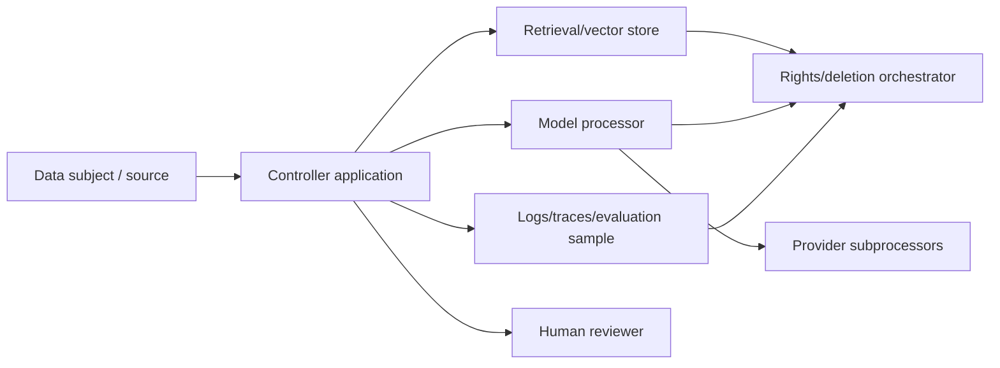

# GDPR for AI Systems

> **Version:** 1.1.0
> **Last updated:** 2026-07-16
> **Status:** Informative AIES implementation profile

## Purpose
Implement data-protection controls for personal data used in AI systems.

## Why
Model calls can create new processing, international transfers, retention, and automated-decision risks.

## When
Use before collecting, training on, retrieving, or transmitting personal data.

## How
1. Document purpose, lawful basis, necessity, data categories, recipients, and retention.
2. Complete DPIA where required.
3. Minimize and pseudonymize context; contract processors and assess transfers.
4. Support access, correction, objection, restriction, and erasure across caches and logs.
5. Assess Article 22 and provide meaningful human intervention where applicable.

## Legal boundary
This is engineering implementation guidance, not legal advice. The controller and qualified privacy counsel or DPO determine roles, lawful basis, necessity, DPIA requirements, international-transfer mechanism, Article 22 applicability, notification duties, and national-law variation. Reassess when purpose, model/provider, data source, recipients, geography, retention, or decision effect changes.

## Article-to-control map
| GDPR provision | Engineering question | Evidence |
|---|---|---|
| Articles 5, 6 and 9 | Is each purpose specific, necessary, compatible, and supported by a lawful basis and Article 9 condition where required? | Purpose/basis decision, prohibited secondary-use rules, special-category controls |
| Articles 13–14 | What must be disclosed about purposes, recipients, transfers, retention, rights, and meaningful automated-decision information? | Versioned notices tied to collection/source and system release |
| Articles 15–18, 20–21 | Can the organization locate, explain, export, correct, restrict, object to, and erase data across prompts, traces, caches, vector stores, datasets and providers? | Data map, identity verification, workflow tests, provider propagation receipts |
| Article 22 | Is there a solely automated decision with legal or similarly significant effect, and does an exception apply? | Counsel decision, genuine human intervention design, contest/correction records |
| Article 25 | Are minimization, separation, access, retention and safe defaults designed into the system? | Architecture/data-flow review and privacy test results |
| Article 28 | Do processor terms cover instructions, confidentiality, security, subprocessors, assistance, deletion/return and audit? | Executed DPA and subprocessor inventory |
| Article 30 | Does the ROPA reflect AI purposes, categories, recipients, transfers, retention and security? | Current processing record and owner attestation |
| Articles 32–34 | Are risk-appropriate security and breach detection/assessment/notification paths operating? | Threat model, control tests, incident and notification decision log |
| Article 35 | Is processing likely high risk and, if so, does the DPIA assess necessity, risks and measures before processing? | DPIA or documented screening decision with DPO consultation |
| Articles 44–49 | What transfer mechanism and supplementary measures apply to each provider/subprocessor path? | Transfer map, TIA/SCC or other mechanism, region and key-control tests |

## Data-flow inventory

For every arrow record purpose, fields, identifier/pseudonym, controller/processor role, region, transfer mechanism, encryption/key owner, retention, deletion API/SLA, and downstream use. Hashing directly identifying text usually produces pseudonymous—not anonymous—data when re-linking remains reasonably possible.

## Rights and deletion verification
1. Resolve subject identity to all approved identifiers without broadening access.
2. Search transactional stores, prompt/content stores, vector indexes, caches, trace/evaluation stores, backups, and processor records.
3. Apply the legally approved action: access, correction, restriction, objection, portability, or erasure.
4. Propagate to providers/subprocessors and record receipts or lawful exceptions.
5. Rebuild derived indexes/caches; test that deleted content is not retrieved.
6. Track backups to expiry or protected suppression, consistent with the approved policy.

Do not promise deletion from trained model weights without a verified capability and legal determination. Record the actual technical boundary and preventive data-governance control.

## Article 22 human-intervention test
Meaningful intervention requires authority to change the outcome, access to relevant evidence, adequate time and competence, freedom from automation-bias incentives, and a path for the person to present their view and contest/correct the decision. A rubber-stamp queue or review after irreversible effect does not satisfy this engineering profile.

## Evidence contract
The decision record is the **AI processing record and DPIA file**. It records controller/processor roles; purposes; lawful bases; categories; recipients; transfers; retention; rights; Article 22 analysis. The controller business owner owns completeness; the evidence is invalid when purpose, data source, recipient, or automated effect changes. Preserve legal/applicability decisions, system and data facts, contracts, evidence versions, approvals, and next-review triggers in the system record.

## Failure response and recovery
**Trigger:** unlawful processing, rights failure, or personal-data breach is suspected.

**Immediate response:** stop the affected processing, preserve minimum evidence, and invoke DPO/breach procedures. Preserve the AI processing record and DPIA file, affected trace IDs, timestamps, and decision logs before mutation. Open an incident when users, data, money, authorization, or a release decision may have been affected; closure requires a regression case and verified control change specific to gdpr for ai systems.

## Decision authority
The **controller business owner** accepts the operational decision. The **DPO or privacy counsel** provides independent challenge for high-risk scope, failed gates, or exceptions. Policy engines can enforce approved boundaries; accountable operators, counsel, privacy, risk, and business owners decide applicability and residual risk.

## Tradeoffs
| Choice | Benefit | Cost |
|---|---|---|
| Data minimization | Lower exposure | Potential quality reduction |

## Anti-patterns
- Treating hashing as anonymization.
- Retaining prompts indefinitely for debugging.

## Enterprise considerations
- Privacy and legal review remain accountable.
- Test data-subject workflows end to end.

## Framework relationship
For **GDPR for AI Systems**, this profile translates governance questions into engineering records. Qualified authorities still decide legal duties, conformity, and risk acceptance.

| Source | Relationship for GDPR for AI Systems | Boundary |
|---|---|---|
| NIST AI RMF | GOVERN 1.2; MAP 4 | Framework mappings organize evidence but do not determine legal obligations. |
| ISO/IEC 42001 | 42001 clauses 8.2 and 8.4 | Certification, where pursued, is scoped to a management system and does not certify each AI output or legal compliance. |
| Domain threat/control source | Privacy is not proven by model safety controls | Test only the threats applicable to the documented system and release |

## Checklist
- [ ] Lawful basis recorded.
- [ ] Deletion reaches vendors.
- [ ] Human intervention is genuine.

## References
- European Union, [Regulation (EU) 2016/679 — GDPR](https://eur-lex.europa.eu/eli/reg/2016/679/oj) (accessed 2026-07-16).
- European Data Protection Board, [Guidelines on automated individual decision-making and profiling](https://www.edpb.europa.eu/our-work-tools/our-documents/guidelines/automated-decision-making-and-profiling_en) (accessed 2026-07-16); verify subsequent guidance and court decisions with counsel.
- European Data Protection Board, [Guidelines on DPIAs](https://www.edpb.europa.eu/our-work-tools/our-documents/guidelines/data-protection-impact-assessments-high-risk-processing_en) (accessed 2026-07-16).
- NIST, [AI RMF 1.0](https://doi.org/10.6028/NIST.AI.100-1), GOVERN and MAP (accessed 2026-07-16).
- ISO, [ISO/IEC 42001:2023](https://www.iso.org/standard/81230.html) (accessed 2026-07-16). References indicate implementation alignment only; no certification is asserted.

## Changelog
| Version | Date | Change |
|---|---|---|
| 1.1.0 | 2026-07-16 | Replaced generic assurance text with the AI processing record and DPIA file, failure trigger, accountable decision, and scoped framework relationships for gdpr for ai systems. |
| 1.0.0 | 2026-07-16 | Initial complete profile. |
