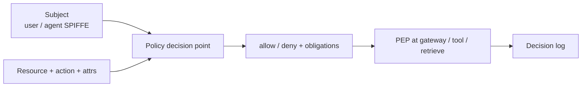

# RBAC and ABAC for AI Systems

> **Version:** 2.0.0 | **Last updated:** 2026-07-16

## Purpose

Authorize users, agents, tools, retrieval corpora, and side-effecting actions with policy enforced **outside** the model — using RBAC where roles are stable and ABAC where attributes (tenant, residency, risk tier, environment) must constrain every call.

## Why

Natural-language instructions are not access control. A prompt that says “you are a readonly auditor” does not prevent a tool call that deletes production. Multi-agent delegation makes this worse: without a policy enforcement point (PEP), privilege launders across hops.

---

## How — Control Plane



### Subject model

| Subject type | Identity | Typical roles |
|--------------|----------|---------------|
| Human user | Enterprise IdP (OIDC/SAML) | `ai.developer`, `ai.operator`, `ai.approver`, `ai.auditor` |
| Agent workload | SPIFFE / cloud workload identity | `agent.planner`, `agent.coder`, `agent.retriever` |
| Service (gateway) | Workload identity | `ai.gateway`, `ai.pep` |

Bind each agent identity to **code/config digest**, environment, tenant scope, and tool allowlist. Short-lived credentials only.

### Resource and action catalog (minimum)

| Resource | Example actions |
|----------|-----------------|
| Model invocation | `invoke`, `invoke.high_cost` |
| Prompt/version | `read`, `publish`, `rollback` |
| Corpus / memory | `retrieve`, `ingest`, `delete`, `admin` |
| Tool | `execute.<tool_id>` |
| Agent session | `start`, `cancel`, `escalate` |
| Eval / golden set | `read`, `mutate` |
| Audit log | `read` (break-glass for export) |

### RBAC vs ABAC — when to use which

| Mechanism | Use when | Example |
|-----------|----------|---------|
| **RBAC** | Stable job functions | `ai.approver` may approve high-impact tools |
| **ABAC** | Per-request constraints | `tenant_id`, `env=prod`, `residency=eu`, `risk_tier=high`, `data_class=restricted` |
| **ReBAC / relationships** (optional) | Object-level ownership | User owns project → retrieve project corpus |

**OAIES default:** RBAC for coarse roles + ABAC attributes on every retrieval and tool call. Roles alone are insufficient for multi-tenant AI.

```typescript
interface AuthzRequest {
  subject: {
    principal: string;
    roles: string[];
    attrs: {
      tenant_id: string;
      env: "dev" | "staging" | "prod";
      clearance?: string;
    };
  };
  action: string;                 // e.g. execute.deploy
  resource: {
    type: string;
    id: string;
    attrs: {
      tenant_id: string;
      data_class: string;
      residency?: string;
    };
  };
  context: {
    intent_id?: string;
    session_id?: string;
    delegation_depth?: number;
    step_up_satisfied?: boolean;
  };
}

interface AuthzDecision {
  effect: "allow" | "deny";
  policy_version: string;
  reasons: string[];
  obligations?: Array<"step_up" | "dual_control" | "redact_logs" | "rate_limit">;
  expires_at?: string;
}
```

---

## How — Enforcement Points

| PEP location | Must enforce |
|--------------|--------------|
| Model gateway | Who may invoke which model/route; cost tier |
| Retrieval | ACL predicates **before** vector/keyword/graph (see memory security standard) |
| Tool runtime | Action ∈ grant ∩ intent; argument allowlists |
| Prompt registry | Who may publish/rollback versions |
| Admin APIs | Break-glass with TTL |

**Default deny.** Missing attributes ⇒ deny. Model output cannot invent roles or tenants.

### High-impact actions

Require step-up auth and/or dual control:

- Production deploy, delete, payment, bulk egress, cross-tenant admin  
- Publishing prompts that change safety behavior  
- Exporting raw audit/prompt content  

```typescript
const DUAL_CONTROL = new Set([
  "execute.deploy",
  "execute.delete_resource",
  "corpus.admin",
  "audit.export_raw",
]);
```

---

## How — Delegation and Agents

1. Human (or trusted service) starts session with `intent_id`.  
2. Agent receives **attenuated** delegation token (audience, actions, resource scope).  
3. Each hop: child capabilities ⊆ parent; PEP re-checks original intent.  
4. Never pass the user’s long-lived bearer token to workers.

See multi-agent [identity-and-delegation](../../05-multi-agent-systems/standards/identity-and-delegation.md).

---

## How — Evidence: Authorization Decision Record

Persist for consequential decisions:

```typescript
interface AuthorizationPolicyBundle {
  decision_id: string;
  at: string;
  subject: string;
  workload?: string;
  tenant_id: string;
  resource: string;
  action: string;
  context_digest: string;       // hash of intent + attrs used
  effect: "allow" | "deny";
  policy_version: string;
  obligations: string[];
  approver?: string;            // for dual control
  expires_at?: string;
}
```

Invalid when the model can influence policy inputs not bound by trusted identity (e.g. trusting `tenant_id` from the prompt).

---

## Failure Response

| Trigger | Immediate response |
|---------|-------------------|
| Cross-tenant access or unauthorized side effect | Revoke tokens; disable capability; freeze affected policy version for review |
| Policy engine unavailable | Fail closed for consequential actions; optional read-only degrade if pre-approved |
| Suspected privilege laundering | Revoke task delegation chain; inspect hop graph |

Preserve decision logs and trace IDs before mutation. Close with a regression case and a verified control change.

---

## Tradeoffs

| Choice | Benefit | Cost |
|--------|---------|------|
| Fine-grained ABAC | Least privilege | Policy complexity, test burden |
| Coarse RBAC only | Simple | Over-privilege, tenant bugs |
| Dual control | Reduces blast radius | Latency, on-call load |

---

## Anti-patterns

| Anti-pattern | Why it fails |
|--------------|--------------|
| One service account for all agents | Total compromise blast radius |
| Credentials in prompts | Leakage + non-revocable in transcripts |
| Trusting role text in system prompt | Injection becomes IAM |
| Filtering ACL after retrieval top-k | Cross-tenant leakage |
| Break-glass without expiry | Permanent shadow admin |

---

## Enterprise Considerations

- Integrate with enterprise IAM; separate dev and prod identities.  
- Quarterly entitlement review; automate deny-path tests in CI.  
- IAM product owner accepts operational posture; appsec challenges high-risk exceptions.  
- Map evidence to internal control frameworks as needed — this profile does not assert certification.

---

## Checklist

- [ ] Default deny at gateway, retrieve, and tool PEPs.  
- [ ] Agent identities are workload-based, short-lived, tool-scoped.  
- [ ] ABAC attributes (tenant, env, class) enforced on every retrieve/tool call.  
- [ ] Delegation attenuates; no user-token reuse in workers.  
- [ ] Dual control / step-up on high-impact actions.  
- [ ] Break-glass expires and is audited.  
- [ ] Cross-tenant isolation tests pass (including cache paths).  
- [ ] Decision records include policy version and deny reasons.  
- [ ] Deny-path and privilege-escalation tests run in CI.

## Changelog

- **2.0.0 — 2026-07-16:** Operational rewrite — subject/resource catalog, RBAC+ABAC, PEP table, schemas, Mermaid; removed hollow assurance slogans.  
- **1.1.0 — 2026-07-16:** Evidence-contract stub.  
- **1.0.0 — 2026-07-16:** Initial profile.
