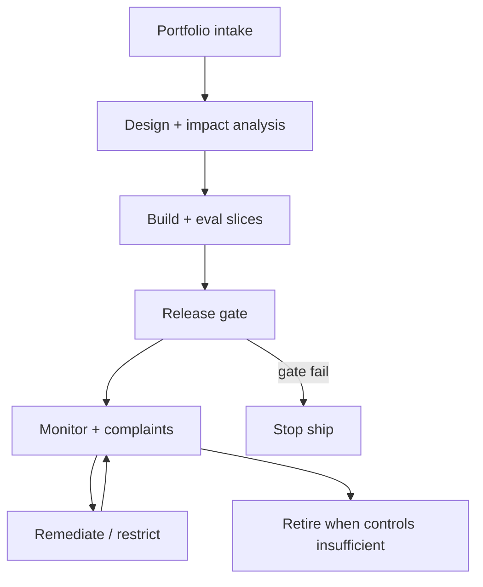
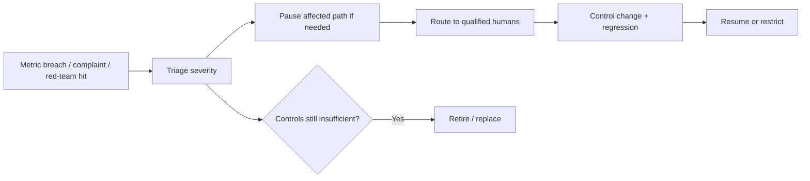

# Responsible AI Operating Standard

> **Version:** 2.0.0 | **Last updated:** 2026-07-16

## Purpose

Turn responsible-AI principles into lifecycle controls: intended use, harm analysis, slice-based metrics, human oversight, monitoring, appeal, and retirement — with accountable owners and stop-ship gates.

## Why

Principles posters do not change system behavior. Fairness as one aggregate accuracy number hides harm. Transparency that dumps security controls helps attackers. Without measurable gates and a kill path, “responsible” is branding.

---

## How — Lifecycle Gates



### 1. Intake — intended use and prohibitions

Document before build spend:

```typescript
interface IntendedUseRecord {
  system_id: string;
  intended_purpose: string;
  out_of_scope_uses: string[];
  foreseeable_misuse: string[];
  prohibited_outcomes: string[];  // e.g. automated denial without appeal
  affected_groups: string[];      // who can be impacted
  decision_consequence: "advisory" | "consequential" | "irreversible";
  human_oversight_mode: "in_the_loop" | "on_the_loop" | "after_the_fact";
  owner: string;                  // product accountable owner
  assurance_challenger: string;   // independent challenge
}
```

If counsel maps the system to regulated categories (e.g. EU AI Act high-risk), bind engineering evidence to that applicability record — this standard does not replace legal classification.

### 2. Design — harms and controls

| Harm class | Engineering response |
|------------|----------------------|
| Wrong decision / hallucination | Grounding, citation gates, abstention |
| Unfair disparate impact | Slice metrics + mitigation; do not “average away” |
| Privacy leakage | Minimization, retrieval ACL, audit digests |
| Safety / misuse | Policy filters, tool PEP, red-team |
| Over-automation | Human oversight matched to consequence |
| Opacity | User notice appropriate to risk; appeal path |

Engage domain experts and affected-stakeholder input **proportionate to impact** — not a one-size workshop for every chatbot.

### 3. Metrics — slice-based, not slogan-based

Define metrics per **slice** (cohort, locale, task type, risk tier):

| Family | Examples |
|--------|----------|
| Quality | Task success, unsupported-claim rate, abstention quality |
| Safety | Policy-violation rate, jailbreak success on red-team set |
| Fairness | Outcome / error gaps across relevant groups **for this use** |
| Oversight | % high-impact actions with valid human approval; override quality |
| Operations | p95 latency, cost, incident MTTD/MTTR |
| Appeal | Time-to-human-review; overturn rate |

**Do not** ship on a single aggregate “fairness score.” Choose group definitions with domain experts; wrong groups are worse than none.

```typescript
interface SliceMetricGate {
  metric: string;
  slice: string;
  baseline: number;
  ship_threshold: number;         // risk-appetite set by accountable owner
  blocking: boolean;
  owner: string;
}
```

### 4. Transparency and notice

| Audience | Provide | Avoid |
|----------|---------|-------|
| End users | That AI is involved when material; how to get help/appeal | Exposing prompts, filters, or exploit detail |
| Operators | Limitations, known failure modes, runbooks | Vanity dashboards without owners |
| Auditors / counsel | Impact record, eval versions, decisions | Claiming certifications this repo does not grant |

### 5. Human oversight

| Consequence | Minimum oversight |
|-------------|-------------------|
| Advisory only | On-the-loop sampling + clear “AI-generated” labeling where required |
| Consequential | In-the-loop or blocking approval for high-impact actions |
| Irreversible | Dual control + deterministic validators; no silent agent autonomy |

An LLM “critique” is not oversight.

### 6. Monitoring, appeal, remediate, retire



**Appeal path:** user or operator can reach a human who can overturn or escalate; measure time-to-response. Broken appeal = stop-ship for consequential systems.

**Retirement criteria (examples):** repeated prohibited outcomes, inability to meet slice gates after remediation budget, loss of accountable owner, legal applicability change that cannot be met.

---

## Evidence: AI Impact and Assurance Case

```typescript
interface AiImpactAssuranceCase {
  system_id: string;
  intended_use: IntendedUseRecord;
  harms: Array<{ id: string; description: string; severity: string; control_ids: string[] }>;
  metrics: SliceMetricGate[];
  oversight: { mode: string; runbook_uri: string };
  notice: { user_facing_uri?: string; limitation_summary: string };
  appeal: { channel: string; slo: string };
  monitoring: { dashboard_uri: string; alert_policy_uri: string };
  retirement: { criteria: string[]; owner: string };
  versions: { eval: string; policy: string; model: string };
  approvals: Array<{ role: string; principal: string; at: string }>;
  next_review_at: string;
}
```

Invalidate and re-approve when affected populations, decision consequences, model/prompt/tooling, or geography materially change.

---

## Failure Response

| Trigger | Immediate response |
|---------|-------------------|
| Prohibited outcome observed | Pause affected decision path; human takeover |
| Material disparity on a gated slice | Restrict rollout; investigate; do not “wait for more data” silently |
| Appeal ineffective | Treat as severity-1 for consequential systems |
| Red-team critical bypass | Patch or disable capability; regression before re-enable |

Preserve the assurance case, traces, and decision logs before mutation.

---

## Decision Authority

| Role | Authority |
|------|-----------|
| Product accountable owner | Accepts residual risk and release |
| Responsible-AI / assurance challenger | Independent challenge on high-risk scope and exceptions |
| Counsel / privacy / security | Applicability and control sufficiency in their domains |
| Policy engines | Enforce approved boundaries — they do not accept risk |

---

## Tradeoffs

| Choice | Benefit | Cost |
|--------|---------|------|
| Broad stakeholder participation | Better harm discovery | Time |
| Strict in-the-loop | Fewer silent failures | Throughput |
| Many fairness slices | Visibility | Labeling cost; statistical noise on small slices |

---

## Anti-patterns

| Anti-pattern | Why it fails |
|--------------|--------------|
| One aggregate fairness metric | Hides harmed cohorts |
| Transparency that publishes exploit internals | Helps attackers |
| “The model is generally helpful” as a gate | Non-measurable |
| Oversight = another LLM judge only | Correlated failure |
| No retirement path | Zombie high-risk systems |

---

## Enterprise Considerations

- Board or executive risk appetite sets boundaries for consequential automation.  
- Independent challenge required for high-impact uses.  
- Coordinate with EU AI Act / GDPR engineering maps where applicable — without treating this file as a conformity statement.  
- Incident process must include responsible-AI triggers, not only availability SEVs.

---

## Checklist

- [ ] Intended use, misuse, prohibitions, and affected groups recorded.  
- [ ] Consequence tier drives oversight mode.  
- [ ] Slice-based quality, safety, and fairness gates defined with owners.  
- [ ] User notice and limitations documented without leaking controls.  
- [ ] Appeal path works and is measured.  
- [ ] Monitoring alerts map to pause/remediate runbooks.  
- [ ] Retirement criteria exist and have an owner.  
- [ ] Assurance case re-approved on material change.  
- [ ] Prohibited-outcome and appeal-failure drills completed.

## Changelog

- **2.0.0 — 2026-07-16:** Operational rewrite — lifecycle Mermaid, intended-use and assurance schemas, slice gates, oversight table; removed hollow completeness slogans.  
- **1.1.0 — 2026-07-16:** Evidence-contract stub.  
- **1.0.0 — 2026-07-16:** Initial profile.
