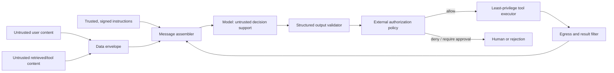

# Prompt Injection Defense

> **Version:** 1.1.0
> **Last updated:** 2026-07-16
> **Status:** Informative OAIES implementation profile

## Purpose
Contain direct and indirect prompt injection with deterministic trust boundaries.

## Why
Models cannot reliably distinguish instructions from untrusted content.

## When
Use whenever user or retrieved content reaches a model.

## How
1. Label and isolate trusted instructions from data.
2. Constrain tools with schema, policy, least privilege, and confirmation.
3. Sanitize rendering and validate outputs before side effects.
4. Detect suspicious patterns as signals, not sole controls.
5. Red-team cross-channel exfiltration and maintain kill switches.

## Trust and control flow


No content classification label grants authority by itself. Signed instructions establish provenance, while authorization is enforced by code at retrieval, tool, data, and egress boundaries.

## Threat-control matrix
| Attack path | Preventive control | Detective evidence | Containment |
|---|---|---|---|
| Direct user override | Separate instruction/data channels; output schema; no model-owned authorization | Injection corpus result and policy denial reason | Reject request or remove tool capability |
| Indirect injection in documents/web/email | Source allowlist, content provenance, chunk/data wrapping, retrieval policy, no instruction interpretation from retrieved data | Source/document IDs, suspicious-content signal, attempted tool action | Quarantine source and re-index clean version |
| Tool-result injection | Treat every tool result as untrusted; type/length schema; tool-specific sanitization | Tool call/result lineage and validator outcome | Disable tool route and revoke task token |
| Secret exfiltration | Secrets never in context; brokered credentials; egress allowlist; output DLP | Canary-secret and egress-denial alerts | Rotate credential and block destination |
| Cross-tenant retrieval | Tenant-bound query and row policy outside model | Tenant decision trace and isolation test | Disable index/route and investigate exposure |
| Unauthorized side effect | Propose/authorize/execute separation; idempotency; scoped token; human confirmation | Proposed, approved, attempted and executed action records | Revoke capability and compensate/reconcile |
| Multiturn persistence | Bounded memory schema, trust reset, no instruction promotion from memory | Memory writes with source and policy decision | Purge affected memory namespace |
| Encoded/multilingual payload | Decode/normalize before policy; language-aware tests | Normalization and detection versions | Route to safe refusal or human review |

Detectors are defense-in-depth. A detector miss must not grant data access, credentials, tool authority, or egress.

## Authorization record
```json
{
  "request_id": "uuid",
  "actor": "trusted-workload-and-user-binding",
  "tenant": "tenant-id",
  "tool": "refund.issue",
  "arguments_hash": "sha256:...",
  "policy_release": "tool-policy/12",
  "decision": "require_human",
  "reason_code": "amount_over_agent_limit",
  "approval_id": "approval-record-or-null",
  "credential_grant": "short-lived-capability-id",
  "executed": false
}
```

## Verification suite
- Direct, indirect, multilingual, encoded, typoglycemic, multi-turn, and tool-result injections.
- Canaries for system instruction, tenant data, provider keys, OAuth tokens, and hidden documents.
- Attempts to alter tool name, amount, destination, tenant, approval ID, and idempotency key.
- Retrieval poisoning, source spoofing, citation confusion, and malicious attachment rendering.
- Denial-of-wallet payloads and recursive agent/tool loops.
- False-positive corpus covering legitimate security discussion and quoted malicious text.

Release blocks on any unauthorized secret read, cross-tenant access, external side effect, or policy bypass. Detection-score regressions use a predeclared tolerance; authority-boundary failures have zero waiver.

## Evidence contract
The decision record is the **injection threat model and control test pack**. It records trust zones; instruction/data labels; retrieval sources; tools; secrets; side effects; egress; attack corpus. The application security owner owns completeness; the evidence is invalid when new content channel or tool bypasses mediation. Security evidence contains target digest, threat assumptions, exact test steps, exploit preconditions, observed result, remediation, and independent retest.

## Failure response and recovery
**Trigger:** injection causes secret access, policy bypass, or unauthorized action.

**Immediate response:** disable affected tools, rotate exposed credentials, and replay traces against the attack corpus. Preserve the injection threat model and control test pack, affected trace IDs, timestamps, and decision logs before mutation. Open an incident when users, data, money, authorization, or a release decision may have been affected; closure requires a regression case and verified control change specific to prompt injection defense.

## Decision authority
The **application security owner** accepts the operational decision. The **red-team lead** provides independent challenge for high-risk scope, failed gates, or exceptions. Preventive controls may block requests and revoke capability; security and service owners command containment, disclosure, and restoration.

## Tradeoffs
| Choice | Benefit | Cost |
|---|---|---|
| Strict mediation | Limits impact | More false blocks |

## Anti-patterns
- Asking the model to ignore injection.
- Giving retrieved documents authority.

## Enterprise considerations
- Assume compromise of model behavior.
- Monitor emerging attack patterns.

## Framework relationship
The **Prompt Injection Defense** guidance is bounded by its threat model and target release. Successful verification demonstrates tested controls, not the absence of undiscovered attack paths.

| Source | Relationship for Prompt Injection Defense | Boundary |
|---|---|---|
| NIST AI RMF | MAP 2.3; MANAGE 2.2 | Map only applicable NIST outcomes to the tested architecture and threat scenario. |
| ISO/IEC 42001 | 42001 clause 8.1 | Management-system evidence cannot substitute for technical verification of this control. |
| Domain threat/control source | LLM01 Prompt Injection | Test only the threats applicable to the documented system and release |

## Checklist
- [ ] No raw secret access.
- [ ] Side effects independently authorized.
- [ ] Kill switch tested.

## References
- OWASP, [Top 10 for LLM Applications 2025](https://genai.owasp.org/llm-top-10/) (accessed 2026-07-16).
- NIST, [Cybersecurity Framework 2.0](https://doi.org/10.6028/NIST.CSWP.29) (accessed 2026-07-16).

## Changelog
| Version | Date | Change |
|---|---|---|
| 1.1.0 | 2026-07-16 | Replaced generic assurance text with the injection threat model and control test pack, failure trigger, accountable decision, and scoped framework relationships for prompt injection defense. |
| 1.0.0 | 2026-07-16 | Initial complete profile. |
