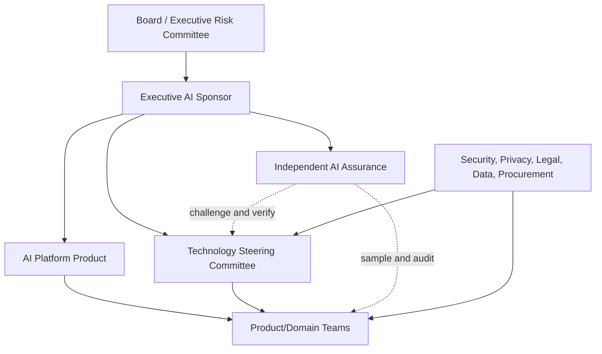

# AI Organization Operating Model

> **Version:** 1.1.0
> **Last updated:** 2026-07-16
> **Status:** Informative AIES implementation profile

## Purpose
Establish a hybrid platform-and-product model with explicit service ownership and decision rights.

## Why
Central standards without embedded delivery become a bottleneck; federation without a platform fragments controls.

## When
Use once multiple teams build or operate AI systems.

## How
1. Charter an AI platform team for gateway, evaluation, observability, approved providers, and standards.
2. Embed accountable AI engineers in product teams.
3. Create an AI governance forum with engineering, product, security, privacy, legal, risk, and affected-domain representation.
4. Publish RACI, service catalog, exception process, and funding model.
5. Review portfolio risk, incidents, adoption, and provider health monthly.

## Organization design


The AI Platform is a funded internal product, not a standards committee. It owns gateway, approved-provider integration, prompt release, evaluation execution, OpenTelemetry pipelines, cost controls, and common incident tooling with published SLOs. Product teams own use-case outcomes, requirements, local data, evaluation semantics, human workflows, and production service health. Independent assurance must not report to the platform or product owner whose evidence it evaluates.

## Decision RACI
`A` means one accountable role; avoid multiple accountable parties.

| Decision | Executive sponsor | Technology Steering Committee (TSC) | AI platform | Product owner | Engineering owner | Security/privacy/legal | Independent assurance |
|---|---|---|---|---|---|---|---|
| Approve enterprise AI risk appetite | A | R | C | I | I | C | C |
| Admit provider/model to approved catalog | I | A | R | C | C | R | C |
| Approve low-risk use-case launch | I | I | C | A | R | C | I |
| Approve medium-risk launch | I | C | C | A | R | R | C |
| Accept high residual risk / high-impact launch | A | R | C | R | C | R | C |
| Operate shared AI controls | I | I | A/R | C | C | C | I |
| Define task quality and affected-person outcomes | I | I | C | A | R | C | C |
| Issue time-bound exception | A for high | A for medium | R for platform controls | R | C | C | C |
| Pause unsafe production capability | I | I | R | A/R | R | R | I |
| Verify corrective action closure | I | I | C | R | R | C | A |
| Retire use case or provider | A for strategic | R | R | A for use case | C | C | C |

## Governance operating cadence
| Forum | Cadence | Quorum | Inputs | Binding outputs |
|---|---|---|---|---|
| TSC | Biweekly; emergency within 24 hours | Chair, platform, product/domain, security; privacy/legal when triggered; assurance attends without owning delivery | Provider qualification, architecture deviations, radar proposals, medium/high exceptions | Approved catalog/radar changes, conditions, owners, expiry |
| AI portfolio review | Monthly | Executive sponsor, finance, product, engineering, risk | Outcome scorecards, incidents, spend forecast, control capacity, remediation debt | Funding changes, expansion/hold/retirement decisions |
| Independent assurance review | Quarterly and pre-launch for high risk | Assurance lead plus qualified reviewer independent of implementation | Sampled evidence packs, control tests, complaints, overrides, provider changes | Findings, severity, due dates, closure criteria |
| Incident learning review | Within five business days of stabilization | Service owner, incident lead, platform, affected control owners | Timeline, trace/release IDs, causal analysis, affected decisions | Corrective actions, golden-set additions, provider requalification |

Minutes record attendees, conflicts, evidence, dissent, decision, accountable owner, due date, expiry/review date, and linked system/provider versions. A meeting is not evidence that a technical control operated.

## Funding model
Use a three-part model:

| Funding pool | Pays for | Allocation rule | Guardrail |
|---|---|---|---|
| Enterprise baseline | Gateway, identity, audit, evaluation runner, observability, approved-provider qualification, incident capability, assurance minimum | Annual platform capacity based on portfolio demand and risk | Product teams cannot opt out of baseline controls to reduce local cost |
| Use-case consumption | Model tokens, dedicated environments, use-case datasets/evaluators, domain review, on-call load | Showback from metered use; chargeback only after metric quality is verified | Cost allocation cannot expose individual prompt content or become employee surveillance |
| Risk remediation reserve | Urgent vulnerabilities, regulatory change, provider exit, incident correction, control scaling | Executive-controlled reserve with post-use review | Reserve does not replace sustained ownership funding |

Every approved use case has a total-cost-of-ownership model covering model/provider, evaluation, telemetry, storage, domain labeling, human oversight, incident response, and exit. If required controls are not funded, the release is not approved; the risk is not transferred to the platform team.

## Exception governance
```yaml
exception:
  id: AI-EX-2026-014
  system_release: sha256:...
  control_or_requirement: "specific requirement"
  business_need: "why normal compliance is currently impossible"
  risk_statement: "scenario, likelihood evidence, impact"
  compensating_controls: ["testable control"]
  owner: "named accountable role"
  approvers: ["authority required by tier"]
  issued_at: "UTC timestamp"
  expires_at: "maximum approved duration"
  telemetry: ["metric and alert proving boundary"]
  exit_plan: "remediation or capability shutdown"
```

Exceptions cannot waive prohibited uses, applicable law, truthful records, incident reporting, or a critical safety/security stop condition. They expire automatically; renewal requires new evidence and an updated remediation plan. The platform enforces machine-testable conditions such as route, tenant, model, token, user cohort, or tool restrictions. Monthly portfolio review publishes counts by control, age, risk, and overdue status.

## Service-level objectives
- Gateway availability and policy-decision integrity are separate SLOs; a fast incorrect allow is not availability success.
- Approved prompt/model configuration propagation has an RTO and a tested last-known-good cache.
- Evaluation gate freshness measures time since last successful run against the exact production release.
- Provider requalification freshness pages before approval expires.
- Assurance finding closure tracks risk-weighted overdue days, not raw ticket count.
- Exception exposure tracks requests, users, side effects, and days under exception.

## Evidence contract
The decision record is the **operating-model charter**. It records decision rights; service catalog; funding; intake; RACI; SLOs; assurance calendar; escalation. The CTO or delegated AI executive owns completeness; the evidence is invalid when platform or assurance lacks mandate, capacity, or independence. Organization evidence records mandate, authority, competence, funding, conflicts, decisions, exceptions, metrics, and review cadence.

## Failure response and recovery
**Trigger:** control demand exceeds funded capacity or teams bypass platform boundaries.

**Immediate response:** prioritize by risk, suspend unsupported launches, and escalate funding decisions. Preserve the operating-model charter, affected trace IDs, timestamps, and decision logs before mutation. Open an incident when users, data, money, authorization, or a release decision may have been affected; closure requires a regression case and verified control change specific to ai organization operating model.

## Decision authority
The **CTO or delegated AI executive** accepts the operational decision. The **enterprise risk executive** provides independent challenge for high-risk scope, failed gates, or exceptions. Committees may decide only within delegated authority; executives retain risk appetite and funding accountability while independent assurance retains challenge.

## Tradeoffs
| Choice | Benefit | Cost |
|---|---|---|
| Hybrid model | Scale with consistency | Coordination overhead |

## Anti-patterns
- A central team owning every use case.
- A committee approving designs without technical evidence.

## Enterprise considerations
- Board-level risk appetite flows to product controls.
- Separate enablement metrics from risk oversight.

## Framework relationship
The **AI Organization Operating Model** document is an operating aid; effectiveness requires observed decisions, funded controls, and independent evidence rather than the existence of this process.

| Source | Relationship for AI Organization Operating Model | Boundary |
|---|---|---|
| NIST AI RMF | GOVERN 2.1 and 2.3 | Use NIST governance outcomes to test decision rights and accountability in practice. |
| ISO/IEC 42001 | 42001 clauses 5.1 and 7.1 | A documented process supports—but does not itself demonstrate—effective management-system operation. |
| Domain threat/control source | Technical risk owners consume OWASP findings | Test only the threats applicable to the documented system and release |

## Checklist
- [ ] Every decision has exactly one accountable role in the RACI.
- [ ] Platform, product, control, and assurance responsibilities are contractually distinct.
- [ ] TSC quorum, conflicts, dissent, and binding outputs are recorded.
- [ ] Baseline, consumption, and remediation funding cover full lifecycle cost.
- [ ] Unfunded controls stop launch rather than becoming implicit platform debt.
- [ ] Exceptions have machine-enforced scope, owner, telemetry, expiry, and exit plan.
- [ ] Independent assurance samples evidence and verifies closure without owning implementation.
- [ ] Platform SLOs cover policy integrity, release freshness, requalification, and rollback.

## References
- NIST, [AI RMF 1.0](https://doi.org/10.6028/NIST.AI.100-1), GOVERN 2–6 (accessed 2026-07-16).
- ISO, [ISO/IEC 42001:2023](https://www.iso.org/standard/81230.html), clauses 5–10 (accessed 2026-07-16). No certification or conformity claim is made.

## Changelog
| Version | Date | Change |
|---|---|---|
| 1.1.0 | 2026-07-16 | Added organization design, decision RACI, governance forums, three-part funding, exception schema, assurance independence, and platform SLOs. |
| 1.0.0 | 2026-07-16 | Initial complete profile. |
