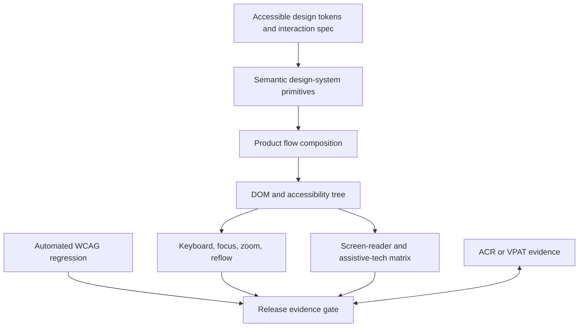

# Accessibility Engineering Architecture Patterns

> Version: 1.1.0 | Updated: 2026-07-16

## Purpose

Define the production components, control paths, state boundaries, and failure containment for semantic component, keyboard flow, focus transition, WCAG audit, remediation, or conformance release.

## Why

Native semantics come first; every operation is keyboard-complete; focus is deterministic; assistive-technology testing supplements automated WCAG checks. The diagram models actual Accessibility Engineering platform elements so reviewers can identify ownership and unsafe coupling.

## How

### Required boundaries

1. Design tokens encode contrast, focus, target, motion, and forced-color behavior.
2. Semantic primitives own name/role/state and complex-widget keyboard models.
3. Product flows own focus transitions, errors, status announcements, and reading order.
4. Automated checks run continuously; manual AT scripts gate critical journeys.
5. Conformance claims link to versioned evidence and open exceptions.

### Operational evidence

- semantic DOM and accessibility tree showing computed name, role, value, state, relationships, and landmarks
- keyboard sequence with visible focus, modal entry/escape/return, route focus, and error focus behavior
- screen-reader transcript across the supported browser/AT matrix
- automated scan results plus manual WCAG mapping, zoom/reflow, contrast, reduced-motion, and forced-colors evidence
- Accessibility Conformance Report/VPAT claims, defects, exceptions, owner, and retest date

### Rollback path

Disable the changed component or restore the previous accessible implementation through a feature flag; do not roll back content/data changes in a way that removes labels, alternatives, or user progress.

## Version-aware caution

Record the conformance target (for example WCAG 2.2 level), browser/OS/screen-reader matrix, design-system version, and audit-tool version. ARIA support differs by browser and assistive technology; APG examples are patterns, not automatic conformance.

## Tradeoffs

The architecture introduces explicit Accessibility Engineering boundaries and operational artifacts that require ownership. In return, failures in missing or incorrect accessible name/description, focus lost, trapped, obscured, or returned incorrectly, ARIA role/state/value diverges from interaction, contrast, non-text contrast, reflow, text spacing, or target-size failure, dynamic status/error not announced or announced excessively become observable and containable.

## Anti-patterns

- Adding arbitrary ARIA to a non-semantic clickable element creates a role without the keyboard, focus, state, and platform behavior users require.
- Do not remove a native warning, validator, policy, or safety limit merely to make generated output pass.
- Do not claim a successful result without preserving the command, target, artifact/revision, and observed output.

## Enterprise considerations

Accessibility governance owns the WCAG target, supported AT matrix, design-system primitives, exception expiry, user-testing participation, procurement requirements, and ACR/VPAT evidence.

## Official sources

- [WCAG 2.2](https://www.w3.org/TR/WCAG22/)
- [WAI-ARIA APG](https://www.w3.org/WAI/ARIA/apg/)
- [ARIA 1.2](https://www.w3.org/TR/wai-aria-1.2/)
- [WCAG evaluation methodology](https://www.w3.org/TR/WCAG-EM/)

## Checklist

- [ ] Design tokens encode contrast, focus, target, motion, and forced-color behavior..
- [ ] Semantic primitives own name/role/state and complex-widget keyboard models..
- [ ] Product flows own focus transitions, errors, status announcements, and reading order..
- [ ] Automated checks run continuously; manual AT scripts gate critical journeys..
- [ ] Conformance claims link to versioned evidence and open exceptions..
- [ ] Diagram matches deployed topology rather than an aspirational target.
- [ ] Rollback path preserves state and mixed-version contracts.

## Changelog

- 1.1.0 (2026-07-16): Replaced generic adapter diagram with native Accessibility Engineering architecture.
- 1.0.0 (2026-07-16): Added initial pattern.
