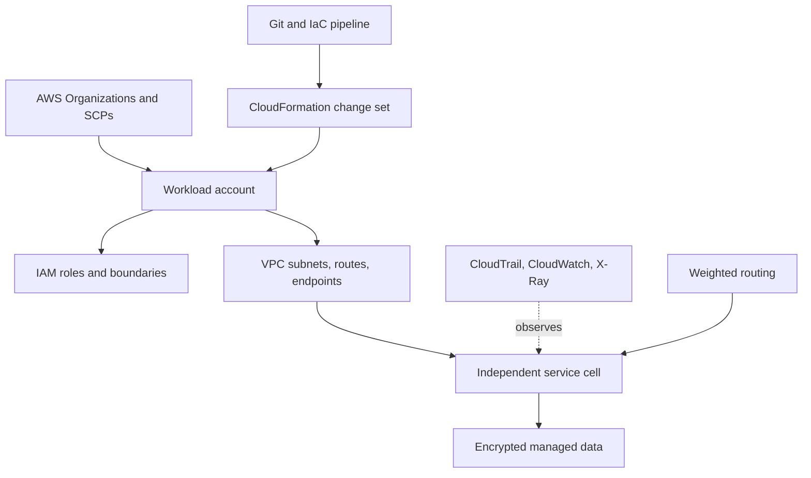

# AWS Architecture Patterns

> Version: 1.1.0 | Updated: 2026-07-16

## Purpose

Define the production components, control paths, state boundaries, and failure containment for account workload, CloudFormation/CDK stack, IAM role, VPC path, Lambda function, or release.

## Why

Accounts and cells bound blast radius; role credentials are short-lived; infrastructure, quotas, retries, and failure isolation are explicit. The diagram models actual AWS platform elements so reviewers can identify ownership and unsafe coupling.

## How

### Required boundaries

1. Organization and account boundaries isolate ownership, billing, policy, and blast radius.
2. Workloads assume roles; long-lived IAM user keys are not application credentials.
3. Cells own compute, quotas, and dependencies required for independent failure.
4. CloudFormation change sets expose replacement and policy changes before execution.
5. Traffic shifting is coupled to CloudWatch user-impact alarms.

### Operational evidence

- template/CDK source, synthesized CloudFormation, change set, stack events, and drift status
- caller identity, IAM identity/resource policies, permission boundaries, session policy, SCP, and explicit denies
- VPC route tables, security groups, NACLs, endpoints, DNS, and Flow Logs
- CloudTrail, CloudWatch metrics/logs, X-Ray traces, service quota, and AWS Health events

### Rollback path

Shift weighted traffic or aliases to the prior immutable version/cell, then use CloudFormation rollback for infrastructure; do not delete a failed stack when retained data or forensic events are required.

## Version-aware caution

Capture AWS CLI/CDK/CloudFormation transform versions, partition, region, service API, runtime, and quota. Managed-service behavior and availability vary by region, account, runtime, architecture, and feature release.

## Tradeoffs

The architecture introduces explicit AWS boundaries and operational artifacts that require ownership. In return, failures in policy-chain AccessDenied, CloudFormation create/update/rollback failure, Lambda timeout, cold start, or concurrency exhaustion, service throttling or quota exhaustion, VPC route, security, endpoint-policy, or DNS failure become observable and containable.

## Anti-patterns

- A single shared production account and VPC turns IAM, quota, network, and deployment failures into organization-wide incidents.
- Do not remove a native warning, validator, policy, or safety limit merely to make generated output pass.
- Do not claim a successful result without preserving the command, target, artifact/revision, and observed output.

## Enterprise considerations

AWS governance enforces organization policies, centralized CloudTrail/configuration evidence, break-glass role controls, region restrictions, data classification, and cost allocation.

## Official sources

- [AWS Architecture Center](https://aws.amazon.com/architecture/)
- [AWS Well-Architected](https://docs.aws.amazon.com/wellarchitected/latest/framework/welcome.html)
- [IAM best practices](https://docs.aws.amazon.com/IAM/latest/UserGuide/best-practices.html)
- [CloudFormation change sets](https://docs.aws.amazon.com/AWSCloudFormation/latest/UserGuide/using-cfn-updating-stacks-changesets.html)

## Checklist

- [ ] Organization and account boundaries isolate ownership, billing, policy, and blast radius..
- [ ] Workloads assume roles; long-lived IAM user keys are not application credentials..
- [ ] Cells own compute, quotas, and dependencies required for independent failure..
- [ ] CloudFormation change sets expose replacement and policy changes before execution..
- [ ] Traffic shifting is coupled to CloudWatch user-impact alarms..
- [ ] Diagram matches deployed topology rather than an aspirational target.
- [ ] Rollback path preserves state and mixed-version contracts.

## Changelog

- 1.1.0 (2026-07-16): Replaced generic adapter diagram with native AWS architecture.
- 1.0.0 (2026-07-16): Added initial pattern.
