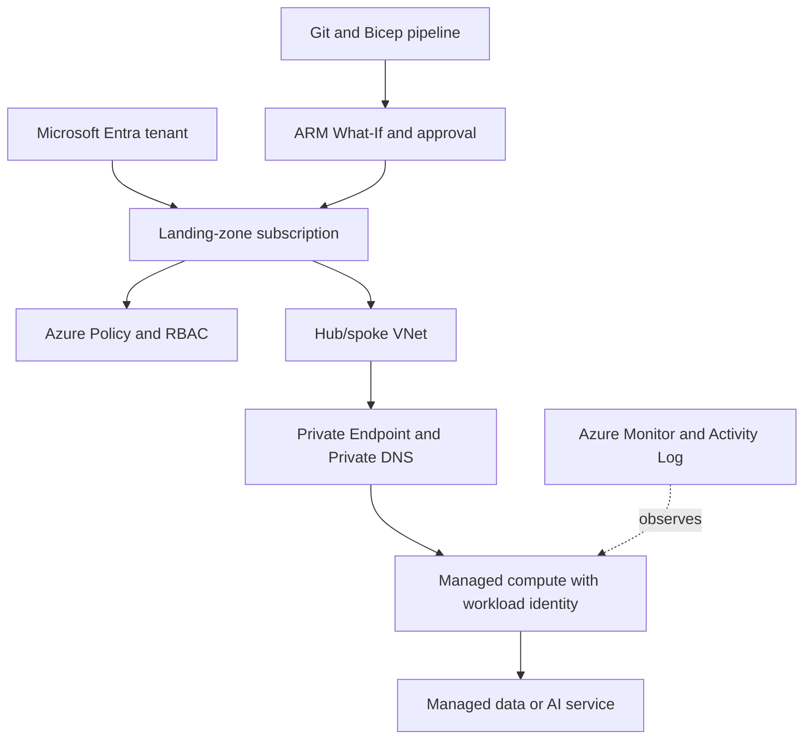

# Azure Architecture Patterns

> Version: 1.1.0 | Updated: 2026-07-16

## Purpose

Define the production components, control paths, state boundaries, and failure containment for subscription workload, Bicep module, managed identity, private endpoint, or release pipeline.

## Why

Infrastructure is declarative; identities are credentialless and least-privilege; private connectivity, policy, diagnostics, and cost ownership are explicit. The diagram models actual Azure platform elements so reviewers can identify ownership and unsafe coupling.

## How

### Required boundaries

1. Landing zones own tenant, subscription, policy, network, logging, and budget controls.
2. Workloads receive managed identities and data-plane roles at the narrowest resource scope.
3. Private endpoints and DNS links are deployed as one connectivity contract.
4. Bicep modules expose stable inputs/outputs and pin explicit API versions.
5. Safe deployment uses rings, health signals, and deployment history.

### Operational evidence

- Bicep/ARM source, parameter provenance, compiled template, and What-If result
- tenant, subscription, resource-group, principal object ID, role assignments, deny assignments, and policy state
- private endpoint, subnet, route, NSG, private DNS zone links, and caller-side DNS resolution
- Activity Log, resource diagnostics, platform metrics, Service Health, quota, and cost data

### Rollback path

Reapply the last approved Bicep/parameter artifact or route traffic to the prior deployment slot; never delete stateful resources to force convergence, and restore access changes through reviewed RBAC/policy state.

## Version-aware caution

Capture Azure CLI/Bicep versions, resource-provider API versions, and service SKU/region capabilities. ARM API and managed-service features vary by API version, cloud, region, and SKU; a portal screenshot is not a reproducible contract.

## Tradeoffs

The architecture introduces explicit Azure boundaries and operational artifacts that require ownership. In return, failures in management-plane authorization or policy denial, ARM/Bicep dependency or API-version deployment failure, managed identity token/role mismatch, private DNS, route, NSG, or endpoint failure, throttling, quota, regional capacity, or service degradation become observable and containable.

## Anti-patterns

- Portal-authored production resources create configuration that cannot be reviewed, reproduced, or safely rolled back.
- Do not remove a native warning, validator, policy, or safety limit merely to make generated output pass.
- Do not claim a successful result without preserving the command, target, artifact/revision, and observed output.

## Enterprise considerations

Azure governance maps management groups to policy initiatives, centralizes Activity Logs and diagnostics, time-bounds exemptions, and records data residency and cost ownership.

## Official sources

- [Azure Architecture Center](https://learn.microsoft.com/azure/architecture/)
- [Azure Well-Architected Framework](https://learn.microsoft.com/azure/well-architected/)
- [Bicep deployments](https://learn.microsoft.com/azure/azure-resource-manager/bicep/deploy-cli)
- [Managed identities](https://learn.microsoft.com/entra/identity/managed-identities-azure-resources/overview)

## Checklist

- [ ] Landing zones own tenant, subscription, policy, network, logging, and budget controls.
- [ ] Workloads receive managed identities and data-plane roles at the narrowest resource scope.
- [ ] Private endpoints and DNS links are deployed as one connectivity contract.
- [ ] Bicep modules expose stable inputs/outputs and pin explicit API versions.
- [ ] Safe deployment uses rings, health signals, and deployment history.
- [ ] Diagram matches deployed topology rather than an aspirational target.
- [ ] Rollback path preserves state and mixed-version contracts.

## Changelog

- 1.1.0 (2026-07-16): Replaced generic adapter diagram with native Azure architecture.
- 1.0.0 (2026-07-16): Added initial pattern.
