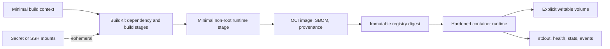

# Docker Architecture Patterns

> Version: 1.1.0 | Updated: 2026-07-16

## Purpose

Define the production components, control paths, state boundaries, and failure containment for Dockerfile, BuildKit build, OCI image, Compose service, or container release.

## Why

Images are minimal, immutable, reproducible, non-root, secret-free, multi-architecture aware, and terminate correctly. The diagram models actual Docker platform elements so reviewers can identify ownership and unsafe coupling.

## How

### Required boundaries

1. Dependency and compile stages consume pinned inputs; runtime receives only required artifacts.
2. Secrets use BuildKit mounts and never become layer contents.
3. The runtime stage declares non-root identity, stop signal, health behavior, and explicit writable paths.
4. Registry promotion is by digest with provenance and SBOM attached.
5. Persistent state lives outside the container filesystem.

### Operational evidence

- Dockerfile, `.dockerignore`, build context list, syntax directive, and BuildKit provenance
- base and final image digests, platform manifest, layer history, SBOM, and vulnerability report
- runtime user, capabilities, seccomp, mounts, ports, environment, healthcheck, and stop signal
- Compose rendered config, network/DNS state, container inspect, events, and resource stats

### Rollback path

Redeploy the previous OCI digest, not a reused tag; preserve volumes and inspect migration compatibility before starting the older image.

## Version-aware caution

Capture Docker Engine, Buildx/BuildKit, Dockerfile syntax directive, Compose specification, target platforms, and base-image digest. Builder features and Compose keys vary; tags alone do not identify the tested filesystem.

## Tradeoffs

The architecture introduces explicit Docker boundaries and operational artifacts that require ownership. In return, failures in architecture or entrypoint exec-format mismatch, runtime file permission or read-only filesystem failure, image/build-cache/log disk exhaustion, OOM kill or CPU throttling, Compose DNS, network, dependency, or health failure become observable and containable.

## Anti-patterns

- Installing build tools, package caches, and credentials in the final stage expands attack surface and makes the image irreproducible.
- Do not remove a native warning, validator, policy, or safety limit merely to make generated output pass.
- Do not claim a successful result without preserving the command, target, artifact/revision, and observed output.

## Enterprise considerations

Container governance approves base-image families, enforces digest promotion and signed provenance, applies vulnerability SLAs, and retains SBOMs for every deployed digest.

## Official sources

- [Dockerfile reference](https://docs.docker.com/reference/dockerfile/)
- [Build best practices](https://docs.docker.com/build/building/best-practices/)
- [Build secrets](https://docs.docker.com/build/building/secrets/)
- [Docker security](https://docs.docker.com/engine/security/)

## Checklist

- [ ] Dependency and compile stages consume pinned inputs; runtime receives only required artifacts.
- [ ] Secrets use BuildKit mounts and never become layer contents.
- [ ] The runtime stage declares non-root identity, stop signal, health behavior, and explicit writable paths.
- [ ] Registry promotion is by digest with provenance and SBOM attached.
- [ ] Persistent state lives outside the container filesystem.
- [ ] Diagram matches deployed topology rather than an aspirational target.
- [ ] Rollback path preserves state and mixed-version contracts.

## Changelog

- 1.1.0 (2026-07-16): Replaced generic adapter diagram with native Docker architecture.
- 1.0.0 (2026-07-16): Added initial pattern.
