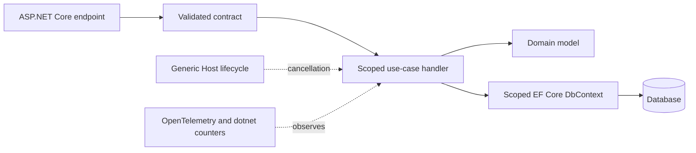

# .NET Architecture Patterns

> Version: 1.1.0 | Updated: 2026-07-16

## Purpose

Define the production components, control paths, state boundaries, and failure containment for ASP.NET Core endpoint, hosted service, EF Core unit of work, or application slice.

## Why

DI lifetimes are valid; CancellationToken reaches I/O; one scoped DbContext owns a unit of work; options fail fast. The diagram models actual .NET platform elements so reviewers can identify ownership and unsafe coupling.

## How

### Required boundaries

1. Endpoint metadata declares authentication, authorization, and response contract.
2. A scoped handler owns one use case and receives CancellationToken.
3. DbContext is a unit of work, not a singleton or generic repository implementation detail.
4. Hosted services create a scope per message or iteration.
5. Options are immutable inputs validated before the host reports ready.

### Operational evidence

- solution/project files, `global.json`, lock files, target frameworks, and package graph
- DI registrations, options binding/validation, middleware order, and endpoint metadata
- EF Core generated SQL, query plan, change tracker, and pool metrics
- dotnet-counters, dotnet-trace, dotnet-dump, and distributed traces

### Rollback path

Stop new background work, drain hosted services within the host shutdown timeout, then redeploy the previous published artifact after checking EF migration compatibility.

## Version-aware caution

Read `global.json`, target framework monikers, SDK lock, runtime image, and package graph. ASP.NET Core hosting, minimal APIs, EF Core translation, and C# language features must match the deployed SDK/runtime baseline.

## Tradeoffs

The architecture introduces explicit .NET boundaries and operational artifacts that require ownership. In return, failures in invalid DI lifetime or missing registration, concurrent or overlong DbContext use, query translation, N+1, or serialization cycle, request cancellation versus upstream timeout, thread-pool, connection-pool, or GC saturation become observable and containable.

## Anti-patterns

- Registering DbContext or a service that captures it as singleton introduces cross-request concurrency and stale tracking.
- Do not remove a native warning, validator, policy, or safety limit merely to make generated output pass.
- Do not claim a successful result without preserving the command, target, artifact/revision, and observed output.

## Enterprise considerations

.NET governance pins SDK and runtime support lines, controls NuGet sources and package signatures, and treats dumps/traces as sensitive production records.

## Official sources

- [.NET documentation](https://learn.microsoft.com/dotnet/)
- [ASP.NET Core fundamentals](https://learn.microsoft.com/aspnet/core/fundamentals/)
- [EF Core](https://learn.microsoft.com/ef/core/)
- [Diagnostics tools](https://learn.microsoft.com/dotnet/core/diagnostics/)

## Checklist

- [ ] Endpoint metadata declares authentication, authorization, and response contract..
- [ ] A scoped handler owns one use case and receives CancellationToken..
- [ ] DbContext is a unit of work, not a singleton or generic repository implementation detail..
- [ ] Hosted services create a scope per message or iteration..
- [ ] Options are immutable inputs validated before the host reports ready..
- [ ] Diagram matches deployed topology rather than an aspirational target.
- [ ] Rollback path preserves state and mixed-version contracts.

## Changelog

- 1.1.0 (2026-07-16): Replaced generic adapter diagram with native .NET architecture.
- 1.0.0 (2026-07-16): Added initial pattern.
