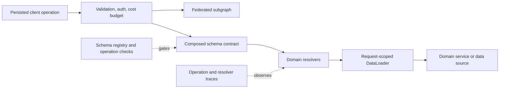

# GraphQL Architecture Patterns

> Version: 1.1.0 | Updated: 2026-07-16

## Purpose

Define the production components, control paths, state boundaries, and failure containment for schema, resolver, request DataLoader, gateway, persisted operation, or federated subgraph.

## Why

Schema exposes domain capabilities; authorization is enforced at trusted resolver/service boundaries; data access is batched per request; operations have resource budgets. The diagram models actual GraphQL platform elements so reviewers can identify ownership and unsafe coupling.

## How

### Required boundaries

1. Gateway validates operation shape, identity, and cost before execution.
2. Schema ownership follows domains and additive evolution.
3. Resolvers remain thin authorization/orchestration boundaries.
4. DataLoaders batch by datasource and request security context.
5. Registry checks schema composition and known client operations before rollout.

### Operational evidence

- canonical SDL, generated schema, registry/composition result, and breaking-change report
- validated operation document, variables, auth context, depth/complexity/cost, and persisted-operation ID
- resolver trace tree, per-field errors, downstream query count, DataLoader batch/cache evidence
- gateway/subgraph routing, ownership, entity representations, and schema rollout matrix

### Rollback path

Route resolvers/subgraphs back to the previous implementation while leaving additive schema visible but safely unavailable/deprecated; remove schema only after registered clients no longer reference it.

## Version-aware caution

Record GraphQL specification assumptions, server/framework, client, federation/directive versions, and schema registry revision. Nullability, incremental delivery, custom directives, and federation composition are implementation/version dependent.

## Tradeoffs

The architecture introduces explicit GraphQL boundaries and operational artifacts that require ownership. In return, failures in non-null propagation and partial response, N+1 resolver fan-out, client/schema validation drift, interface/union runtime type resolution, depth, complexity, alias, batch, or rate budget rejection become observable and containable.

## Anti-patterns

- Mapping every table and unrestricted relation directly into GraphQL creates authorization gaps, cyclic queries, and unbounded resolver fan-out.
- Do not remove a native warning, validator, policy, or safety limit merely to make generated output pass.
- Do not claim a successful result without preserving the command, target, artifact/revision, and observed output.

## Enterprise considerations

GraphQL governance assigns type/field ownership, schema review, operation registration, cost limits, deprecation windows, and controls introspection and trace payload retention.

## Official sources

- [GraphQL specification](https://spec.graphql.org/)
- [GraphQL Learn](https://graphql.org/learn/)
- [GraphQL response](https://graphql.org/learn/response/)
- [OWASP GraphQL](https://cheatsheetseries.owasp.org/cheatsheets/GraphQL_Cheat_Sheet.html)

## Checklist

- [ ] Gateway validates operation shape, identity, and cost before execution..
- [ ] Schema ownership follows domains and additive evolution..
- [ ] Resolvers remain thin authorization/orchestration boundaries..
- [ ] DataLoaders batch by datasource and request security context..
- [ ] Registry checks schema composition and known client operations before rollout..
- [ ] Diagram matches deployed topology rather than an aspirational target.
- [ ] Rollback path preserves state and mixed-version contracts.

## Changelog

- 1.1.0 (2026-07-16): Replaced generic adapter diagram with native GraphQL architecture.
- 1.0.0 (2026-07-16): Added initial pattern.
