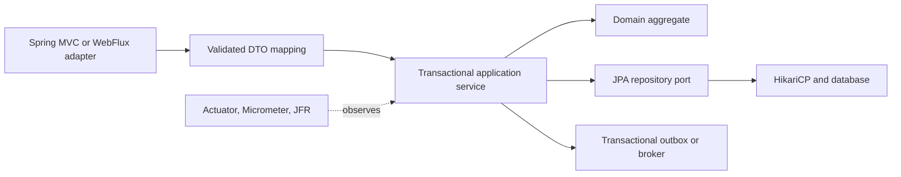

# Java Architecture Patterns

> Version: 1.1.0 | Updated: 2026-07-16

## Purpose

Define the production components, control paths, state boundaries, and failure containment for Spring controller, application service, JPA aggregate, message consumer, or JVM process.

## Why

Transactions wrap use cases; transport DTOs do not leak persistence entities; pools are bounded and JVM evidence drives tuning. The diagram models actual Java platform elements so reviewers can identify ownership and unsafe coupling.

## How

### Required boundaries

1. Controllers terminate HTTP concerns and map DTOs.
2. Application services own transaction, authorization, and orchestration.
3. Aggregates protect invariants without Spring or JPA behavior dependencies.
4. Repositories load an explicit aggregate or projection for one use case.
5. Outbox publication follows committed state rather than dual writes.

### Operational evidence

- `pom.xml` or Gradle catalogs, wrapper version, toolchain, BOM, and dependency tree
- Spring condition report, bean graph, active profiles, and validated configuration properties
- JFR recording, GC logs, thread dump, heap dump, and connection-pool metrics
- DDL/migration scripts plus generated SQL and transaction traces

### Rollback path

Pause message admission and traffic, drain transactions, then restore the previous JVM artifact only after verifying Flyway/Liquibase and serialized-event backward compatibility.

## Version-aware caution

Read the Maven/Gradle toolchain, wrapper, Spring dependency management, and runtime image. Java language, virtual-thread, Spring Boot, Jakarta namespace, and Hibernate behavior vary by aligned release set; never mix guidance from another baseline.

## Tradeoffs

The architecture introduces explicit Java boundaries and operational artifacts that require ownership. In return, failures in bean graph or configuration binding failure, transaction/lazy-loading boundary failure, thread or connection pool starvation, deadlock or blocked monitor, heap, metaspace, direct-memory, or GC pressure become observable and containable.

## Anti-patterns

- Returning managed JPA entities from controllers makes serialization trigger queries outside the intended transaction.
- Do not remove a native warning, validator, policy, or safety limit merely to make generated output pass.
- Do not claim a successful result without preserving the command, target, artifact/revision, and observed output.

## Enterprise considerations

Java governance aligns JDK, Spring, Jakarta, Hibernate, and build-plugin baselines; it also controls JFR/heap-dump access because diagnostics may contain regulated data.

## Official sources

- [Java documentation](https://docs.oracle.com/en/java/)
- [Spring Boot reference](https://docs.spring.io/spring-boot/reference/)
- [Spring transactions](https://docs.spring.io/spring-framework/reference/data-access/transaction.html)
- [JDK Flight Recorder](https://docs.oracle.com/javacomponents/jmc-5-5/jfr-runtime-guide/about.htm)

## Checklist

- [ ] Controllers terminate HTTP concerns and map DTOs.
- [ ] Application services own transaction, authorization, and orchestration.
- [ ] Aggregates protect invariants without Spring or JPA behavior dependencies.
- [ ] Repositories load an explicit aggregate or projection for one use case.
- [ ] Outbox publication follows committed state rather than dual writes.
- [ ] Diagram matches deployed topology rather than an aspirational target.
- [ ] Rollback path preserves state and mixed-version contracts.

## Changelog

- 1.1.0 (2026-07-16): Replaced generic adapter diagram with native Java architecture.
- 1.0.0 (2026-07-16): Added initial pattern.
