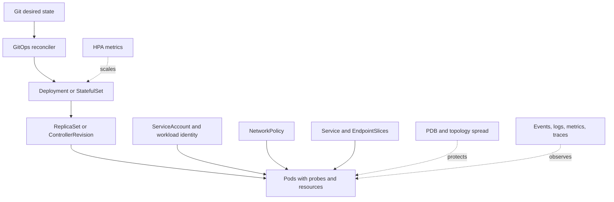

# Kubernetes Architecture Patterns

> Version: 1.1.0 | Updated: 2026-07-16

## Purpose

Define the production components, control paths, state boundaries, and failure containment for controller-managed workload, Service, policy, autoscaler, disruption budget, or GitOps release.

## Why

Controllers own Pods; workload identity and network policy are least-privilege; probes, resources, topology, disruption, and rollout are explicit desired state. The diagram models actual Kubernetes platform elements so reviewers can identify ownership and unsafe coupling.

## How

### Required boundaries

1. GitOps reconciliation is authoritative; emergency changes are committed back or automatically reverted.
2. A controller owns every Pod and exposes rollout state.
3. ServiceAccount plus cloud/workload identity grants only the Pod's required external permissions.
4. Default-deny NetworkPolicy is extended with explicit caller, dependency, and DNS paths.
5. Probes, requests, HPA, PDB, rollout surge, and topology spread are designed as one availability system.

### Operational evidence

- rendered manifests plus Git revision, field manager, server-side dry-run, diff, and admission result
- Deployment/StatefulSet status, ReplicaSets, Pod conditions, events, previous logs, and termination state
- Service, EndpointSlice, NetworkPolicy, DNS, routes, and caller-side connectivity
- ServiceAccount/workload identity binding, RBAC `can-i`, Pod security context, and admission policy
- requests/limits, node pressure, HPA signals, PDB, topology spread, and eviction events

### Rollback path

Revert the Git revision or use `kubectl rollout undo` only when controller history and schema compatibility are verified; never patch Pods, and pause rollout before collecting failed Pod events and previous logs.

## Version-aware caution

Capture server and kubectl versions, API discovery, node OS/runtime, CNI/CSI, admission policies, and managed-cluster release. API availability, field semantics, sidecar behavior, and feature gates vary by cluster version; validate manifests server-side against the target cluster.

## Tradeoffs

The architecture introduces explicit Kubernetes boundaries and operational artifacts that require ownership. In return, failures in CrashLoopBackOff, probe failure, or bad configuration, ImagePullBackOff or architecture/registry identity failure, Pending due to requests, affinity, taints, topology, or volume, OOMKilled, throttling, node pressure, or eviction, Service/EndpointSlice/DNS/NetworkPolicy path failure become observable and containable.

## Anti-patterns

- Directly patching a production Pod bypasses controller history, GitOps convergence, rollout safety, and reproducible incident recovery.
- Do not remove a native warning, validator, policy, or safety limit merely to make generated output pass.
- Do not claim a successful result without preserving the command, target, artifact/revision, and observed output.

## Enterprise considerations

Kubernetes platform governance owns admission policy, supported APIs, node/CNI/CSI baselines, namespace tenancy, workload identity, image policy, and audit-log retention.

## Official sources

- [Kubernetes workloads](https://kubernetes.io/docs/concepts/workloads/controllers/)
- [Probes](https://kubernetes.io/docs/concepts/configuration/liveness-readiness-startup-probes/)
- [NetworkPolicy](https://kubernetes.io/docs/concepts/services-networking/network-policies/)
- [Pod disruptions](https://kubernetes.io/docs/concepts/workloads/pods/disruptions/)
- [Security checklist](https://kubernetes.io/docs/concepts/security/security-checklist/)

## Checklist

- [ ] GitOps reconciliation is authoritative; emergency changes are committed back or automatically reverted..
- [ ] A controller owns every Pod and exposes rollout state..
- [ ] ServiceAccount plus cloud/workload identity grants only the Pod's required external permissions..
- [ ] Default-deny NetworkPolicy is extended with explicit caller, dependency, and DNS paths..
- [ ] Probes, requests, HPA, PDB, rollout surge, and topology spread are designed as one availability system..
- [ ] Diagram matches deployed topology rather than an aspirational target.
- [ ] Rollback path preserves state and mixed-version contracts.

## Changelog

- 1.1.0 (2026-07-16): Replaced generic adapter diagram with native Kubernetes architecture.
- 1.0.0 (2026-07-16): Added initial pattern.
