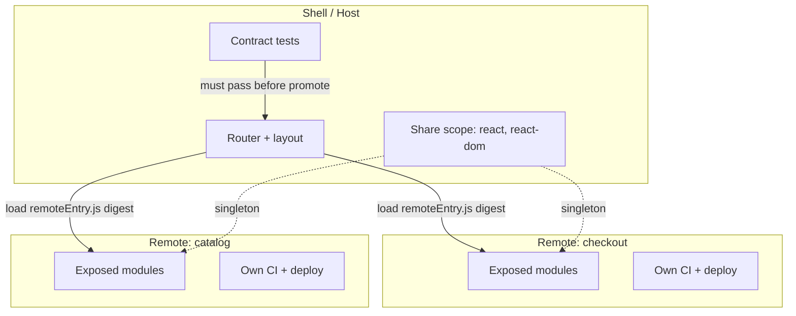
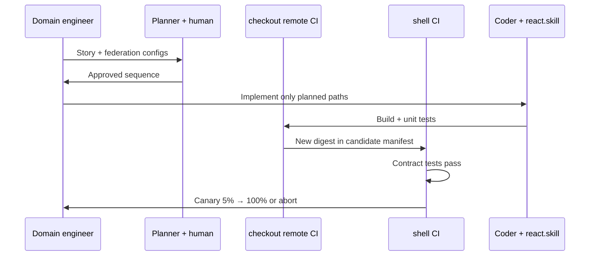

# Microfrontends Cookbook

> **Stack:** Module Federation / independent deployable UI slices  
> **Focus:** Shell contracts, remotes, share scope, independent release, rollback  
> **Version:** 1.2.0 | **Updated:** 2026-07-16  
> **Handbook:** [`handbook/how-to-give-context.md`](../../handbook/how-to-give-context.md) · [`handbook/pr-review-with-ai.md`](../../handbook/pr-review-with-ai.md)

---

## Purpose

Use AI assistance on microfrontend work **without** breaking shell contracts, duplicating React runtimes, or shipping an irreversible remote. This cookbook is for UI platform and domain teams that own a shell + remotes.

## Why microfrontends fail under naive AI coding

Agents optimize local correctness (“the button renders”) and miss platform invariants:

- Share-scope singleton violations → two Reacts → hooks explode  
- Remote entry URL/digest drift → shell loads yesterday’s broken remote  
- Cross-slice imports → deploy coupling that destroys team autonomy  
- CSP/CORS mistakes → remotes fail only in prod  



## When to use this cookbook

- Changing shell route → remote mapping  
- Adding/updating a federated remote  
- Debugging duplicate framework / white-screen on remote load  
- Independent release of one domain slice  

**Do not** use microfrontends (or this cookbook) to split a single team’s page into five remotes “because AI can generate them.” Prefer a modular monolith until org boundaries are real.

## Architecture invariants (non-negotiable)

| Invariant | How you prove it |
|-----------|------------------|
| Domain ownership | Named team owns remote lifecycle |
| Versioned shell contract | Contract tests in CI for current + next remote |
| Independent build | Remote builds without shell source |
| Independent deploy | Remote pipeline can promote alone |
| Rollback | Prior remote digest still addressable |
| Share policy | Singletons for react/react-dom; ranges documented |

Repo working notes belong in your app; OAIES reference patterns: [`architecture/patterns.md`](./architecture/patterns.md).

## How to work with AI on an MFE change

### 1. Build a context package (do not paste the monorepo)

Include:

- Shell remote manifest (routes → remote name → entry URL pattern)  
- `ModuleFederationPlugin` / Rspack federation config for **host and** the remote you touch  
- Share scope config  
- Contract test file paths  
- Last known good remote digest  

Use the handbook: [How to give context](../../handbook/how-to-give-context.md).

### 2. Plan before coding (Planner pattern)

Multi-repo or host+remote changes always need a plan: [`patterns/planner-pattern/README.md`](../../patterns/planner-pattern/README.md) + [`implementation-plan.prompt.md`](../../08-ai-sdlc/prompts/implementation-plan.prompt.md).

Plan must list:

- Host files vs remote files  
- Contract changes (breaking or not)  
- Roll-forward and roll-back digests  
- Order: contract expand → remote deploy → shell cutover → contract contract  

### 3. Use the prompts and skill in this cookbook

| Task | Artifact |
|------|----------|
| Generate remote module / route wiring | [`prompts/generate.prompt.md`](./prompts/generate.prompt.md) |
| Review host/remote diff | [`prompts/review.prompt.md`](./prompts/review.prompt.md) |
| Debug load / singleton / CSP failures | [`prompts/debug.prompt.md`](./prompts/debug.prompt.md) |
| Native procedure | [`skills/microfrontends.skill.md`](./skills/microfrontends.skill.md) |
| Failure catalog | [`debug-workflows/common-errors.md`](./debug-workflows/common-errors.md) |

### 4. Verify with native commands

```bash
# Per remote — independently
npm ci
npm run typecheck
npm test
npm run build

# Federation stats (webpack example)
npx webpack --profile --json=stats.json
node -e "const s=require('./stats.json'); console.log(Object.keys(s.entrypoints||{}))"

# Prove remote entry is immutable + CORS/CSP-friendly
curl -sI "$REMOTE_ENTRY_URL" | sed -n '1,20p'
```

Contract tests must run in shell CI against **current and candidate** remote manifests.

## Worked example — add `POST /reports` UI remote module

**Goal:** Catalog shell already hosts remotes; Checkout team adds `ReportForm` exposed as `./ReportForm`.



**Plan excerpt (must appear in the PR):**

| Step | Actor | Artifact |
|------|-------|----------|
| 1 | Remote | Expose `./ReportForm`; no shell import of remote internals |
| 2 | Remote | Deploy digest `sha256:…` |
| 3 | Shell | Candidate manifest entry; contract test green |
| 4 | Shell | Canary; abort if remote-load error rate > budget |
| 5 | Shell | Promote; keep previous digest for rollback |

**Rollback:** Point shell manifest back to previous digest; do not “hotfix” by coupling shell to remote source.

## Failure classes (start here, not random refactors)

See [`debug-workflows/common-errors.md`](./debug-workflows/common-errors.md). Top three:

1. **Invalid hook call / two Reacts** — share scope singleton broken  
2. **RemoteEntry 404 / CORS** — wrong URL, cache, or origin allowlist  
3. **White screen only in prod** — CSP blocks remote scripts; local webpack serves same-origin  

## Human in the loop

| Gate | Owner |
|------|-------|
| Plan approval (host+remote) | Shell + domain leads |
| Breaking contract change | Platform owner |
| Prod promote | On-call / release owner |
| AI PR review | Human merges — see [PR review with AI](../../handbook/pr-review-with-ai.md) |

## Tradeoffs

| Choice | Benefit | Cost |
|--------|---------|------|
| More remotes | Team autonomy | Runtime complexity, duplicate deps risk |
| Strict singletons | Stable hooks | Version coordination tax |
| Independent deploys | Fast domain delivery | Contract testing discipline |

## Anti-patterns

- AI generates `import from '../../../other-remote/src/...'` — **forbidden**; use contracts only  
- “Just pin React in every remote” without share scope — duplicate runtime  
- Shell and remote released as one artifact “for simplicity” — you no longer have MFEs  
- Prompt that asks the model to “fix CSP by disabling it” — Block  

## Enterprise considerations

- CSP origins allowlist per remote CDN  
- Accessibility baseline owned by shell; remotes must not regress axe gates  
- Telemetry: segment RUM by `shellVersion` + `remoteName@version`  
- Decommission: remove manifest entry before deleting CDN assets  

## Checklist

- [ ] Context package includes host + remote federation configs and LKG digest  
- [ ] Plan approved for cross-boundary work  
- [ ] Share scope singletons verified after change  
- [ ] Contract tests green for current + candidate  
- [ ] Rollback digest documented  
- [ ] PR reviewed with plan conformance ([code-review skill](../../03-skill-engineering/skills/code-review.skill.md))  

## Changelog

- 1.2.0 (2026-07-16): Replaced shallow template with operational MFE handbook-style guidance, diagrams, and repo links.  
- 1.1.0 (2026-07-16): Technology-native evidence pass.  
- 1.0.0 (2026-07-16): Initial cookbook.
