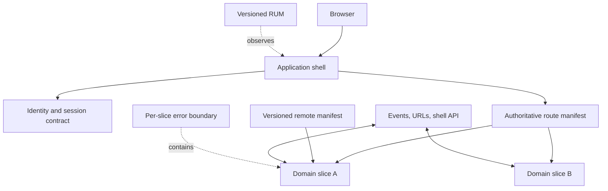

# Microfrontends Architecture Patterns

> Version: 1.1.0 | Updated: 2026-07-16

## Purpose

Define the production components, control paths, state boundaries, and failure containment for domain slice, shell contract, route, federated remote, shared package, or independent frontend release.

## Why

Slices follow durable business domains, integrate through versioned shell contracts, fail locally, and prove independent build and deployment. The diagram models actual Microfrontends platform elements so reviewers can identify ownership and unsafe coupling.

## How

### Required boundaries

1. The shell exposes a deliberately small versioned API.
2. Each slice owns complete domain UI and data orchestration behind one route boundary.
3. Runtime manifests point to immutable assets and support fallback.
4. Shared packages are limited to platform contracts and design primitives.
5. Errors, styles, storage, events, and telemetry are namespaced by slice.

### Operational evidence

- domain ownership, route manifest, shell API/event contracts, and compatibility matrix
- host/remote build metadata, remote entry URL/digest, share scope, singleton/range resolution, and CSP/CORS headers
- independent test/deploy pipeline, asset cache policy, rollback manifest, and fallback behavior
- RUM segmented by shell/slice versions, route, remote-load failure, and duplicate framework/runtime cost

### Rollback path

Update the runtime manifest or feature flag to the prior immutable remote asset set; keep the shell contract backward compatible until all cached tabs and remote versions age out.

## Version-aware caution

Capture shell, bundler/module-federation plugin, framework, router, browser targets, and deployed remote manifests. Share-scope and runtime-loading semantics depend on exact host/remote bundler versions and cannot be inferred from source alone.

## Tradeoffs

The architecture introduces explicit Microfrontends boundaries and operational artifacts that require ownership. In return, failures in eager shared-module consumption or share-scope initialization, unsatisfied singleton/range or duplicate framework runtime, remote entry unavailable, stale, or blocked by CSP/CORS, shell/slice route collision, cross-slice event/state contract drift become observable and containable.

## Anti-patterns

- Splitting page widgets among teams creates chatty runtime coupling without independent domain ownership or deployability.
- Do not remove a native warning, validator, policy, or safety limit merely to make generated output pass.
- Do not claim a successful result without preserving the command, target, artifact/revision, and observed output.

## Enterprise considerations

Microfrontend governance owns shell contracts, route allocation, shared-dependency policy, CSP origins, accessibility baseline, telemetry schema, and decommission windows.

## Official sources

- [Module Federation](https://webpack.js.org/concepts/module-federation/)
- [HTML custom elements](https://html.spec.whatwg.org/multipage/custom-elements.html)
- [Micro Frontends architecture](https://martinfowler.com/articles/micro-frontends.html)

## Checklist

- [ ] The shell exposes a deliberately small versioned API..
- [ ] Each slice owns complete domain UI and data orchestration behind one route boundary..
- [ ] Runtime manifests point to immutable assets and support fallback..
- [ ] Shared packages are limited to platform contracts and design primitives..
- [ ] Errors, styles, storage, events, and telemetry are namespaced by slice..
- [ ] Diagram matches deployed topology rather than an aspirational target.
- [ ] Rollback path preserves state and mixed-version contracts.

## Changelog

- 1.1.0 (2026-07-16): Replaced generic adapter diagram with native Microfrontends architecture.
- 1.0.0 (2026-07-16): Added initial pattern.
