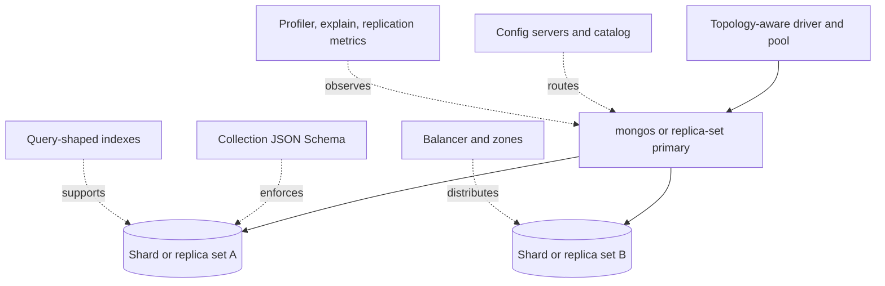

# MongoDB Architecture Patterns

> Version: 1.1.0 | Updated: 2026-07-16

## Purpose

Define the production components, control paths, state boundaries, and failure containment for document model, collection validator, query, aggregation, index, transaction, or shard key.

## Why

Documents match atomic access patterns; validators enforce shape; explain evidence drives indexes; shard keys distribute both writes and queries. The diagram models actual MongoDB platform elements so reviewers can identify ownership and unsafe coupling.

## How

### Required boundaries

1. Driver topology discovery and pools are shared per process and bounded.
2. Document aggregate boundaries contain atomic invariants and bounded arrays.
3. Collection validators make schema expectations observable during evolution.
4. Indexes are derived from measured query shapes and shard targeting.
5. Shard zones and balancer policy align data locality and failure domains.

### Operational evidence

- `db.version()`, `getParameter featureCompatibilityVersion`, driver version, `hello`, and replica/shard topology
- `getCollectionInfos`, `$jsonSchema` validator, indexes, collection stats, and sampled document-size distribution
- `explain('executionStats')` including examined/returned ratio, sort/spill, and shard targeting
- replication lag, oplog window, chunk distribution, balancer, transaction, and connection-pool metrics

### Rollback path

Disable writers for the new schema, restore dual-shape readers, and keep additive indexes/fields until old clients are stable; do not mass-update documents back without a resumable, audited migration.

## Version-aware caution

Capture server/FCV, driver, topology, storage engine, Atlas/managed tier, and feature compatibility. Query operators, retryable writes, transactions, sharding, and index features depend on server, FCV, topology, and driver alignment.

## Tradeoffs

The architecture introduces explicit MongoDB boundaries and operational artifacts that require ownership. In return, failures in E11000 unique-index conflict, aggregation memory/spill or blocking stage, transaction/topology incompatibility or transient abort, shard-key routing or hotspot failure, server-selection, TLS, DNS, or pool timeout become observable and containable.

## Anti-patterns

- Normalizing every relation into separate collections forces joins or multi-document transactions and discards document-level atomicity.
- Do not remove a native warning, validator, policy, or safety limit merely to make generated output pass.
- Do not claim a successful result without preserving the command, target, artifact/revision, and observed output.

## Enterprise considerations

MongoDB governance owns database/collection naming, validator enforcement, encryption and audit settings, shard-key approval, backup evidence, and access to profiler samples containing data.

## Official sources

- [MongoDB manual](https://www.mongodb.com/docs/manual/)
- [Data modeling](https://www.mongodb.com/docs/manual/data-modeling/)
- [Query plans](https://www.mongodb.com/docs/manual/core/query-plans/)
- [Sharding](https://www.mongodb.com/docs/manual/sharding/)

## Checklist

- [ ] Driver topology discovery and pools are shared per process and bounded..
- [ ] Document aggregate boundaries contain atomic invariants and bounded arrays..
- [ ] Collection validators make schema expectations observable during evolution..
- [ ] Indexes are derived from measured query shapes and shard targeting..
- [ ] Shard zones and balancer policy align data locality and failure domains..
- [ ] Diagram matches deployed topology rather than an aspirational target.
- [ ] Rollback path preserves state and mixed-version contracts.

## Changelog

- 1.1.0 (2026-07-16): Replaced generic adapter diagram with native MongoDB architecture.
- 1.0.0 (2026-07-16): Added initial pattern.
