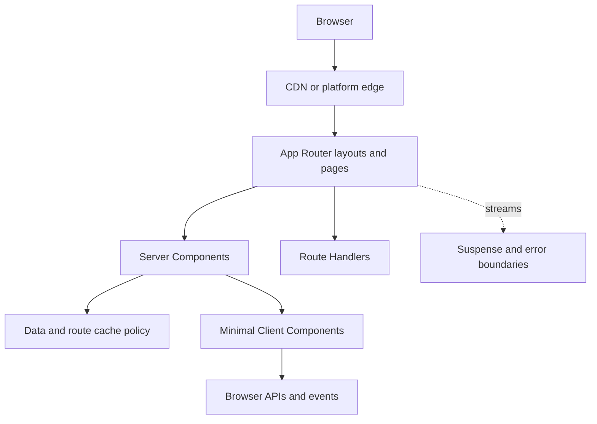

# Next.js Architecture Patterns

> Version: 1.1.0 | Updated: 2026-07-16

## Purpose

Define the production components, control paths, state boundaries, and failure containment for App Router route, layout, Server Component, Client Component, or Route Handler.

## Why

Server Components are the default; client boundaries are minimal; cache and dynamic behavior are declared at the data boundary. The diagram models actual Next.js platform elements so reviewers can identify ownership and unsafe coupling.

## How

### Required boundaries

1. Layouts own shared shell and metadata, not mutable feature state.
2. Server Components fetch close to the data source and pass serializable props to client islands.
3. Cache policy is attached to each fetch or route, with an owner for invalidation.
4. Route Handlers are external trust boundaries and do not substitute for internal domain services.
5. Suspense boundaries align with independent latency and failure regions.

### Operational evidence

- `package.json`, lockfile, `next.config.*`, and installed Next.js docs
- route tree including `layout`, `page`, `loading`, `error`, `not-found`, and Route Handlers
- build output showing static, dynamic, and route bundle classification
- response `Cache-Control`, `Vary`, revalidation, and RSC request evidence

### Rollback path

Route traffic to the prior immutable deployment, then invalidate only cache entries whose HTML/RSC or data contract is incompatible; never rely on redeploy alone to remove stale edge content.

## Version-aware caution

Use the locally installed Next.js documentation under `node_modules/next/dist/docs/` and the lockfile version. App Router caching, request APIs, middleware/proxy naming, and build output change between releases; latest web docs are not evidence for this repository.

## Tradeoffs

The architecture introduces explicit Next.js boundaries and operational artifacts that require ownership. In return, failures in Server/Client module boundary violations, static-to-dynamic build conflicts, RSC serialization failures, stale or over-invalidated cache entries, hydration and streaming boundary failures become observable and containable.

## Anti-patterns

- Marking a layout or page `use client` pulls its import graph into the browser and discards the App Router's server-first boundary.
- Do not remove a native warning, validator, policy, or safety limit merely to make generated output pass.
- Do not claim a successful result without preserving the command, target, artifact/revision, and observed output.

## Enterprise considerations

Next.js governance must pin hosting behavior, cache ownership, public environment-variable review, third-party script policy, and framework upgrade tests against installed documentation.

## Official sources

- [Next.js App Router](https://nextjs.org/docs/app)
- [Server and Client Components](https://nextjs.org/docs/app/getting-started/server-and-client-components)
- [Caching](https://nextjs.org/docs/app/guides/caching)
- [Production checklist](https://nextjs.org/docs/app/guides/production-checklist)

## Checklist

- [ ] Layouts own shared shell and metadata, not mutable feature state.
- [ ] Server Components fetch close to the data source and pass serializable props to client islands.
- [ ] Cache policy is attached to each fetch or route, with an owner for invalidation.
- [ ] Route Handlers are external trust boundaries and do not substitute for internal domain services.
- [ ] Suspense boundaries align with independent latency and failure regions.
- [ ] Diagram matches deployed topology rather than an aspirational target.
- [ ] Rollback path preserves state and mixed-version contracts.

## Changelog

- 1.1.0 (2026-07-16): Replaced generic adapter diagram with native Next.js architecture.
- 1.0.0 (2026-07-16): Added initial pattern.
