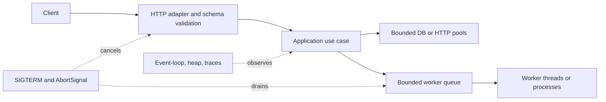

# Node.js Architecture Patterns

> Version: 1.1.0 | Updated: 2026-07-16

## Purpose

Define the production components, control paths, state boundaries, and failure containment for HTTP handler, worker, stream pipeline, package, or process lifecycle.

## Why

The event loop remains non-blocking; concurrency is bounded; AbortSignal, errors, and shutdown propagate through every I/O boundary. The diagram models actual Node.js platform elements so reviewers can identify ownership and unsafe coupling.

## How

### Required boundaries

1. Transport validates size, shape, identity, and deadline before application work.
2. Application code receives explicit clients and AbortSignal; it does not create global connections.
3. CPU-bound work uses a bounded worker pool or separate service.
4. Stream pipelines preserve backpressure from sink to source.
5. Shutdown closes admission first and dependencies last.

### Operational evidence

- runtime and package-manager pin plus lockfile integrity
- module mode, export map, TypeScript target, and startup command
- event-loop delay, heap, CPU profile, active handles, and request trace
- timeout, retry, pool, body-size, and graceful-shutdown configuration

### Rollback path

Stop new admission, drain workers and keep idempotency records, then route to the previous image; do not kill consumers while acknowledgements or writes are in flight.

## Version-aware caution

Read `engines.node`, `.nvmrc`/toolchain files, the lockfile, and the runtime image. APIs and default module, permission, test-runner, and fetch behavior depend on the deployed Node release; validate against that release's API docs.

## Tradeoffs

The architecture introduces explicit Node.js boundaries and operational artifacts that require ownership. In return, failures in unhandled promise rejection or uncaught exception, event-loop blocking and CPU saturation, listener, handle, or heap retention, socket reset, timeout, or pool starvation, partial shutdown with in-flight work become observable and containable.

## Anti-patterns

- Unbounded `Promise.all` over user-controlled input converts one request into connection-pool and memory exhaustion.
- Do not remove a native warning, validator, policy, or safety limit merely to make generated output pass.
- Do not claim a successful result without preserving the command, target, artifact/revision, and observed output.

## Enterprise considerations

Node service governance pins runtime and package-manager lines, reviews install scripts and native addons, retains SBOMs, and tests shutdown against the orchestrator grace period.

## Official sources

- [Node.js API](https://nodejs.org/docs/latest/api/)
- [Don't block the event loop](https://nodejs.org/en/learn/asynchronous-work/dont-block-the-event-loop)
- [Node.js diagnostics](https://nodejs.org/en/learn/diagnostics/user-journey)
- [OWASP Node.js security](https://cheatsheetseries.owasp.org/cheatsheets/Nodejs_Security_Cheat_Sheet.html)

## Checklist

- [ ] Transport validates size, shape, identity, and deadline before application work.
- [ ] Application code receives explicit clients and AbortSignal; it does not create global connections.
- [ ] CPU-bound work uses a bounded worker pool or separate service.
- [ ] Stream pipelines preserve backpressure from sink to source.
- [ ] Shutdown closes admission first and dependencies last.
- [ ] Diagram matches deployed topology rather than an aspirational target.
- [ ] Rollback path preserves state and mixed-version contracts.

## Changelog

- 1.1.0 (2026-07-16): Replaced generic adapter diagram with native Node.js architecture.
- 1.0.0 (2026-07-16): Added initial pattern.
