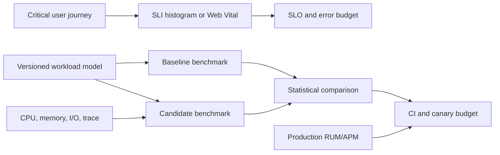

# Performance Engineering Architecture Patterns

> Version: 1.1.0 | Updated: 2026-07-16

## Purpose

Define the production components, control paths, state boundaries, and failure containment for SLO, workload model, benchmark, profile, capacity plan, Web Vital budget, or regression gate.

## Why

Optimization starts from a reproducible workload and user-impact metric; profiles identify the limiting resource; CI and production enforce budgets. The diagram models actual Performance Engineering platform elements so reviewers can identify ownership and unsafe coupling.

## How

### Required boundaries

1. User journeys define SLIs and budgets before code optimization.
2. Workload models are versioned artifacts derived from production distributions.
3. Profiles and benchmark samples are captured from the same run.
4. CI catches deterministic regressions; canaries catch environment-dependent impact.
5. Capacity and cost are first-class outputs alongside latency.

### Operational evidence

- SLI/SLO definition, histogram boundaries, trace sampling, RUM attribution, and business-impact cohort
- workload script, request/data distribution, concurrency/arrival model, warmup, repetitions, and raw results
- CPU, allocation/heap, I/O, lock, network, database, and browser trace aligned to one run
- baseline/candidate confidence, effect size, noise controls, capacity saturation, and cost per operation

### Rollback path

Shift traffic or artifact to the measured baseline when user-impact guardrails regress; retain candidate telemetry and profiles so rollback does not erase causal evidence.

## Version-aware caution

Record hardware, OS/kernel, runtime/browser, build mode, dependency versions, dataset, network shaping, cache state, and measurement tool version. Results from different environments or metric definitions are not comparable.

## Tradeoffs

The architecture introduces explicit Performance Engineering boundaries and operational artifacts that require ownership. In return, failures in tail latency hidden by averages, benchmark/production workload mismatch, CPU, event-loop, thread-pool, or lock saturation, heap retention, allocation pressure, or GC pause, LCP, INP, or CLS field regression become observable and containable.

## Anti-patterns

- Optimizing a local microbenchmark without production distribution or profile evidence moves code while leaving the system bottleneck unchanged.
- Do not remove a native warning, validator, policy, or safety limit merely to make generated output pass.
- Do not claim a successful result without preserving the command, target, artifact/revision, and observed output.

## Enterprise considerations

Performance governance standardizes metric definitions, benchmark hardware, raw-result retention, RUM privacy, SLO ownership, exception expiry, and capacity-review cadence.

## Official sources

- [Web Vitals](https://web.dev/articles/vitals)
- [Chrome performance](https://developer.chrome.com/docs/devtools/performance/)
- [OpenTelemetry](https://opentelemetry.io/docs/)
- [Google SRE monitoring](https://sre.google/sre-book/monitoring-distributed-systems/)

## Checklist

- [ ] User journeys define SLIs and budgets before code optimization.
- [ ] Workload models are versioned artifacts derived from production distributions.
- [ ] Profiles and benchmark samples are captured from the same run.
- [ ] CI catches deterministic regressions; canaries catch environment-dependent impact.
- [ ] Capacity and cost are first-class outputs alongside latency.
- [ ] Diagram matches deployed topology rather than an aspirational target.
- [ ] Rollback path preserves state and mixed-version contracts.

## Changelog

- 1.1.0 (2026-07-16): Replaced generic adapter diagram with native Performance Engineering architecture.
- 1.0.0 (2026-07-16): Added initial pattern.
