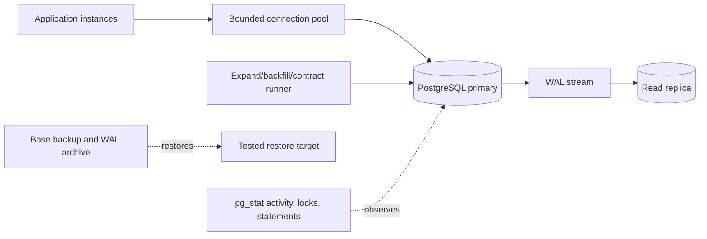

# PostgreSQL Architecture Patterns

> Version: 1.1.0 | Updated: 2026-07-16

## Purpose

Define the production components, control paths, state boundaries, and failure containment for schema, migration, query, index, transaction, replication path, or recovery runbook.

## Why

Constraints enforce invariants; actual plans justify indexes; transactions are short and consistently ordered; migrations use expand/contract. The diagram models actual PostgreSQL platform elements so reviewers can identify ownership and unsafe coupling.

## How

### Required boundaries

1. Connection budgets allocate capacity among application pools, migrations, replication, and operator reserve.
2. Primary constraints are authoritative for invariants under concurrency.
3. Read replicas serve only workloads that tolerate measured lag.
4. Migration phases are separately deployable and backfills are resumable.
5. Backups are accepted only after restore and consistency verification.

### Operational evidence

- `\conninfo`, `SELECT version()`, extension inventory, relevant `SHOW` settings, and topology
- `EXPLAIN (ANALYZE, BUFFERS, WAL, SETTINGS, FORMAT JSON)` from a safe representative environment
- `pg_stat_activity`, `pg_locks`, blockers, wait events, transaction age, and statement fingerprints
- schema-only dump, constraints, indexes, statistics, bloat, migration history, and table size
- WAL generation, replication slots, replay lag, backup status, restore evidence, and RPO/RTO

### Rollback path

Stop the migration runner and application feature, release locks, and revert only additive/compatible DDL; for destructive or data-rewriting steps use a tested forward fix or point-in-time recovery, never an improvised down migration.

## Version-aware caution

Capture `server_version`, client version, extensions, parameter settings, managed-service restrictions, and replica versions. SQL syntax, planner behavior, lock semantics, generated columns, replication, and extension features differ by PostgreSQL major release.

## Tradeoffs

The architecture introduces explicit PostgreSQL boundaries and operational artifacts that require ownership. In return, failures in deadlock or long lock wait, connection exhaustion or pool leak, statement timeout from plan or blocker, unique/FK/check constraint conflict under concurrency, WAL, replication slot, replica lag, backup, or storage pressure become observable and containable.

## Anti-patterns

- A one-step column rename/drop on a hot table breaks mixed-version application instances and can hold an ACCESS EXCLUSIVE lock.
- Do not remove a native warning, validator, policy, or safety limit merely to make generated output pass.
- Do not claim a successful result without preserving the command, target, artifact/revision, and observed output.

## Enterprise considerations

PostgreSQL governance assigns schema ownership, migration approval, privileged-role controls, extension allowlists, audit/retention policy, and regularly evidenced restore objectives.

## Official sources

- [PostgreSQL documentation](https://www.postgresql.org/docs/current/)
- [EXPLAIN](https://www.postgresql.org/docs/current/using-explain.html)
- [Explicit locking](https://www.postgresql.org/docs/current/explicit-locking.html)
- [Monitoring statistics](https://www.postgresql.org/docs/current/monitoring-stats.html)
- [Backup and restore](https://www.postgresql.org/docs/current/backup.html)

## Checklist

- [ ] Connection budgets allocate capacity among application pools, migrations, replication, and operator reserve.
- [ ] Primary constraints are authoritative for invariants under concurrency.
- [ ] Read replicas serve only workloads that tolerate measured lag.
- [ ] Migration phases are separately deployable and backfills are resumable.
- [ ] Backups are accepted only after restore and consistency verification.
- [ ] Diagram matches deployed topology rather than an aspirational target.
- [ ] Rollback path preserves state and mixed-version contracts.

## Changelog

- 1.1.0 (2026-07-16): Replaced generic adapter diagram with native PostgreSQL architecture.
- 1.0.0 (2026-07-16): Added initial pattern.
