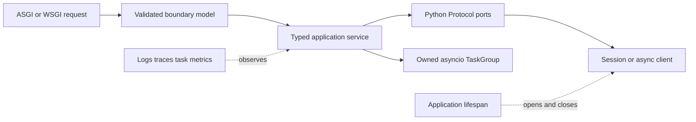

# Python Architecture Patterns

> Version: 1.1.0 | Updated: 2026-07-16

## Purpose

Define the production components, control paths, state boundaries, and failure containment for package, FastAPI/Django boundary, asyncio task, worker, or library API.

## Why

Public boundaries are typed and validated; environments are reproducible; async code contains no blocking I/O and preserves cancellation. The diagram models actual Python platform elements so reviewers can identify ownership and unsafe coupling.

## How

### Required boundaries

1. Framework models map into typed application inputs at the adapter.
2. Protocols describe infrastructure behavior without importing framework classes into the core.
3. One request or job owns its session and task group.
4. Application lifespan creates and closes pools exactly once.
5. Background work crosses a durable queue rather than escaping request task ownership.

### Operational evidence

- `pyproject.toml`, lock/constraints, interpreter pin, and installed dependency report
- type-checker, formatter, linter, and test configuration
- async task dump, traceback with chained causes, profile, and open-resource evidence
- ASGI/WSGI server, worker count, timeout, and database-pool settings

### Rollback path

Stop producers before reverting consumers when task schemas changed; deploy the previous wheel/image only after confirming database and serialized payload compatibility.

## Version-aware caution

Read `requires-python`, lock/constraint files, environment metadata, and framework pins. Typing syntax, asyncio behavior, packaging metadata, and standard-library APIs differ by Python minor release; use the deployed interpreter's documentation.

## Tradeoffs

The architecture introduces explicit Python boundaries and operational artifacts that require ownership. In return, failures in environment or import resolution mismatch, unawaited coroutine or lost cancellation, blocking work in the event loop, resource/session leak, schema or type contract drift become observable and containable.

## Anti-patterns

- Calling `asyncio.create_task` without retained ownership loses exceptions, cancellation, and shutdown guarantees.
- Do not remove a native warning, validator, policy, or safety limit merely to make generated output pass.
- Do not claim a successful result without preserving the command, target, artifact/revision, and observed output.

## Enterprise considerations

Python governance requires approved indexes, hash-locked dependencies, native-wheel provenance, supported interpreter lines, and controls for notebook or dynamic-code execution.

## Official sources

- [Python documentation](https://docs.python.org/3/)
- [asyncio](https://docs.python.org/3/library/asyncio.html)
- [Packaging User Guide](https://packaging.python.org/en/latest/)
- [Typing specification](https://typing.python.org/en/latest/spec/)

## Checklist

- [ ] Framework models map into typed application inputs at the adapter.
- [ ] Protocols describe infrastructure behavior without importing framework classes into the core.
- [ ] One request or job owns its session and task group.
- [ ] Application lifespan creates and closes pools exactly once.
- [ ] Background work crosses a durable queue rather than escaping request task ownership.
- [ ] Diagram matches deployed topology rather than an aspirational target.
- [ ] Rollback path preserves state and mixed-version contracts.

## Changelog

- 1.1.0 (2026-07-16): Replaced generic adapter diagram with native Python architecture.
- 1.0.0 (2026-07-16): Added initial pattern.
