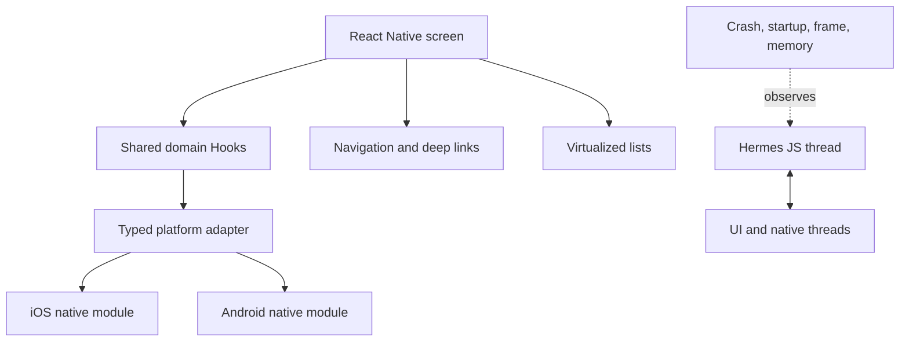

# React Native Architecture Patterns

> Version: 1.1.0 | Updated: 2026-07-16

## Purpose

Define the production components, control paths, state boundaries, and failure containment for screen, navigation flow, FlatList, native module, platform adapter, or mobile release.

## Why

Domain logic is shared; platform behavior is explicit; native boundaries are typed; JS/UI threads and lists are measured on representative devices. The diagram models actual React Native platform elements so reviewers can identify ownership and unsafe coupling.

## How

### Required boundaries

1. Screens compose shared domain hooks and platform-neutral design primitives.
2. Platform adapters isolate genuine OS behavior and permissions.
3. Native module contracts specify threads, ownership, errors, and ABI/version compatibility.
4. Navigation and persisted state have explicit migration contracts.
5. Performance is profiled in release mode on physical devices.

### Operational evidence

- `package.json`/lockfile, Podfile/lock, Gradle catalogs/wrapper, Xcode project, and platform deployment targets
- Metro config/resolution, generated native code/autolinking state, and debug/release build settings
- JS/UI frame rates, Hermes profile, native Instruments/Perfetto trace, memory, startup, and list metrics
- screen-reader tree, focus order, dynamic text, touch target, keyboard, and platform permission behavior

### Rollback path

Stop phased rollout or select the previous OTA bundle only when its native-module ABI matches installed binaries; otherwise ship a corrective store build and preserve migrated local data.

## Version-aware caution

Read React Native, React, navigation, native dependency, Gradle/AGP/Kotlin, Xcode/Swift, deployment-target, and architecture settings. Native APIs, autolinking, Metro, Hermes, and New Architecture compatibility are release-specific.

## Tradeoffs

The architecture introduces explicit React Native boundaries and operational artifacts that require ownership. In return, failures in native module missing/unlinked or architecture incompatible, app registration/startup exception, nested/unbounded VirtualizedList, Metro module resolution or cache/config mismatch, JS thread, UI thread, bridge/native boundary, or memory stall become observable and containable.

## Anti-patterns

- Scattering `Platform.OS` branches through domain logic creates two untestable applications hidden in one source tree.
- Do not remove a native warning, validator, policy, or safety limit merely to make generated output pass.
- Do not claim a successful result without preserving the command, target, artifact/revision, and observed output.

## Enterprise considerations

React Native governance aligns JS/native dependency matrices, signing, store roles, OTA policy, privacy declarations, device support, accessibility evidence, and crash-symbol retention.

## Official sources

- [React Native documentation](https://reactnative.dev/docs/getting-started)
- [Performance](https://reactnative.dev/docs/performance)
- [Native platform](https://reactnative.dev/docs/native-platform)
- [Accessibility](https://reactnative.dev/docs/accessibility)

## Checklist

- [ ] Screens compose shared domain hooks and platform-neutral design primitives..
- [ ] Platform adapters isolate genuine OS behavior and permissions..
- [ ] Native module contracts specify threads, ownership, errors, and ABI/version compatibility..
- [ ] Navigation and persisted state have explicit migration contracts..
- [ ] Performance is profiled in release mode on physical devices..
- [ ] Diagram matches deployed topology rather than an aspirational target.
- [ ] Rollback path preserves state and mixed-version contracts.

## Changelog

- 1.1.0 (2026-07-16): Replaced generic adapter diagram with native React Native architecture.
- 1.0.0 (2026-07-16): Added initial pattern.
