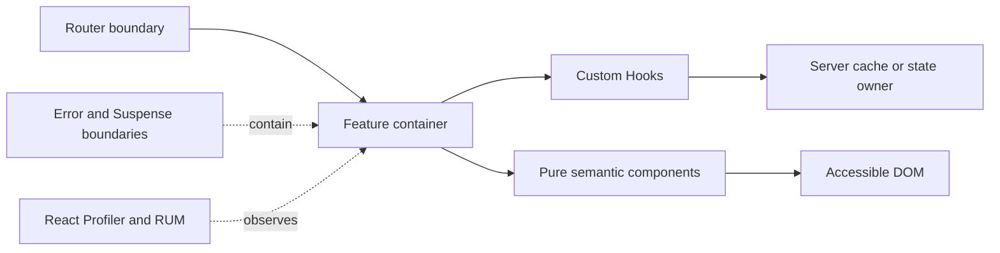

# React Architecture Patterns

> Version: 1.1.0 | Updated: 2026-07-16

## Purpose

Define the production components, control paths, state boundaries, and failure containment for component, Hook, context boundary, or route UI.

## Why

Rendering stays pure; state has one owner; Effects synchronize only with external systems. The diagram models actual React platform elements so reviewers can identify ownership and unsafe coupling.

## How

### Required boundaries

1. Route and feature boundaries own orchestration; leaf components receive typed data and events.
2. A custom Hook owns one synchronization concern and exposes no renderer-specific side effects.
3. Error and Suspense boundaries are placed at independently recoverable UI regions.
4. Server state remains in the data cache; transient interaction state remains local.
5. The design system owns semantic primitives and focus behavior.

### Operational evidence

- `package.json` plus the lockfile entries for React, renderer, router, state, and test libraries
- `tsconfig.json` and ESLint React/Hook rules
- the nearest component, test, CSS, and Storybook conventions
- React DevTools Profiler commit/flamegraph for the reproduced interaction

### Rollback path

Disable the owning feature flag first; otherwise redeploy the previous immutable client assets while preserving API compatibility for already-cached bundles.

## Version-aware caution

Read the installed `react` and `react-dom` versions from the lockfile. Concurrent rendering, form actions, and server integration differ across React and framework releases; never copy an API from current react.dev into an older dependency graph without checking that release's reference.

## Tradeoffs

The architecture introduces explicit React boundaries and operational artifacts that require ownership. In return, failures in Rules of Hooks violations, stale closures and effect feedback loops, unstable keys or identity, hydration divergence, excessive render or bundle cost become observable and containable.

## Anti-patterns

- A page-wide context holding unrelated mutable state causes every consumer to share a render and release boundary.
- Do not remove a native warning, validator, policy, or safety limit merely to make generated output pass.
- Do not claim a successful result without preserving the command, target, artifact/revision, and observed output.

## Enterprise considerations

For React estates, govern design-system packages, browser support, telemetry consent, third-party scripts, and accessibility evidence centrally; product teams retain ownership of feature behavior.

## Official sources

- [React Learn](https://react.dev/learn)
- [Rules of Hooks](https://react.dev/reference/rules/rules-of-hooks)
- [React DevTools Profiler](https://react.dev/learn/react-developer-tools)
- [WAI-ARIA APG](https://www.w3.org/WAI/ARIA/apg/)

## Checklist

- [ ] Route and feature boundaries own orchestration; leaf components receive typed data and events.
- [ ] A custom Hook owns one synchronization concern and exposes no renderer-specific side effects.
- [ ] Error and Suspense boundaries are placed at independently recoverable UI regions.
- [ ] Server state remains in the data cache; transient interaction state remains local.
- [ ] The design system owns semantic primitives and focus behavior.
- [ ] Diagram matches deployed topology rather than an aspirational target.
- [ ] Rollback path preserves state and mixed-version contracts.

## Changelog

- 1.1.0 (2026-07-16): Replaced generic adapter diagram with native React architecture.
- 1.0.0 (2026-07-16): Added initial pattern.
