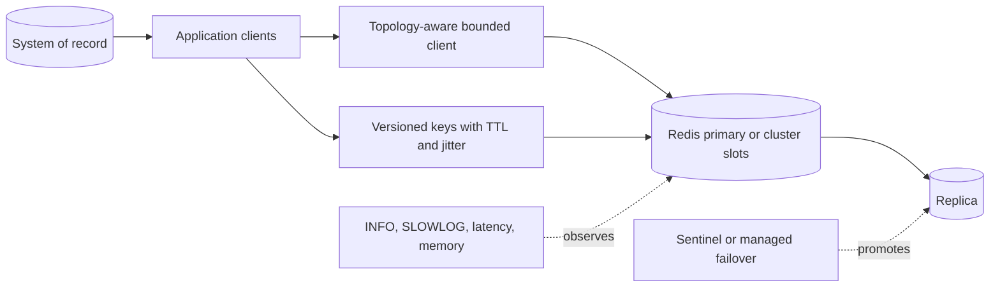

# Redis Architecture Patterns

> Version: 1.1.0 | Updated: 2026-07-16

## Purpose

Define the production components, control paths, state boundaries, and failure containment for keyspace, cache, session store, rate limiter, stream consumer, or Redis topology.

## Why

Every keyspace defines type, cardinality, TTL, memory policy, atomicity, durability, topology, and behavior when Redis is unavailable. The diagram models actual Redis platform elements so reviewers can identify ownership and unsafe coupling.

## How

### Required boundaries

1. The system of record remains authoritative unless Redis durability is explicitly designed and tested.
2. Clients are cluster/failover aware and bound commands by deadline and queue.
3. Key schema versions allow coexistence and rollback.
4. TTL jitter and single-flight behavior protect the source during misses.
5. Memory, persistence, and eviction policies match the keyspace's data-loss contract.

### Operational evidence

- `INFO server`, `INFO memory`, `INFO persistence`, `INFO replication`, and `INFO cluster`
- `CONFIG GET` for maxmemory/policy, persistence, timeout, and output-buffer settings under approved access
- `SLOWLOG GET`, `LATENCY DOCTOR`, commandstats, keyspace stats, and sampled `MEMORY USAGE`
- key naming/type/TTL/cardinality specification plus client timeout/retry/pool settings

### Rollback path

Disable writes to the new versioned key prefix and revert clients; let disposable keys expire or delete them with bounded SCAN/UNLINK jobs—never use FLUSHDB on a shared instance.

## Version-aware caution

Capture `redis_version`, mode, persistence, replication/cluster state, client library, and managed-service restrictions. Commands, ACLs, functions, eviction, and cluster behavior depend on server and client versions.

## Tradeoffs

The architecture introduces explicit Redis boundaries and operational artifacts that require ownership. In return, failures in maxmemory/OOM or unsafe eviction, WRONGTYPE or key-schema collision, MOVED/ASK cluster routing mismatch, READONLY/failover topology mismatch, slow command, big key, fork, persistence, or network latency become observable and containable.

## Anti-patterns

- Using unbounded values or KEYS on a shared production instance blocks Redis's command execution path and destabilizes unrelated tenants.
- Do not remove a native warning, validator, policy, or safety limit merely to make generated output pass.
- Do not claim a successful result without preserving the command, target, artifact/revision, and observed output.

## Enterprise considerations

Redis governance allocates key prefixes, memory budgets, ACL patterns, persistence tiers, and noisy-neighbor controls; destructive commands require break-glass access.

## Official sources

- [Redis documentation](https://redis.io/docs/latest/)
- [Data types](https://redis.io/docs/latest/develop/data-types/)
- [Eviction](https://redis.io/docs/latest/develop/reference/eviction/)
- [Latency monitor](https://redis.io/docs/latest/operate/oss_and_stack/management/optimization/latency-monitor/)

## Checklist

- [ ] The system of record remains authoritative unless Redis durability is explicitly designed and tested..
- [ ] Clients are cluster/failover aware and bound commands by deadline and queue..
- [ ] Key schema versions allow coexistence and rollback..
- [ ] TTL jitter and single-flight behavior protect the source during misses..
- [ ] Memory, persistence, and eviction policies match the keyspace's data-loss contract..
- [ ] Diagram matches deployed topology rather than an aspirational target.
- [ ] Rollback path preserves state and mixed-version contracts.

## Changelog

- 1.1.0 (2026-07-16): Replaced generic adapter diagram with native Redis architecture.
- 1.0.0 (2026-07-16): Added initial pattern.
