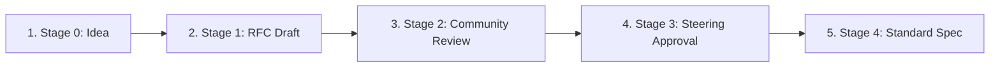

# AIES Open Governance Model & RFC Process

> **The AI Engineering Standard (AIES) is an open-source, community-governed specification.**
> No single company or model vendor owns the standard. Decisions regarding stage gates, prompt engineering schemas, MCP tool contracts, and evaluation standards are driven by public RFCs (Requests for Comments).

---

## Governance Principles

1. **Vendor Neutrality**: AIES specifications must remain model-agnostic, supporting open-weights models and proprietary APIs equally.
2. **Evidence-First Verification**: Every proposed standard must include reproducible audit criteria, test manifests, or schema validators.
3. **Open Critique**: Proposal discussions happen publicly on GitHub Discussions and Pull Requests.

---

## The RFC Lifecycle

### Stage 0: Idea (Discussion)
- Anyone can propose an enhancement or new standard specification by starting a thread in [GitHub Discussions (Category: RFC Ideas)](https://github.com/grvmithas/open-ai-engineering-standards/discussions).
- Community feedback establishes initial interest and refines the scope.

### Stage 1: RFC Draft (Pull Request)
- Author submits a Pull Request adding `RFC-XXXX-title.md` to `content/governance/rfcs/`.
- Must follow the official [RFC Template](./RFC_TEMPLATE.md).
- Status set to `Draft`.

### Stage 2: Community Review (Public Comment)
- Minimum **14-day** public review period.
- Maintainers, practitioners, and enterprise adopters review security implications, schema design, and backward compatibility.

### Stage 3: Steering Approval (Final Comment Period)
- The AIES Steering Advisory Board reviews the RFC against core principles.
- Approval requires a consensus vote (or 2/3 majority of steering board members).

### Stage 4: Standard Spec (Merged & Released)
- Approved RFCs are merged into the canonical `content/` specification and released in the next semver version of AIES.

---

## Steering Advisory Board

The Steering Board oversees governance integrity, release cadence, and cross-framework alignment (NIST AI RMF, ISO 42001, OWASP Top 10 LLM).

Members represent enterprise practitioners, open-source maintainers, and security researchers. To apply for a steering board seat, submit an issue tagged `governance/steering-board-nomination`.
