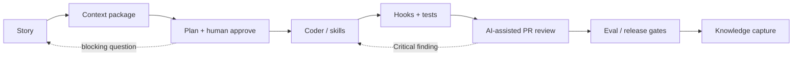

# Practitioner Handbook

> **Audience:** Engineering orgs adopting AI-assisted delivery (UI, platform, and full-stack)  
> **Goal:** Depth over inventory — how to work day-to-day, not a dump of every file in the repo  
> **Version:** 1.1 | **Updated:** 2026-07-29

---

## Purpose

This handbook is the **operating manual** for teams that ship with AI. Libraries (skills, agents, MCPs, cookbooks) live elsewhere. Here you learn **when to reach for which tool**, how to keep humans in control, and how to stop wasting tokens and review cycles.

## How to use this handbook

0. New to the site? Read **[How to browse](./how-to-browse.md)** once (kit → workflow → SDLC tools → patterns → assure).
1. Org leaders: start with **[AI migration bible path](./ai-migration-bible-path.md)** (pilot → harness → gate → SoA).
2. Individuals: read **Skills vs prompts vs agents** once as the shared vocabulary.
3. Map your stage on the **[AI SDLC stage tooling map](../08-ai-sdlc/stage-tooling-map.md)**.
4. Run your next feature through **Context → Planning → HITL → Coding → PR review → Evals**.
5. Wire **hooks** and **MCP** only after the workflow is clear.
6. Use cookbooks and patterns as **specialist references**, not as day-one browsing.

## Chapters

| Chapter | You will be able to |
|---------|---------------------|
| [How to browse](./how-to-browse.md) | Follow the site in a logical order without thrashing |
| [AI migration bible path](./ai-migration-bible-path.md) | Sequence org pilot → team harness → production gate → SoA |
| [External standards map](./external-standards-map.md) | Navigate OWASP LLM/Agentic, NIST AI RMF, ISO 42001, SLSA without certification theater |
| [Skills vs prompts vs agents](./skills-vs-prompts-vs-agents.md) | Stop treating every XML blob as a “skill” |
| [How to give context](./how-to-give-context.md) | Build packages agents can actually use |
| [How to set up planning](./how-to-set-up-planning.md) | Enforce plan-before-code without ceremony theater |
| [Human in the loop](./human-in-the-loop.md) | Place approvals where risk is real |
| [PR review with AI](./pr-review-with-ai.md) | Run severity-calibrated reviews that humans still own |
| [Evals as quality gates](./evals-as-quality-gates.md) | Block merges on model regressions |
| [Hooks in practice](./hooks-in-practice.md) | Fail closed before bad artifacts leave the laptop |
| [MCP when and how](./mcp-when-and-how.md) | Add tools without turning agents into confused deputies |
| [Containing token waste](./containing-token-waste.md) | Cut cost and noise without starving quality |
| [AIDLC roles & evolving delivery](./aidlc-roles-and-evolving-delivery.md) | Staff the new jobs AI-DLC creates |

## Repo map (start here on disk)

| Concern | Canonical path |
|---------|----------------|
| Behavioral contract | [`CLAUDE.md`](../../CLAUDE.md) |
| Planner pattern | [`content/patterns/planner-pattern/README.md`](../patterns/planner-pattern/README.md) |
| Implementation plan prompt | [`content/08-ai-sdlc/prompts/implementation-plan.prompt.md`](../08-ai-sdlc/prompts/implementation-plan.prompt.md) |
| Skills | [`content/03-skill-engineering/`](../03-skill-engineering/README.md) |
| Agents | [`content/04-agent-engineering/`](../04-agent-engineering/README.md) |
| Hooks | [`content/04-agent-engineering/hooks/`](../04-agent-engineering/hooks/README.md) |
| MCPs | [`content/mcps/`](../mcps/README.md) |
| Eval gate workflow | [`.github/workflows/eval-gate.yml`](../../.github/workflows/eval-gate.yml) |
| React cookbook (UI depth) | [`content/cookbook/react/README.md`](../cookbook/react/README.md) |
| Normative controls | [`content/standard/`](../standard/README.md) |

## Design rule for this handbook

If a page is only a list of links, it does not belong here. Push catalogs to [Skills](../03-skill-engineering/README.md), [MCPs](../mcps/README.md), [Cookbook](../cookbook/README.md), and [Patterns](../patterns/README.md). Keep this folder for **teachable practice**.

## Checklist — handbook readiness for an org

- [ ] Engineers can name the difference between prompt, skill, agent, hook, and MCP
- [ ] Every multi-file change has a plan approval recorded
- [ ] PR review uses severity + verification, not “LGTM from the bot”
- [ ] Eval gate exists for user-visible model behavior
- [ ] Token budgets are measured, not vibed
- [ ] Roles for AI-DLC (plan approver, review owner, eval owner) are named

## Changelog

- 2026-07-29: Linked AI migration bible path as the org-adoption spine.
- 2026-07-16: Introduced practitioner handbook spine and curated navigation.
