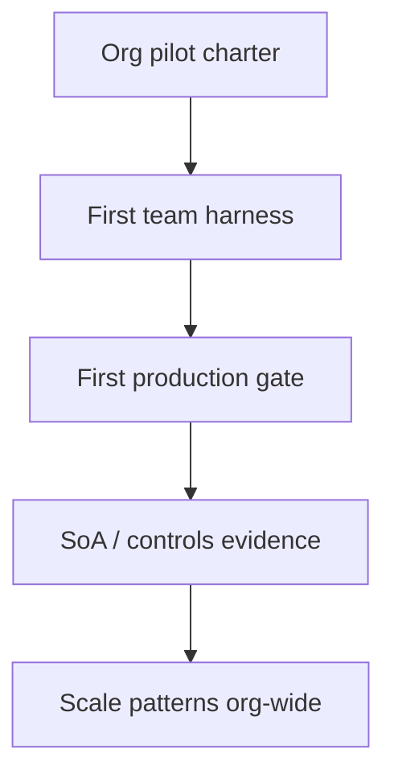

# AI Migration Bible Path

> **Status:** Working guidance · AIES v1.0 corpus  
> **Updated:** 2026-11-06  
> **Audience:** Engineering leaders, architects, and first pilot teams adopting AI-assisted delivery

---

## Purpose

Give organizations one **opinionated path** from “we should use AI” to a governed production practice — without inventing a private dialect of prompts, agents, and approvals.

## Why

Most AI migrations fail the same way: demos without gates, copilots without plans, agents without HITL, and “standards” that are slide decks. AIES already ships the corpus. This page sequences **what to run first**.

## The path (do not skip)



| Stage | Outcome | Primary AIES surfaces |
|-------|---------|------------------------|
| 1. Org pilot | Written charter, risk tier, owner, kill criteria | [Enterprise pattern](../patterns/enterprise-pattern/README.md) · [Org playbook](../10-ai-org-playbook/README.md) · site `/workflows/idea` |
| 2. First team | One repo with IDE-native kit (skills/prompts/cookbook), plan-before-code | site `/start` · `npx @grvmithas/create-aies-kit` · [How to set up planning](./how-to-set-up-planning.md) |
| 3. First production gate | Eval/CI or checklist gate that can **block** a release | [Evals as quality gates](./evals-as-quality-gates.md) · [Definition of Done](../08-ai-sdlc/quality-standards/definition-of-done.md) |
| 4. SoA / controls | Mapped evidence for AI-touched controls | site `/portal` · [Human in the loop](./human-in-the-loop.md) · [Enterprise pattern](../patterns/enterprise-pattern/README.md) |

---

## Stage 1 — Org pilot charter (1–2 weeks)

### Goal

Approve a **bounded** pilot: one product surface, one team, one risk tier, one success metric.

### Do this

1. Write non-goals (what AI will **not** touch).
2. Assign AIDLC roles (sponsor, tech lead, reviewer) — see [AIDLC roles](./aidlc-roles-and-evolving-delivery.md).
3. Classify data: public / internal / confidential — drives MCP and logging policy.
4. Pick primary model/provider; forbid “whatever the IDE defaults to” in production paths.
5. Publish a kill date if metrics are not met.

### Exit evidence

- One-page charter with metrics and non-goals
- Named owners
- Risk tier recorded

### Anti-patterns

- Org-wide Copilot rollout with no plan gate
- Pilot that touches regulated data on day one
- Success metric = “engineers like the tool”

---

## Stage 2 — First team harness (1 week)

### Goal

One repository where AI coding cannot skip planning and human approval.

### Do this

1. Open site `/start` or run:

```bash
npx @grvmithas/create-aies-kit@latest --stack <stack> --ide <ide> --role <role> --maturity intermediate --goal existing-codebase --model <model> --data-class <class> --yes
```

2. Copy `plans/_TEMPLATE.md` → `plans/{STORY_ID}-plan.md` for the first slice (root `implementation_plan.md` is only the index — never a living plan).  
3. Complete plan approval HITL (site `/workflows/human-review`) before coding.  
4. Use the native commands (`/implementation-plan`, `/coding`) and `.agents/skills/` the kit installed — not ad-hoc chat only.  
5. Confirm the native guard hook fires: ask the agent to run `git push --force` and verify it is denied ([Native agent hooks](./native-agent-hooks.md)).  
6. Keep MCP empty until [MCP: remote servers & OAuth](./mcp-remote-servers-and-auth.md) is reviewed; then enable one read-only vendor endpoint.  
7. Add `npx @grvmithas/create-aies-kit@latest audit --min-score 90` to CI so the harness cannot silently decay.  
8. Parallel agents come **after** one serial PR has landed cleanly — then use `scripts/aies-worktree.mjs` with task contracts ([Parallel agents & worktrees](./parallel-agents-and-worktrees.md)).

### Exit evidence

- Kit committed; `audit` ≥ 90 in CI
- At least one approved plan → merged PR
- Native guard hook verified to deny a destructive command; evidence-gate hooks or equivalent checklist enforced

---

## Stage 3 — First production gate (2–4 weeks)

### Goal

A release can be **blocked** by an AI-quality or security gate — not only by human memory.

### Do this

1. Add tests/evals for AI-touched paths.
2. Wire [evals as quality gates](./evals-as-quality-gates.md) into CI for the pilot service.
3. Run a security pass before expand — [security skill](../03-skill-engineering/skills/security.skill.md).
4. Require human PR accountability — [PR review with AI](./pr-review-with-ai.md).

### Exit evidence

- CI job that fails the pipeline on eval/security regression
- Documented waiver process with expiry (if any)

### Anti-patterns

- Snapshot-only LLM tests
- “AI reviewed the PR” as sole approval
- Enabling broad MCP write tools to “move faster”

---

## Stage 4 — SoA / controls evidence (ongoing)

### Goal

External or internal assessors can see **where** AI delivery maps to controls.

### Do this

1. Open the standards portal (`/portal`) and identify controls touched by the pilot.
2. Attach evidence: plans, eval reports, approval logs, incident notes.
3. Use [Enterprise pattern](../patterns/enterprise-pattern/README.md) for org rollout rules.
4. Only then expand to team 2+ with the same harness — do not fork private prompt dialects.

### Exit evidence

- Control IDs linked from pilot docs
- Reproducible evidence paths in the repo or GRC system

---

## Role cheatsheet

| Role | Start here |
|------|------------|
| Engineering manager / sponsor | Stage 1 charter → [Org playbook](../10-ai-org-playbook/README.md) |
| Architect | Stage 1 risk tier + architecture ADR discipline |
| First engineers | Stage 2 kit + [How to set up planning](./how-to-set-up-planning.md) |
| QA / platform | Stage 3 evals + [Definition of Done](../08-ai-sdlc/quality-standards/definition-of-done.md) |
| Compliance / security | Stage 4 portal + [Security skill](../03-skill-engineering/skills/security.skill.md) |

---

## Tradeoffs

| Approach | Gain | Cost |
|----------|------|------|
| This sequenced path | Shared vocabulary; fewer silent failures | Slower than “turn on Copilot for everyone” |
| Tool-first rollout | Fast adoption metrics | Unreproducible delivery; audit pain later |

## Anti-patterns

- Declaring “we follow AIES” without a kit, plan gate, or eval gate
- Skipping Stage 3 because “the model is good enough”
- Claiming community-standard maturity before external pilot evidence (roadmap S1)

## Enterprise considerations

- Confidential data class ⇒ private endpoints, empty MCP default, stricter HITL
- Segregation of duties: planner ≠ sole production approver on high-risk work
- Prefer pinned `npx @grvmithas/create-aies-kit@x.y.z` over unsigned curl installers

## Checklist

- [ ] Charter with metrics, non-goals, owners, risk tier
- [ ] First repo harness installed (kit + IDE rules)
- [ ] Plan approval before multi-file AI coding
- [ ] At least one blocking eval/security gate in CI
- [ ] Controls/evidence path identified in portal
- [ ] Team 2 reuses the same harness — no private dialect

## Related

- Practitioner handbook: [README](./README.md)
- Adoption roadmap: [roadmap](../roadmap.md)
- Lifecycle workflows: site `/workflows`
- Personalized quick start: site `/quickstart`

## Changelog

- **2026-11-06:** Stage 2 updated for kit 2.0 — ephemeral `plans/` per story, native commands and `.agents/skills`, guard-hook verification, CI `audit --min-score`, remote MCP, parallel agents only after a clean serial PR.
- **2026-07-29:** Initial migration bible path for org pilot → SoA.
