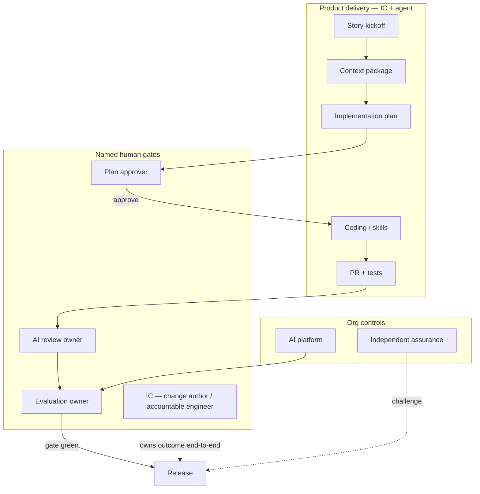
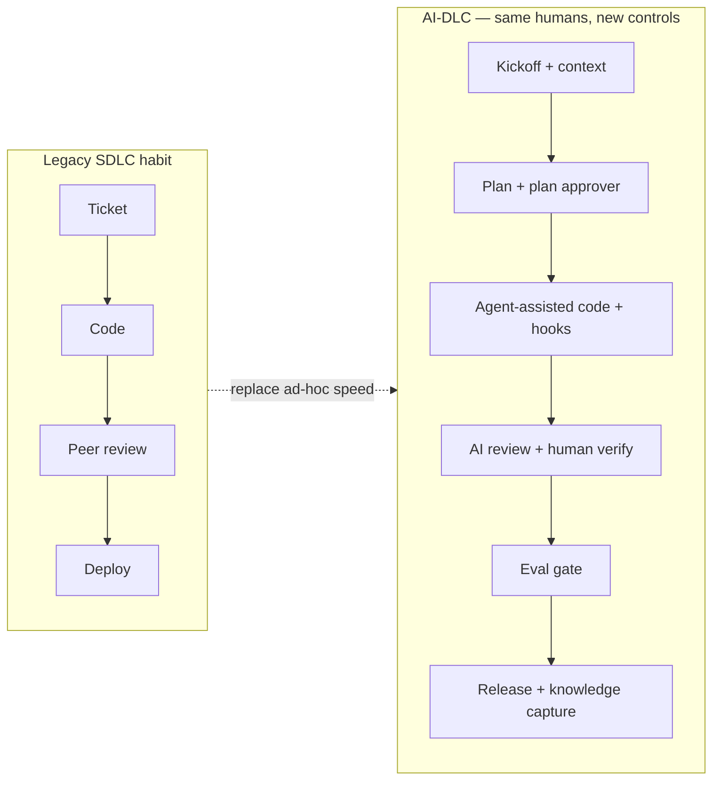

# AIDLC Roles and Evolving Delivery

> **Handbook:** Staff the jobs AI-DLC creates — humans still own outcomes  
> **Repo anchors:** [`content/10-ai-org-playbook/`](../10-ai-org-playbook/README.md) · [`content/08-ai-sdlc/`](../08-ai-sdlc/README.md) · [`roles-and-accountability.md`](../10-ai-org-playbook/governance/roles-and-accountability.md)  
> **Version:** 1.0 | **Updated:** 2026-07-16

---

## Purpose

Name how **development roles change** when delivery runs through an AI-enhanced SDLC: who approves plans, who owns evals, who owns AI-assisted review, and what the IC still owes as a human accountable for the change. Agents accelerate work; they do not absorb accountability.

## Why

AI-DLC without named owners produces theater:

| Symptom | Root cause |
|---------|------------|
| Plans merge without HITL | No plan approver |
| Eval gate flaky / ignored | No evaluation owner |
| “Bot LGTM” ships Sev-2 | No AI review owner; IC abdicated |
| Committee “owns” residual risk | Shared responsibility without decision rights |

[`roles-and-accountability.md`](../10-ai-org-playbook/governance/roles-and-accountability.md): assign one accountable human for every AI system, release, control, incident, and provider relationship. Maker-checker for high impact. Competence by evidence, not course badges.

## Mental model — roles on the AIES loop

The 26-stage flow in [`content/08-ai-sdlc/README.md`](../08-ai-sdlc/README.md) still applies. What changes is **who is on the hook** at stages 9 (human approval), 13–15 (review/test/eval), and 20 (deployment).

## How roles evolve

### Individual contributor (IC) — still human, still accountable

| Before AI-DLC | With AI-DLC |
|---------------|-------------|
| Types most of the code | Directs agents/skills; reviews every material diff |
| Writes the plan in a ticket | Produces / steers plan; **cannot** self-approve high-risk plans alone |
| Asks for peer review | Triages AI review findings; verifies Critical/High |
| “Tests pass” | Ensures evidence for hooks + DoD ([`definition-of-done.md`](../08-ai-sdlc/quality-standards/definition-of-done.md)) |

**IC must not:** treat agent output as reviewed, waive eval failures, or merge without plan conformance (or an approved plan delta).

**IC still owns:** acceptance criteria truth, AuthZ on new surfaces, rollback story, and saying “stop” when the agent is wrong.

### Plan approver

**Accountable for:** accepting the implementation plan before workspace writes ([stage 9](../08-ai-sdlc/README.md), [`implementation-plan.prompt.md`](../08-ai-sdlc/prompts/implementation-plan.prompt.md), [`pre-code.hook.sh`](../04-agent-engineering/hooks/pre-code.hook.sh)).

**Decides:** architecture direction, sequencing, rollback adequacy, test plan sufficiency, risk class.

**Must not approve alone:** their own high-risk exception; plans they authored without a second qualified reviewer when policy requires maker-checker.

**Competence:** Practitioner+ for low risk; Lead for medium/high ([competence framework](../10-ai-org-playbook/governance/roles-and-accountability.md)).

### Evaluation owner

**Accountable for:** metric definitions, golden-set governance, gate configuration, calibration ([`eval/README.md`](../../eval/README.md), [`continuous-eval.md`](../07-llmops/evaluation/continuous-eval.md)).

**Decides:** what blocks merge vs promote; judge contracts; canary abort interpretation for quality metrics.

**Must not alone:** accept residual business harm (“ship anyway for revenue”) — that is product/executive risk acceptance.

**Wired to:** [`.github/workflows/eval-gate.yml`](../../.github/workflows/eval-gate.yml), offline `eval/run.mjs`, production run ledgers.

### AI review owner

**Accountable for:** severity-calibrated AI-assisted PR review process — prompts/skills used, false-positive budget, escalation to human security/architecture review.

**Decides:** which findings are blocking; when [`security-review.prompt.md`](../08-ai-sdlc/prompts/security-review.prompt.md) / architecture review are mandatory; that “LGTM from the bot” is never sufficient ([DoD human gates](../08-ai-sdlc/quality-standards/definition-of-done.md)).

**Must not:** rubber-stamp their own agent-authored PR without independent review where policy requires it.

### Adjacent org roles (unchanged authority, new workload)

From [`roles-and-accountability.md`](../10-ai-org-playbook/governance/roles-and-accountability.md) and [`operating-model.md`](../10-ai-org-playbook/governance/operating-model.md):

| Role | AI-DLC touchpoint |
|------|-------------------|
| Product / use-case owner | Intended use, affected-person outcomes, residual harm acceptance |
| Engineering owner | Architecture, reliability, rollback of AI-touched services |
| Security / privacy / data | Tool/MCP scopes, prompt data class, logging bans |
| AI platform product | Gateway, eval runner, approved providers, shared hooks |
| Independent assurance | Samples evidence; does not implement the control it verifies |
| Incident commander | AI-involved incidents; freeze routes; seed golden-set cases |

## RACI for a typical feature

| Decision | IC | Plan approver | AI review owner | Eval owner | Product owner |
|----------|----|---------------|-----------------|------------|---------------|
| Story ready to plan | R | C | I | I | A (acceptance) |
| Approve implementation plan | C | A | I | I | C (if user-visible risk) |
| Merge code PR | R | I | A (review process) | C (if prompt/agent change) | I |
| Accept eval gate config change | C | I | I | A | C |
| Accept residual harm to ship | C | C | C | R (metrics) | A |
| Pause unsafe capability | R | I | C | R | A/R |

`A` = one accountable role. Avoid dual-A.

## Delivery evolution — ceremony vs control

Speed comes from **agents on coding/test/docs**, not from deleting stages 9, 13, or 15. Teams that skip human approval and evals do not move faster — they move incidents forward ([`08-ai-sdlc/README.md`](../08-ai-sdlc/README.md)).

### Staffing pattern that works

| Team size | Pattern |
|-----------|---------|
| 1–2 ICs | Plan approver = tech lead on another squad (maker-checker); eval owner = platform shared service; IC remains review owner for own PRs with peer challenge |
| Squad (5–8) | Named plan approver rotation; one AI review owner; eval owner embedded or platform |
| Multi-team | Platform owns eval runner + hook library; product teams own semantics; assurance samples quarterly |

## Worked example — feature with all four human roles

**Story.** Add a refund explanation endpoint that grounds answers in policy docs (RAG). Touches prompts + retrieval policy.

1. **IC** runs [`story-kickoff.prompt.md`](../08-ai-sdlc/prompts/story-kickoff.prompt.md); assembles context; drafts plan with [`implementation-plan.prompt.md`](../08-ai-sdlc/prompts/implementation-plan.prompt.md).
2. **Plan approver** rejects v1 (no rollback, no adversarial eval cases). IC revises. Approver writes approval evidence for `pre-code`.
3. **IC + agent** implement under [`coding.prompt.md`](../08-ai-sdlc/prompts/coding.prompt.md); hooks enforce verify/test evidence.
4. **AI review owner** runs calibrated review; escalates AuthZ finding to security; verifies Critical items personally — does not merge on bot LGTM.
5. **Evaluation owner** confirms new cases land in a **new** dataset version; offline gate + [`eval-gate.yml`](../../.github/workflows/eval-gate.yml) paths green; signs that policy-sensitive false-accept limit holds.
6. **Product owner** accepts residual risk for known abstention behavior; **IC** remains on-call for the release.

**If step 5 fails:** merge blocks. Product cannot override by asking the IC to skip CI without an executive exception record ([`operating-model.md`](../10-ai-org-playbook/governance/operating-model.md) exception governance).

## Tradeoffs

| Choice | Benefit | Cost |
|--------|---------|------|
| Explicit plan / eval / review owners | Fast, auditable decisions | Named ownership burden |
| IC keeps outcome accountability | No “the model did it” | ICs need review skill, not only prompting skill |
| Shared platform eval owner | Consistent gates | Product must still own task semantics |
| Committee as accountable party | Political comfort | No one can pause/ship |
| Collapsing plan approver into IC always | Less waiting | Blind spots on own plans |

## Anti-patterns

| Anti-pattern | Why it fails |
|--------------|--------------|
| Vendor / model provider “owns” customer outcomes | Contract ≠ accountability |
| Agent approves its own plan or PR | No independence |
| Eval owner also sole product risk acceptor | Conflict; ship-the-metric pressure |
| AI review owner never samples false negatives | Process drifts to rubber stamps |
| Training completion as competence | No scenario evidence ([roles doc](../10-ai-org-playbook/governance/roles-and-accountability.md)) |
| Skipping stage 9 because “the agent planned well” | Highest leverage control removed |
| Dual accountable owners on one decision | Diffused pause authority |

## Enterprise considerations

- **Register.** Maintain a role and competence register: role, decisions, required level, evidence, delegation, backup, conflicts, review date.
- **Succession.** Loss of the only qualified evaluation owner → restricted operation until backup is qualified.
- **Assurance independence.** Reviewers who authored the control do not close their own assurance findings.
- **Funding.** If eval/hooks/MCP controls are unfunded, release is not approved — risk does not transfer to platform by neglect ([`operating-model.md`](../10-ai-org-playbook/governance/operating-model.md)).
- **Frameworks.** NIST AI RMF GOVERN 2.x and ISO/IEC 42001 clauses on roles/competence apply as tests of practice, not as paperwork substitutes.

## Checklist

- [ ] Every AI-touched system has named: plan approver, eval owner, AI review owner, engineering/product owners
- [ ] IC accountability for merged changes is written in team norms
- [ ] High-risk plans require maker-checker (author ≠ sole approver)
- [ ] Eval gate has a human owner on-call for failures
- [ ] “Bot LGTM” is forbidden in DoD / review policy
- [ ] Competence assessed with scenarios (injection, judge drift, rollback), not attendance
- [ ] Delegations are scoped, accepted, expiring, auditable
- [ ] Qualified backups exist for eval and plan approval
- [ ] Exception path cannot waive eval for severe policy fails without executive record
- [ ] Knowledge capture assigns an owner ([`knowledge-capture.prompt.md`](../08-ai-sdlc/prompts/knowledge-capture.prompt.md))

## Repo map

| Concern | Path |
|---------|------|
| Org playbook | [`content/10-ai-org-playbook/README.md`](../10-ai-org-playbook/README.md) |
| Roles & competence | [`content/10-ai-org-playbook/governance/roles-and-accountability.md`](../10-ai-org-playbook/governance/roles-and-accountability.md) |
| Operating model / RACI | [`content/10-ai-org-playbook/governance/operating-model.md`](../10-ai-org-playbook/governance/operating-model.md) |
| Adoption & assurance | [`content/10-ai-org-playbook/governance/adoption-and-assurance.md`](../10-ai-org-playbook/governance/adoption-and-assurance.md) |
| AI SDLC stages | [`content/08-ai-sdlc/README.md`](../08-ai-sdlc/README.md) |
| Definition of Done | [`content/08-ai-sdlc/quality-standards/definition-of-done.md`](../08-ai-sdlc/quality-standards/definition-of-done.md) |
| Definition of Ready | [`content/08-ai-sdlc/quality-standards/definition-of-ready.md`](../08-ai-sdlc/quality-standards/definition-of-ready.md) |
| Handbook spine | [`content/handbook/README.md`](./README.md) |

## Changelog

- 2026-07-16: Initial handbook chapter — AIDLC role evolution for plan, eval, review, and IC accountability.
