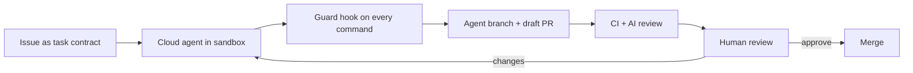

# Cloud and Background Agents

> **Handbook:** Delegate tasks to agents that run off your laptop — and still merge safely  
> **Repo anchors:** [Parallel agents and worktrees](./parallel-agents-and-worktrees.md) · [PR review with AI](./pr-review-with-ai.md) · [Native agent hooks](./native-agent-hooks.md)  
> **Version:** 1.0 | **Updated:** 2026-11-06

---

## Purpose

Set the operating rules for agents that run asynchronously in vendor or CI infrastructure — GitHub Copilot cloud agent, Cursor Cloud Agents, Codex cloud tasks, and headless CLI agents in CI — so they produce reviewable draft PRs inside the same guardrails as local work.

## Why

Background agents change the economics of delegation: an issue becomes a draft PR while the engineer does something else. They also remove the human from the inner loop. Nobody watches the terminal, so every control that relied on "the developer would notice" must become a mechanical control:

| Local agent assumption | Cloud agent reality | Required control |
|------------------------|---------------------|------------------|
| Developer sees each command | Nobody watches | Native guard hook + sandboxed runner |
| Developer's credentials, scoped by habit | Runner credentials, scoped by config | Least-privilege, repo-scoped tokens; no production secrets |
| Work lands on the developer's branch | Agent pushes its own branch | Branch protection; draft PRs only |
| Context from the developer | Context from the issue text | Issue template = task contract |
| Environment already set up | Fresh container | Declared setup (`copilot-setup-steps.yml`, `.cursor/environment.json`) |

## How

### 1. Make the issue a task contract

Use an issue template with the [task contract](./parallel-agents-and-worktrees.md) sections: objective, allowed paths, acceptance criteria, stop conditions. Agents do exactly as well as the issue is specified.

### 2. Declare the environment

| Runtime | Environment file | Notes |
|---------|------------------|-------|
| GitHub Copilot cloud agent | `.github/workflows/copilot-setup-steps.yml` (job `copilot-setup-steps`) | Install deps, tools, test DB; runs before the agent |
| Cursor Cloud Agents | `.cursor/environment.json` | `install` command; snapshot for speed |
| Codex cloud | Environment settings in Codex | Setup script + internet access policy |
| Headless CLI in CI | Your workflow YAML | e.g., Claude Code GitHub Action, `codex exec`, `gemini -p` |

The AIES kit emits the first two for Copilot and Cursor targets, and a headless review template in `templates/ci/`.

### 3. Constrain what the agent can touch

- Token: repository-scoped, no admin, no secrets access beyond test fixtures.
- Network: allowlist package registries and required APIs; block the rest where the runtime supports it.
- Hooks: the guard runs in cloud agents too (Copilot honors `bash` entries in `.github/hooks/*.json` on its Linux runner).
- Branch protection: required reviews and status checks on `main`; agents cannot bypass.

### 4. Review like any external contribution

Cloud agent PRs are drafts from an untrusted author. Run CI, the AI review pass, and a human review. Never auto-merge agent PRs, even when green.

### 5. Measure and cap

Track cost per merged PR, merge rate, and rework rate per runtime. Cap concurrent cloud agents per repo (start at 4) so review keeps pace.

## Tradeoffs

| Choice | Gain | Cost |
|--------|------|------|
| Cloud agents for well-specified issues | Parallel throughput without laptop contention | Weak issues produce confident wrong PRs |
| Strict runner sandbox | Contains injected or mistaken actions | Some tasks cannot complete (no network to a needed API) |
| Draft-only PRs | Human accountability preserved | Review becomes the throughput limit |
| Headless review in CI | Consistent first pass on every PR | Model cost per PR; noise if prompts are not severity-calibrated |

## Anti-patterns

- **Auto-merge for agent PRs.** Green CI proves tests pass, not that the change is right.
- **Production credentials in the agent environment** "so it can verify the fix". It will eventually use them.
- **Vague issues delegated to cloud agents.** "Improve performance" yields an unreviewable diff.
- **No environment declaration.** The agent burns its budget installing dependencies or guessing commands.
- **Ignoring cost per merged PR.** Abandoned agent PRs are pure spend.

## Enterprise considerations

- Approve runtimes centrally; record which repos allow which cloud agent and with what token scopes.
- Data residency: cloud agents run code and read repository content in vendor infrastructure — map to data class policy; confidential repos may require self-hosted runners.
- Audit trail: agent identity, issue, model, and session link in every PR.

## Checklist

- [ ] Issue template carries task-contract sections
- [ ] Environment declared for each cloud runtime in use
- [ ] Repo-scoped least-privilege tokens; no production secrets
- [ ] Guard hook active in the cloud runtime
- [ ] Agent PRs are drafts; no auto-merge
- [ ] Cost per merged PR and merge rate tracked per runtime

## Changelog

- 2026-11-06: Initial chapter — cloud agent controls, environment declaration, review policy.
